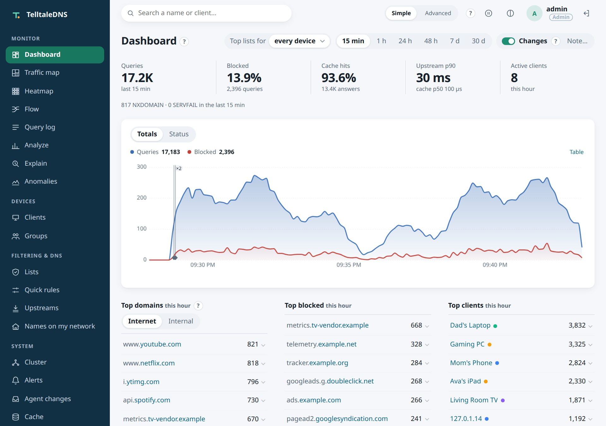

# TelltaleDNS

> **This is a fork:** [`nbacheller/telltaledns`](https://github.com/nbacheller/telltaledns), based on [`paimonsoror/telltaledns`](https://github.com/paimonsoror/telltaledns). Everything below this box is upstream's README. The badges, releases, quick start and project site are upstream's too. The fork's work is on the [`feat/ipam-integrations`](https://github.com/nbacheller/telltaledns/tree/feat/ipam-integrations) branch and follows the same spec-driven process. Its decisions are numbered from ADR-901 in [`spec/11`](spec/11-decisions.md).
>
> **What the fork adds** (milestones in the [roadmap](spec/10-roadmap-and-tasks.md)):
> - **M22, network inventory and home integrations (done):**
>   - device names from a UniFi gateway and from Home Assistant;
>   - those names answered in DNS (`kitchen-tablet.home.arpa`, with reverse lookups);
>   - your networks and VLANs, with how full each one is;
>   - a Home Assistant integration for TelltaleDNS;
>   - a [Docker Desktop bundle](deploy/docker-desktop/README.md) to try it.
> - **M24, replacing Pi-hole (in progress):**
>   - Pi-hole's special names: iCloud Private Relay blocked by default, `resolver.arpa` with encrypted DNS discovery (DDR), and domain-needed;
>   - **Update lists now** (Pi-hole's "Update Gravity"), for every list or one row at a time, with when each list was last confirmed current;
>   - in the UI: special names and DDR, device names in DNS, DNS names and naming sources on the Clients page, and a **Networks** page (make a group from a network);
>   - **Import from Pi-hole** in Settings (admins only): upload a Teleporter export or `gravity.db`, see what would be imported and where each entry points, then apply it as one change; the importer also reads `dnsmasq.d` lines;
>   - still to come: keepalived failover, IPv6 device names.
> - **M23, secrets and integrations in the UI (in progress):** secrets store, write-only API, no credential on any read surface; secrets replicated to every full cluster member; a **Secrets** page, and credentials (alerts, routers) entered in the UI, write-only, while a secret file still wins; routers (UniFi, Home Assistant) added, checked and changed from a **Routers** page without a restart. Still to come: encrypted backups, OIDC, sinks.
> - **M25, network inventory beyond the gateway (in progress):** in so far: the inventory model, which merges devices by MAC; sandboxed discovery workers (a separate process with seccomp, no capabilities and not dumpable) and a `[discovery]` section; an SNMP library (v2c, and v3 with AES). Still to come:
>   - SNMP polling of your gateway and switches (which device is on which port);
>   - more UniFi reads;
>   - importing results from a scanner you run yourself.
> - **M26, live network map (planned):** an animated map of your network and of where its lookups go, coloured green, yellow or red by health. A world view is optional.
> - **A three-node test cluster (T21.5, [`deploy/cluster3`](deploy/cluster3/README.md)):** a primary and two replicas in containers, checked in CI on every change to the cluster code; it found and fixed a replica that followed a dead primary after a promotion.
> - **M27, UI for everything (planned):** a UI control for every older setting too, with guarded admin controls for listeners, TLS, keys and cluster setup ([ADR-914](spec/11-decisions.md)).
>
> **Every feature gets a UI control**, not only config, API or MCP. Fork issues are tracked [here](https://github.com/nbacheller/telltaledns/issues). Changes from upstream are merged regularly.
>
> **Upstream:** what the fork changed from upstream, the upstream issues it triaged, and how it syncs and watches upstream are in [`spec/upstream.md`](spec/upstream.md).

[](https://github.com/paimonsoror/telltaledns/actions/workflows/ci.yml?query=branch%3Amain)
[](https://github.com/paimonsoror/telltaledns/security/code-scanning?query=branch%3Amain)
[](https://github.com/paimonsoror/telltaledns/releases/latest)
[](#license)
[](https://github.com/paimonsoror/telltaledns/pulls?q=is%3Apr+author%3Aapp%2Fdependabot)

**See every question. Answer on your terms.**

Every connection on your network starts with a DNS lookup. TelltaleDNS answers it in microseconds, filters it by your rules per device, and shows you exactly who asked, what they asked, and why it answered the way it did. It runs on a Raspberry Pi, in Kubernetes, or on both as one cluster that keeps answering even when parts of it fail.

> A *telltale* is the strip of yarn sailors tie to a sail to see what the wind is really doing. DNS is your network's telltale: it reveals what every device is up to.

<p align="center">
  <picture>
    <source media="(prefers-color-scheme: dark)" srcset="docs/images/dashboard-dark.jpg">
    
  </picture>
  <br>
  <sub>The dashboard on a demo network. Every device, name, and address in it is made up.</sub>
</p>

## Mission
Give everyone who runs a home or small network an honest, real-time view of what their devices are doing, and full control over it, without trading away speed, footprint, or reliability.

- **See:** every query is attributed to a device, explained, and timed per stage.
- **Decide:** your rules per device and group, enforced instantly at no performance cost.
- **Never fail:** DNS keeps answering from its last good config, whatever happens to the control plane.
- **Run anywhere:** the same artifact on a Pi, in a cluster, or both at once.

## What it does
- **Every answer explained.** The query log ties each query to a named device, times every stage, and says why it was answered that way. Names come from your router, from what devices announce over mDNS, or from the UI, and TelltaleDNS recognizes what each device is (a Roku player, a camera, a thermostat) from its maker and the names it asks for.
- **Your rules, per device.** Blocklists, groups for each network or VLAN, schedules, safe search, blocked services, rewrites, and quick rules. Before you save a change, see what it would have done to yesterday's real traffic.
- **Encrypted both ways.** DoT, DoH, and DoQ for your devices and to your upstreams, DNSSEC validation, and full recursion when you'd rather not forward at all.
- **Watch it work.** A dashboard for the whole cluster, one node, or one site. A heatmap of when your network asks, a flow from each group to its answers, answer times as a heatmap, every change marked on every chart, and which devices and names spent the error budget. Compare nodes side by side, see a device's rhythm and its day, and put it all on a wall display. Device anomalies and alerts; Prometheus metrics, OpenTelemetry, dnstap, and event sinks for your SIEM.
- **One cluster, many places.** A Pi and Kubernetes nodes share one config and one management plane. A witness lets a replica take over automatically, and the config can live in Git. Changes can reach a few canary nodes first and roll back by themselves if those start failing, and maintenance mode takes a node out of service without dropped queries or false alarms.
- **Private by design.** Privacy levels decide how much of each query is kept, from everything to counters only, and every change lands in an audit log.
- **Ready for agents.** A documented REST API with OpenAPI, `telltale ctl` for the shell, and MCP tools with plans and approval for AI agents.
- **Small and fast.** One static binary in an image of about 13 MiB, for amd64, arm64, and 32-bit Pi OS. It idles at about 14 MiB of memory, holds a million blocked names in 60 MiB, and sends 99.999 % of cached and blocked answers within 250 µs of the query arriving, under load from another machine ([measurements](docs/v1-gate.md)).
- **Verifiable.** Images are signed with cosign, each release binary carries its dependency list and an SBOM, and two builds of the same commit are identical ([how to check](docs/running.md#versions-and-updates)).

## Quick start
On a Raspberry Pi or any Linux host with Docker:
```sh
mkdir telltale && cd telltale
curl -fsSLO https://raw.githubusercontent.com/paimonsoror/telltaledns/main/deploy/compose/compose.yaml
curl -fsSLO https://raw.githubusercontent.com/paimonsoror/telltaledns/main/deploy/compose/telltale.toml
docker compose up -d
docker compose exec telltale telltale auth setup-token     # then open http://<host>:8053/
```
Kubernetes (Helm), a native systemd install, clustering, and moving from Pi-hole or Technitium are covered in [`docs/running.md`](docs/running.md).

**Status:** pre-1.0. Tagged [releases](https://github.com/paimonsoror/telltaledns/releases) are stable (`latest`), and `edge` is built from every commit on `main`. Releases before 1.0 can still change configuration keys and APIs, and their notes call out every such change; the [roadmap](spec/10-roadmap-and-tasks.md) shows what's next. Project site: **https://paimonsoror.github.io/telltaledns/**

| Read this | If you want |
|---|---|
| [FAQ](https://paimonsoror.github.io/telltaledns/faq.html) | Quick answers to what people ask most: replacing other setups, root-server resolving, blocking categories, per-device encrypted DNS, clusters |
| [`EXECUTIVE-SUMMARY.md`](EXECUTIVE-SUMMARY.md) | What TelltaleDNS is built around, and the projects that inspired it |
| [`docs/analysis.md`](docs/analysis.md) | Design notes: what we learned from Pi-hole and Technitium |
| [`spec/`](spec/00-overview.md) | The build specification (requirements, architecture, ADRs, roadmap) |
| [`AGENTS.md`](AGENTS.md) | Instructions for the agent or developer implementing it |

## Spec index
0. [Overview](spec/00-overview.md): vision, goals, release-gate metrics
1. [Requirements](spec/01-requirements.md): numbered P0/P1/P2 contract
2. [Architecture](spec/02-architecture.md): roles, crates, threading, data flow
3. [Resolution pipeline](spec/03-resolution-pipeline.md): listeners, cache, DNSSEC, recursion
4. [Upstreams](spec/04-upstreams.md): protocols, presets, strategies, custom plugins
5. [Filtering](spec/05-filtering.md): list syntax, FST/DFA snapshots, groups, schedules
6. [Observability](spec/06-observability.md): QueryEvent, metrics, query-log store, analytics
7. [API and UI](spec/07-api-and-ui.md)
8. [Deployment, config, security](spec/08-deployment-config-security.md): Helm, Pi, auth (local + OIDC)
9. [Testing and benchmarks](spec/09-testing-and-benchmarks.md)
10. [Roadmap and tasks](spec/10-roadmap-and-tasks.md)
11. [Decisions (ADRs)](spec/11-decisions.md)
12. [Clustering and HA](spec/12-clustering-and-ha.md)
13. [Agent API and MCP](spec/13-agent-api-and-mcp.md)

## Contributors
Thank you to everyone who helps make TelltaleDNS better, whether by reporting what they found running it for real, writing code, or improving the docs:

<!-- ALL-CONTRIBUTORS-LIST:START - Do not remove or modify this section -->
<!-- prettier-ignore-start -->
<!-- markdownlint-disable -->
<table>
  <tbody>
    <tr>
      <td align="center" valign="top" width="14.28%"><a href="https://github.com/gregpakes"><br /><sub><b>Greg Pakes</b></sub></a><br /><a href="https://github.com/paimonsoror/telltaledns/commits?author=gregpakes" title="Code">💻</a> <a href="https://github.com/paimonsoror/telltaledns/issues?q=author%3Agregpakes" title="Bug reports">🐛</a> <a href="https://github.com/paimonsoror/telltaledns/commits?author=gregpakes" title="Tests">⚠️</a> <a href="https://github.com/paimonsoror/telltaledns/issues/38" title="Ideas, Planning, & Feedback">🤔</a></td>
      <td align="center" valign="top" width="14.28%"><a href="https://github.com/JohnDepon"><br /><sub><b>John Depon</b></sub></a><br /><a href="https://github.com/paimonsoror/telltaledns/commits?author=JohnDepon" title="Code">💻</a> <a href="https://github.com/paimonsoror/telltaledns/commits?author=JohnDepon" title="Tests">⚠️</a> <a href="https://github.com/paimonsoror/telltaledns/commits?author=JohnDepon" title="Documentation">📖</a></td>
      <td align="center" valign="top" width="14.28%"><a href="https://github.com/tusc"><br /><sub><b>Carlos Talbot</b></sub></a><br /><a href="https://github.com/paimonsoror/telltaledns/commits?author=tusc" title="Code">💻</a> <a href="https://github.com/paimonsoror/telltaledns/commits?author=tusc" title="Tests">⚠️</a> <a href="https://github.com/paimonsoror/telltaledns/commits?author=tusc" title="Documentation">📖</a></td>
    </tr>
  </tbody>
</table>

<!-- markdownlint-restore -->
<!-- prettier-ignore-end -->

<!-- ALL-CONTRIBUTORS-LIST:END -->

This project follows the [all-contributors](https://github.com/all-contributors/all-contributors) specification. Contributions of any kind are welcome: [open an issue](https://github.com/paimonsoror/telltaledns/issues) or a pull request.

### Built with Claude
TelltaleDNS is developed with [Claude Code](https://claude.com/claude-code), Anthropic's coding agent, working from this repository's specification under the maintainer's direction. Claude writes much of the code, tests, and documentation; the maintainer sets the priorities, decides what ships, and approves every release and rollout.

The history shows exactly where Claude took part: every commit it worked on carries a `Co-Authored-By: Claude` trailer, naming the model. `git log --grep "Co-Authored-By: Claude"` lists them.

## License
Licensed under either of [Apache License 2.0](LICENSE-APACHE) or [MIT](LICENSE-MIT), at your option.
