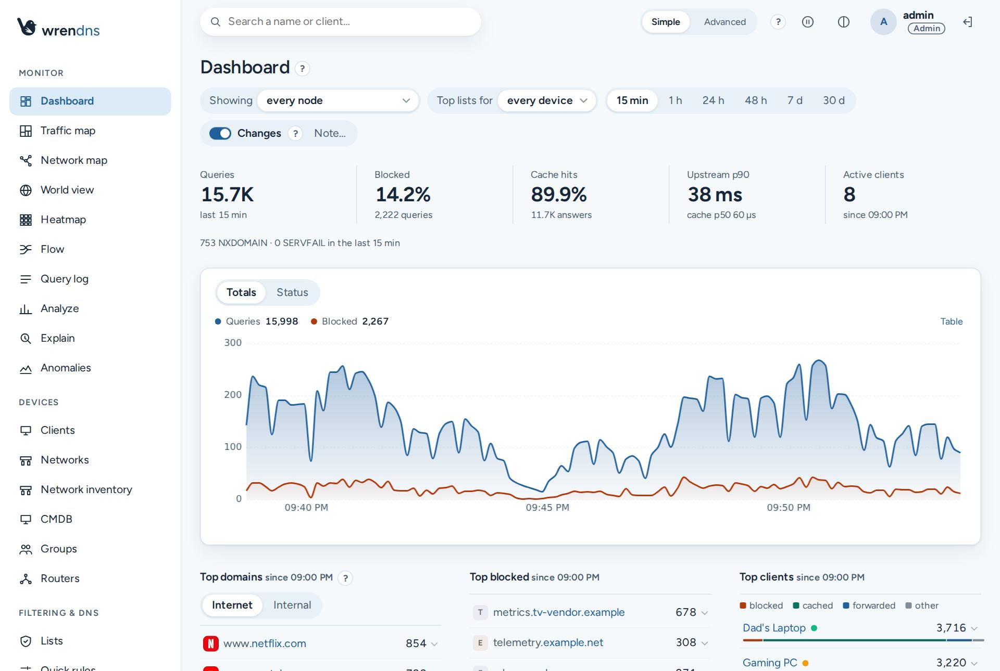
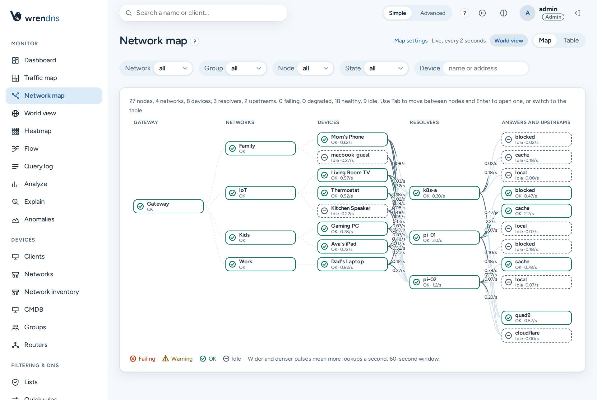
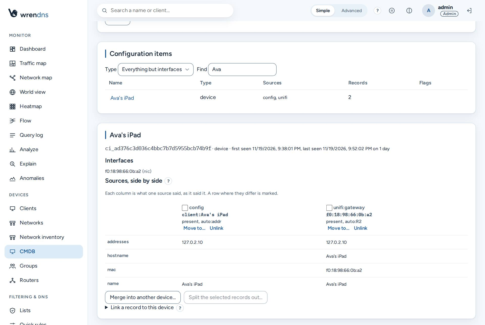
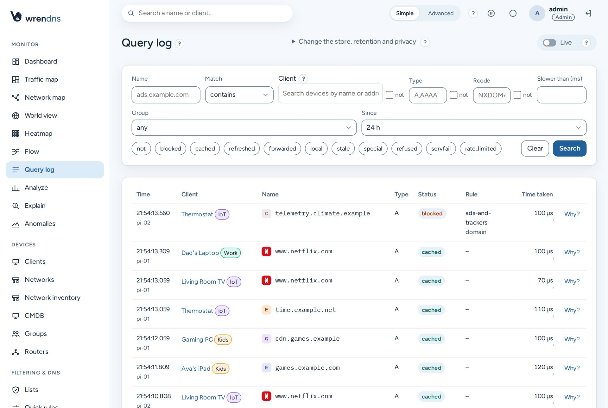
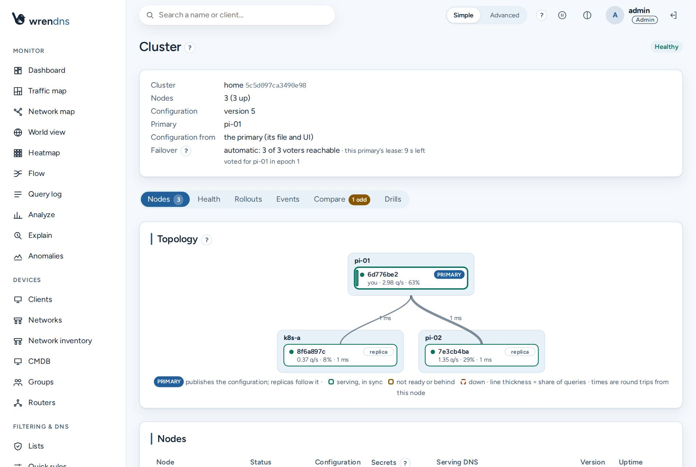

<p align="center">
  <picture>
    <source media="(prefers-color-scheme: dark)" srcset="brand/logos/wrendns-lockup-night.svg">
    
  </picture>
</p>

<p align="center"><strong>Put a bird on it!</strong></p>

<p align="center">
  <a href="https://github.com/nbacheller/wrendns/actions/workflows/ci.yml?query=branch%3Amain"></a>
  <a href="https://github.com/nbacheller/wrendns/actions/workflows/image.yml?query=branch%3Amain"></a>
  <a href="https://github.com/nbacheller/wrendns/actions/workflows/site.yml?query=branch%3Amain"></a>
  <a href="LICENSING.md"></a>
  <a href="https://www.wrendns.com"></a>
</p>

# WrenDNS

WrenDNS is a small, fast DNS resolver and ad blocker for a home or small network. It answers every lookup in microseconds, filters it by your rules per device, and tells you exactly who asked, what they asked and why it answered the way it did. It keeps a live inventory of every device on the network, draws the network as a map, and runs as one cluster across a Raspberry Pi and Kubernetes that keeps answering when parts of it fail.

**Website and guides: [www.wrendns.com](https://www.wrendns.com)**

<p align="center">
  <picture>
    <source media="(prefers-color-scheme: dark)" srcset="docs/images/dashboard-night.jpg">
    
  </picture>
  <br>
  <sub>The dashboard of a three-node demo cluster. Every device, name and address in these pictures is made up.</sub>
</p>

## Contents

- [Why WrenDNS](#why-wrendns)
- [Features](#features)
- [A tour in pictures](#a-tour-in-pictures)
- [Install](#install)
- [First steps](#first-steps)
- [Upgrading](#upgrading)
- [Configuration](#configuration)
- [Clustering and high availability](#clustering-and-high-availability)
- [The API, the shell and MCP](#the-api-the-shell-and-mcp)
- [Monitoring](#monitoring)
- [Security](#security)
- [Performance and footprint](#performance-and-footprint)
- [Documentation](#documentation)
- [Support](#support)
- [Contributing](#contributing)
- [Licence](#licence)
- [Acknowledgement](#acknowledgement)

## Why WrenDNS

Every connection on your network starts with a DNS lookup, so the resolver is the one place that sees what every device is doing. Pi-hole showed that network-wide blocking on a small computer belongs in every home; Technitium showed how complete a self-hosted DNS server can be. WrenDNS learned from both ([design notes](docs/analysis.md)) and is built around a different combination, for people who run a Raspberry Pi, Kubernetes or both and want to see deeply into their network:

- **See.** Every query is tied to a named device, explained (which list and line blocked it, which upstream answered) and timed per stage. Devices are named from your router, Home Assistant and what they announce, and recognised by what they are.
- **Decide.** Your rules per device, group and network, enforced at no cost to speed, and tried against yesterday's real traffic before you save them.
- **Never fail.** DNS keeps answering from its last good configuration whatever happens to the API, the storage, the telemetry or the rest of the cluster.
- **Run anywhere.** One static binary and one signed image, the same on a Pi, in a container and in Kubernetes, as one cluster with one management plane.
- **Light.** A compressed image under 25 MiB, an idle node under 32 MiB of memory, and a million blocked names in a few bytes each.

WrenDNS is developed spec first: the requirements, the architecture and every decision are in [`spec/`](spec/00-overview.md), and each feature traces to a numbered requirement and its tests. Since it became its own project in November 2026 it has added, in milestones M22 to M35 of the [roadmap](spec/10-roadmap-and-tasks.md): names and networks from UniFi and Home Assistant, secrets and integrations managed in the UI, a full replacement for a Pi-hole pair (with an importer and a VIP failover), a read-only network inventory over SNMP, a live network map, a UI control for every setting, a leaner image, domain icons, a CMDB that reconciles every source into one record per device, and the WrenDNS name and brand. Planned next: a cloud-hosted resolver for devices away from home (M32) and public authoritative DNS (M34).

**Status:** pre-1.0. Tagged [releases](https://github.com/nbacheller/wrendns/releases) are the stable channel and `edge` is built from every commit on `main`. Releases before 1.0 can still change configuration keys and APIs; their notes call out every such change.

## Features

### Filtering and policy
- Block and allow lists in hosts, domain and AdGuard syntax, by URL, file or inline rules, compiled into one compact index whose lookup cost doesn't grow with the list; lists update in the background and swap in atomically. Update now, see when each list was last confirmed current, and which lists overlap.
- **Content categories and filter profiles:** pick what to block (adult, gambling, malware, social, newly registered domains and more, each from an open, licensed list) per device or network, with Basic and Enhanced presets and a memory budget that refuses what a small node can't hold.
- Groups per device, network or VLAN; schedules; safe search; blocked services; rewrites; quick rules; DNS64; rebinding protection; per-client rate limits; Pi-hole's special names (iCloud Private Relay, `resolver.arpa` and encrypted DNS discovery).
- **A device's policy:** click a device to see the group it lands in and why, and every list, service, schedule, rule and upstream that applies.
- **Try a change first:** see what a change would have done to yesterday's real traffic before you save it, and run a list in shadow mode (counted, never blocking).
- Import from Pi-hole (Teleporter or `gravity.db`, with `dnsmasq.d` lines) and from Technitium, with a preview of every entry before it is applied.

### Encrypted DNS
- For your devices: DNS over TLS, HTTPS (HTTP/2 and HTTP/3) and QUIC, with certificates reloaded on renewal and per-device client IDs.
- To your upstreams: DoT, DoH, DoH3, DoQ, DNSCrypt and DNS stamps, with failover, round robin, weighted, fastest and parallel strategies, serve-stale and prefetch. A simple picker for the public providers, or your own.
- DNSSEC validation, full recursion from the root when you'd rather not forward at all, conditional forwarding and stub zones, local records and zones, and device names answered in DNS (`kitchen-tablet.home.arpa`, with reverse lookups and IPv6).

### Explainability: "Why?"
- Every answer has a **Why?**: the list and the line that blocked it, the rule or group that applied, or the upstream that answered, with the time spent in each stage.
- The query log searches 30 days in seconds on a Pi, with a "not" on every filter, a live tail, and names looked up when read, so renaming a device relabels its history. Privacy levels decide how much of each query is kept, from everything to counters only.

### Observability and the map
- A calm dashboard for the whole cluster, one node or one site, with change markers on every chart.
- **Network map:** your gateway, networks, devices, resolvers and upstreams, coloured green, yellow or red by health and sampled off the DNS path. An optional **world view** shows where lookups go, with a country database you download only if you turn it on.
- A traffic map, a heatmap of when your network asks, a flow from each group to its answers, latency heatmaps with exemplars, service-level objectives and which devices spent the error budget, node comparison, a device's rhythm and its day, and a wall display.
- Device anomalies (query spikes, bursts of new domains, phone-home beacons) with acknowledgement and mutes, and alerts by email, ntfy, Gotify, Slack-compatible channels or any webhook.

### Devices, inventory and CMDB
- Devices named from your router's leases (UniFi, OPNsense), Home Assistant, mDNS, or by you in the UI, and recognised by what they are (a camera, a TV, a thermostat) from their maker, their name and the domains they talk to.
- **Network inventory** for devices that never ask DNS: read-only SNMP polling of your gateway and switches (which device is on which port), and more UniFi and Home Assistant reads; importing the results of a scanner you run yourself is planned. It never scans the network itself, and its workers are sandboxed.
- **CMDB:** one configuration item for each real thing on the network, built from every source that reports on it, with each source's record side by side, and Move, Unlink, Merge and Split to fix a wrong link (each previewed before it is written).

### Clustering and high availability
- A Pi and Kubernetes nodes share one signed, versioned configuration; any node's UI manages the whole cluster, and a change made on a replica goes to the primary.
- Automatic failover with a witness or a third node, a VIP with keepalived for a Pi pair, replicated secrets, staged rollouts with automatic rollback, maintenance mode without dropped queries, scheduled failover drills, version pinning, and GitOps (configuration from a Git repository).

### Integrations
- **UniFi:** device names, MACs, networks and VLANs, reservations and offline clients, read-only.
- **Home Assistant:** names from Home Assistant, and a [Home Assistant integration](integrations/home-assistant/README.md) with sensors, blocking switches, anomaly events and device quarantine.
- **SNMP:** v2c and v3 (SHA with AES) reads of ARP, forwarding and LLDP tables ([SNMP setup](docs/snmp-setup.md)).
- **Kubernetes:** a Helm chart that preserves real client addresses, and Kubernetes workloads shown as devices.
- A Pi-hole compatible API, so dashboards, phone apps and Home Assistant's Pi-hole integration keep working (off by default).

### API, MCP and agents
- A documented REST API ([OpenAPI](docs/api/openapi.json)), `wrendns ctl` for the shell, and an MCP server on every node for AI agents, with scoped, rate-limited agent tokens, a stated reason for every change, dry runs, and plans that a person approves.

### Security and secrets
- Local users and OIDC sign-in (Keycloak, Authentik, Entra ID and others) with role mapping, two-factor sign-in, and a hash-chained audit log.
- A secrets store with a write-only API: no credential ever appears on a read surface, and backups carry secrets encrypted under a passphrase.
- Guarded changes for listeners, TLS and keys: a review, a typed confirmation and a rollback countdown.

### Updates
- A daily, signed update check (it can be turned off), `wrendns self-update` that verifies the release signature and the binary's SHA-256 before it swaps, signed images, an SBOM per binary, and reproducible builds.

## A tour in pictures

<p align="center">
  <picture>
    <source media="(prefers-color-scheme: dark)" srcset="docs/images/map-night.jpg">
    
  </picture>
  <br>
  <sub>The network map: from the gateway through networks and devices to the resolvers and upstreams, coloured by health.</sub>
</p>

<p align="center">
  <picture>
    <source media="(prefers-color-scheme: dark)" srcset="docs/images/cmdb-night.jpg">
    
  </picture>
  <br>
  <sub>The CMDB: one device with what each source said about it, side by side.</sub>
</p>

<p align="center">
  <picture>
    <source media="(prefers-color-scheme: dark)" srcset="docs/images/queries-night.jpg">
    
  </picture>
  <br>
  <sub>The query log: every lookup with its device, its node, its answer and a Why?.</sub>
</p>

<p align="center">
  <picture>
    <source media="(prefers-color-scheme: dark)" srcset="docs/images/cluster-night.jpg">
    
  </picture>
  <br>
  <sub>The cluster: a primary and two replicas, with automatic failover.</sub>
</p>

The pictures come from a demo network of made-up devices on loopback addresses: a three-node cluster, a stub UniFi gateway and synthetic traffic. `ui/tests/demo/run.sh` takes them all, in Day and Night, with one command (its header says how).

## Install

WrenDNS runs on Linux on x86-64, arm64 and 32-bit ARM (Raspberry Pi 3, 4, 5 and Zero 2 W), in a container, and in Kubernetes. Every download is free; the [download page](https://www.wrendns.com/download.html) lists them all.

> **Before the first WrenDNS release:** the commands below install the latest release. Until the first WrenDNS release is published, use the `edge` builds of `main`: `WRENDNS_TAG=edge` for Compose, `--edge` for `install.sh`, the image tag `:edge`, and a chart version `0.8.0-edge.<n>`.

### Docker and Docker Compose

On a Raspberry Pi or any Linux host with Docker, with host networking so WrenDNS sees real client addresses:

```sh
mkdir wrendns && cd wrendns
curl -fsSLO https://raw.githubusercontent.com/nbacheller/wrendns/main/deploy/compose/compose.yaml
curl -fsSLO https://raw.githubusercontent.com/nbacheller/wrendns/main/deploy/compose/wrendns.toml
docker compose up -d
docker compose exec wrendns wrendns auth setup-token     # then open http://<host>:8053/
```

Or one container (`ghcr.io/nbacheller/wrendns`, for `linux/amd64`, `linux/arm64` and `linux/arm/v7`, signed with cosign):

```sh
docker run -d --name wrendns --restart unless-stopped \
  --read-only --cap-drop ALL --security-opt no-new-privileges \
  -p 53:53/udp -p 53:53/tcp -p 8053:8053 -p 9153:9153 \
  -v "$PWD/wrendns.toml:/etc/wrendns/wrendns.toml:ro" \
  -v wrendns-data:/var/lib/wrendns \
  ghcr.io/nbacheller/wrendns:latest
```

Details, host networking and port 53: [Container image](docs/running.md#container-image) and [Raspberry Pi and Linux](docs/running.md#raspberry-pi-and-linux).

### Native Linux and Raspberry Pi (systemd)

`install.sh` downloads the static binary for your CPU, checks the release signature and the binary's SHA-256, creates a `wrendns` system user, installs a sandboxed systemd unit and a starter configuration, and starts the service:

```sh
curl -fsSLO https://raw.githubusercontent.com/nbacheller/wrendns/main/deploy/systemd/install.sh
less install.sh                     # read it before running it as root
sudo sh install.sh                  # the latest release; --edge for builds of main
```

It asks a few questions on a new install (upstreams, blocklists, the listen address, systemd-resolved's stub listener, the first admin) unless you pass `--yes`. Running it again upgrades; `sudo sh install.sh --uninstall` removes it. See [Raspberry Pi and Linux](docs/running.md#raspberry-pi-and-linux).

**Moving from TelltaleDNS:** <!-- rebrand:keep --> run `install.sh`. It installs the WrenDNS binary and then runs [`deploy/systemd/migrate-from-telltale.sh`](deploy/systemd/migrate-from-telltale.sh), which moves `/etc/telltale` and `/var/lib/telltale` to the new paths, renames the user and the unit with your edits and drop-ins, and leaves links behind so scripts that name the old paths keep working. It can run alone with `--dry-run` first. The old names keep working for one release. See [Upgrading to WrenDNS](docs/running.md#upgrading-to-wrendns), which covers Compose and Helm too.

**Moving from Pi-hole or Technitium:** `wrendns import pihole` (or **Import from Pi-hole** in Settings) and `wrendns import technitium`, each showing what it would import before anything changes; see [Moving from Pi-hole](docs/running.md#moving-from-pi-hole) and [Moving from Technitium](docs/running.md#moving-from-technitium). A Pi-hole pair behind a VIP can move to two WrenDNS nodes with keepalived: [Failover with a VIP](docs/running.md#failover-with-a-vip-keepalived).

### Kubernetes (Helm)

The chart is published with every release as an OCI artifact (Kubernetes 1.26+, amd64 and arm64):

```sh
helm install wrendns oci://ghcr.io/nbacheller/charts/wrendns --version <version> \
  -n wrendns --create-namespace \
  --set service.dns.annotations."metallb\.universe\.tf/loadBalancerIPs"=10.0.0.53
kubectl -n wrendns get svc wrendns-dns          # point your clients (DHCP) at its EXTERNAL-IP
```

It keeps real client addresses (`externalTrafficPolicy: Local`), and offers scaled resolver pods, encrypted listeners with cert-manager, a ServiceMonitor, Prometheus rules, a Grafana dashboard and network policies. Every value: `helm show values oci://ghcr.io/nbacheller/charts/wrendns --version <version>`, [`values.yaml`](deploy/helm/wrendns/values.yaml), or the site's [Helm values](https://www.wrendns.com/helm-values.html). See [Kubernetes (Helm)](docs/running.md#kubernetes-helm).

### Docker Desktop bundle

To try WrenDNS on Windows or macOS against your own UniFi gateway and Home Assistant (read-only), with an optional throwaway Home Assistant: [`deploy/docker-desktop`](deploy/docker-desktop/README.md). Docker Desktop can't show real client addresses, so use a Pi or a Linux host for real per-device use.

### Home Assistant

The integration in [`integrations/home-assistant`](integrations/home-assistant/README.md) connects Home Assistant to any WrenDNS node with a scoped agent token: sensors, a blocking switch for everyone and for each group, an event for each new anomaly, and actions to quarantine and release a device. Copy `custom_components/wrendns` into Home Assistant's `config/custom_components/` and add the integration; its README has the steps.

### From source

```sh
git clone https://github.com/nbacheller/wrendns && cd wrendns
(cd ui && npm ci && npm run build)          # the binary embeds the UI
cargo build --release -p wrendns            # target/release/wrendns
docker buildx build -t wrendns:dev .        # or the image (cross-compiles, no QEMU)
```

## First steps

1. Open the UI at `http://<node>:8053/` and create the first admin with the token from `wrendns auth setup-token` (or create the admin from a secret, see [Users and sign-in](docs/running.md#users-and-sign-in)).
2. Check what a name gets and why: `dig @<node> example.com`, then the **Query log** and its **Why?**.
3. Point your router's DHCP at the node's address (or at the cluster's VIP or LoadBalancer), so every device uses it.
4. Name your devices and give them groups (**Clients**, or the routers on the **Routers** page), and choose what to block per group (**Groups**, **Lists**).

## Upgrading

- **Native:** `sudo wrendns self-update --restart` (`--channel edge` for builds of `main`, `--check` to only look), or run `install.sh` again.
- **Compose:** `docker compose pull && docker compose up -d`.
- **Helm:** `helm upgrade`, or bump the chart version in your GitOps values.
- **A cluster:** upgrade the replicas first, then the primary; nodes of two versions run together through a rolling upgrade.

`wrendns self-update` and `install.sh` install only a release whose `SHA256SUMS` and `releases.json` are signed with the WrenDNS release key built into the binary (minisign, key ID `4CBF504A8FBF5357`, [`deploy/release/wrendns-release.pub`](deploy/release/wrendns-release.pub); ADR-1034), then check the binary's SHA-256, test-run it, swap it in atomically and keep the previous binary as `wrendns.old`. Containers never update themselves: pull a new image. A node checks once a day for a new release and shows it in the sidebar and **Settings → System**; `[updates] check = false` turns that off. Verify an image with cosign:

```sh
cosign verify ghcr.io/nbacheller/wrendns:<version> \
  --certificate-identity-regexp '^https://github\.com/nbacheller/wrendns/\.github/workflows/image\.yml@' \
  --certificate-oidc-issuer https://token.actions.githubusercontent.com
```

More: [Versions and updates](docs/running.md#versions-and-updates), and [Backups and moving to a new machine](docs/running.md#backups-and-moving-to-a-new-machine).

## Configuration

WrenDNS reads one TOML file, `/etc/wrendns/wrendns.toml`, plus optional overrides. Every key is optional; unknown keys are errors, so a typo never goes unnoticed. Almost everything can also be changed in the UI, where a field the file sets shows "set by file".

```sh
wrendns config check wrendns.toml           # "config OK", or every problem with its key path
wrendns config check wrendns.toml --print   # the effective configuration (credentials redacted)
wrendns config schema > wrendns.schema.json # for editor completion
```

Precedence, lowest to highest: built-in defaults, the files in order, `WRENDNS_<SECTION>_<KEY>` environment variables, command-line flags. The full reference is [`docs/configuration.md`](docs/configuration.md), the generated schema [`docs/config-schema.json`](docs/config-schema.json), a commented example [`docs/examples/wrendns.toml`](docs/examples/wrendns.toml), and the site's [configuration page](https://www.wrendns.com/config.html) lists every key with its default.

**The node and the cluster**

| Section | What it sets |
|---|---|
| `[node]` | the node's name, role, worker threads, data directory, secret file directories |
| `[cluster]` | cluster name, site, primary eligibility, the cluster port, Git as the configuration source, staged rollouts (`[cluster.rollout]`) |
| `[api]` | the REST API and UI listener, trusted proxies |
| `[auth]` | sessions, two-factor sign-in, OIDC providers (`[auth.oidc]`) |
| `[agents]` | agent tokens on or off, their rate limit |
| `[updates]` | the daily update check and its index |
| `[support]`, `[watchdog]` | the support package's log files; the watchdog that dumps and restarts a node that stops answering |

**Answering**

| Section | What it sets |
|---|---|
| `[[listen]]` | UDP, TCP, DoT, DoH, DoH3 and DoQ listeners, TLS certificates, PROXY protocol |
| `[[upstream]]`, `[[upstream_group]]` | upstream resolvers (the URL scheme picks the protocol) and groups with a strategy |
| `[[route]]` | conditional forwarding by domain, group or query type |
| `[[record]]`, `[local]` | local records, hosts files, automatic reverse names |
| `[cache]` | memory budget, TTL clamps, serve-stale, prefetch |
| `[dns]`, `[special]` | EDNS size, NSID, special names |
| `[[zone]]` | authoritative zones, for everyone or only some groups (split horizon) |
| `[dnssec]` | DNSSEC validation of forwarded answers, trust anchors, negative trust anchors |
| `[access]`, `[ratelimit]` | who may query, and how often |

**Filtering and devices**

| Section | What it sets |
|---|---|
| `[[list]]`, `[filter]` | block and allow lists, their refresh, size limits, shadow mode, the category budget |
| `[[group]]` | groups: networks, lists, content categories, safe search, schedules, services, rewrites, DNS64 |
| `[[schedule]]` | weekly schedules that groups use: block everything, or add lists or blocked services, in their windows |
| `[[rule]]` | quick rules: allow or block a domain for some devices, groups or everyone, optionally until a time |
| `[[client]]`, `[clients]` | known devices and how to recognise them, the neighbour table, mDNS |
| `[[router]]` | UniFi, OPNsense and Home Assistant sources, with their credentials in files or the secrets store |
| `[identify]` | device identification |
| `[discovery]`, `[cmdb]` | the network inventory (SNMP, UniFi reads) and the CMDB |
| `[kubernetes]` | Kubernetes workloads as devices |

**Observing**

| Section | What it sets |
|---|---|
| `[telemetry]` | query-log retention and privacy level, Prometheus metrics, OTLP export, device anomalies |
| `[[anomaly_mute]]` | device-anomaly kinds muted for some devices or groups |
| `[map]` | the network map's sampler, thresholds and the optional GeoIP database |
| `[slo]`, `[probe]`, `[upstream_check]` | service-level objectives, listener probes, upstream second opinions |
| `[exclusions]` | names and devices kept out of the query log |
| `[alerts]` | alert rules and destinations (email, ntfy, Gotify, Slack-compatible, webhook) |
| `[simulate]`, `[drill]` | change simulation over the query log, scheduled failover drills |

## Clustering and high availability

A cluster is one primary that publishes signed, versioned configuration snapshots and replicas that follow it; every node answers from its last snapshot, so DNS keeps going if the primary is unreachable. Any node's UI manages the whole cluster.

```sh
# On the first node, as the user wrendns runs as, then restart it:
sudo -u wrendns wrendns cluster init --name home --advertise https://pi-01.home.arpa:8443
sudo systemctl restart wrendns
sudo -u wrendns wrendns cluster token create --ttl 30m --eligible   # a join token
# On the second node, then restart it:
sudo -u wrendns wrendns cluster join <token> --site pi-02 --eligible --advertise https://pi-02.home.arpa:8443
sudo systemctl restart wrendns
# On the primary, once there are three voters:
sudo -u wrendns wrendns cluster set-failover auto
```

These are for the native systemd install; in Docker or Kubernetes, run them inside the container and restart it. The full walk-through is in [Clusters](docs/running.md#clusters).

- **Failover:** with two nodes, promotion is manual (a third vote is needed to be safe); add a witness or a third node for automatic failover. A Pi pair can also share one address with keepalived.
- **Kubernetes:** the chart's controller creates the cluster and resolver pods join as ephemeral members; a Pi joins the same cluster.
- **Changes:** staged rollouts reach canary nodes first and roll back by themselves when those fail; maintenance mode drains a node without dropped queries or false alarms; scheduled drills prove failover works.

See [Clusters](docs/running.md#clusters) and [`spec/12-clustering-and-ha.md`](spec/12-clustering-and-ha.md).

## The API, the shell and MCP

- **REST API** at `/api/v1` on every node, described by [`docs/api/openapi.json`](docs/api/openapi.json) (also served at `/api/v1/openapi.json`): JSON in camelCase, RFC 9457 problems with a stable `code` and a `hint`, `?dryRun=true` on every change, `If-Match` and `Idempotency-Key` for safe retries. See [API](docs/running.md#api).
- **The shell:** `wrendns ctl` (`wrendns ctl --help`) for the same operations from scripts.
- **MCP:** every node serves the Model Context Protocol at `http://<node>:8053/mcp`, and `wrendns mcp --stdio` relays for agents that start their tools as a subprocess. The tools are listed in [`docs/api/mcp-tools.json`](docs/api/mcp-tools.json).
- **Agent tokens** are scoped (read-only by default, without the query log), rate-limited, can be limited to one group, need an `X-Wrendns-Reason` on every change, and are refused for users, tokens, secrets and backups. `[agents] enabled = false` is the kill switch. See [AI agents and automation](docs/running.md#ai-agents-and-automation) and [`spec/13-agent-api-and-mcp.md`](spec/13-agent-api-and-mcp.md).

## Monitoring

- **Prometheus:** `/metrics` on port 9153 (counters, histograms with OpenMetrics exemplars, per-upstream and per-device percentiles, cluster and update state). The chart has a ServiceMonitor and Prometheus rules.
- **Grafana:** dashboards in [`deploy/grafana`](deploy/grafana), and as a ConfigMap for the Grafana sidecar from the chart.
- **OpenTelemetry:** OTLP export of metrics and traces, with sampling of slow queries; dnstap; event sinks for your SIEM.
- **Health:** `/healthz`, `/livez` and `/readyz` (ready only when the DNS listener answers), service-level objectives, listener probes, and alerts.

See [Monitoring](docs/running.md#monitoring).

## Security

- The image is one static binary built from scratch, run as a non-root user with a read-only root filesystem and no capabilities; the systemd unit is sandboxed with only `CAP_NET_BIND_SERVICE`.
- Releases are signed (minisign, ADR-1034), images are signed with cosign, each binary carries its dependency list and an SBOM, and two builds of the same commit are identical.
- `cargo deny` (licences and advisories, no ignored advisory) and CodeQL run in CI; the DNS parsers are fuzzed. The only `unsafe` code is in `wrendns-net`, each use justified.
- Credentials are write-only and never shown again; a node sends nothing to MySummitKeep LLC, and its only outbound contact of its own is the signed release check, which can be turned off.

To report a vulnerability, see [SECURITY.md](SECURITY.md): GitHub private vulnerability reporting, or `support@wrendns.com` marked SECURITY. The design is in [`spec/08-deployment-config-security.md`](spec/08-deployment-config-security.md).

## Performance and footprint

Performance is a feature, and every claim comes from the reproducible harness in [`bench/`](bench/README.md). The release gates ([`spec/00`](spec/00-overview.md), section 5):

| Gate | Target |
|---|---|
| Cache-hit throughput, 4-core x86-64 / Raspberry Pi 4 | at least 150k / 25k queries a second |
| Added latency for a cached or blocked answer (p99, at half load) | at most 250 µs |
| Compressed container image | under 25 MiB per architecture (ADR-916) |
| Memory, idle with no lists | at most 32 MiB (ADR-1031) |
| Memory with 1M blocked names, 100k cache entries and telemetry | at most 128 MiB (ADR-1031) |
| List recompile, 2M names on a Pi 4 | at most 8 s, with p99 latency at most 10% worse during it |
| Cold start to serving | at most 500 ms |
| Query-log search, 30 days and 50M rows on a Pi 4 | at most 2 s |
| Configuration reaching every node | at most 5 s (p95) |
| DNS while the primary is down | 100%: every replica keeps answering |

The image gate and the memory gates are hard: CI fails a change that crosses them. Measurements are in [`docs/v1-gate.md`](docs/v1-gate.md) and on the site's [performance page](https://www.wrendns.com/performance.html).

## Documentation

| Read this | For |
|---|---|
| [www.wrendns.com](https://www.wrendns.com) | Getting started, guides, the FAQ, every configuration key and Helm value |
| [`docs/running.md`](docs/running.md) | Operating WrenDNS: install, every feature, clusters, monitoring, the API |
| [`docs/configuration.md`](docs/configuration.md) | The configuration file, precedence, environment variables and every section |
| [`docs/secrets.md`](docs/secrets.md) | The secrets store |
| [`docs/recovery.md`](docs/recovery.md) | Recovering a node or a cluster |
| [`docs/snmp-setup.md`](docs/snmp-setup.md) | SNMP for the network inventory |
| [`docs/releasing.md`](docs/releasing.md) | How releases are made and signed |
| [`docs/analysis.md`](docs/analysis.md) | What WrenDNS learned from Pi-hole and Technitium |
| [`EXECUTIVE-SUMMARY.md`](EXECUTIVE-SUMMARY.md) | What WrenDNS is built around |
| [`spec/`](spec/00-overview.md) | The specification: [requirements](spec/01-requirements.md), [architecture](spec/02-architecture.md), [decisions](spec/11-decisions.md), [roadmap](spec/10-roadmap-and-tasks.md) |
| [`AGENTS.md`](AGENTS.md) | The ground rules for anyone, person or agent, changing the code |

## Support

- **Questions and ideas:** [GitHub Discussions](https://github.com/nbacheller/wrendns/discussions).
- **Bugs:** [an issue](https://github.com/nbacheller/wrendns/issues/new/choose), with a support package (**Settings → System → Support package**, or `wrendns support-package`): it replaces addresses and names and removes secrets.
- **Help by email:** [support@wrendns.com](mailto:support@wrendns.com); what to expect is on the [support page](https://www.wrendns.com/support).
- **Support WrenDNS:** WrenDNS is free and stays free. If it saves you time, you can chip in, once ([choose the amount](https://donate.stripe.com/8x28wRghj8W011E1ClcIE00)) or monthly ([$3](https://buy.stripe.com/6oU8wR6GJgosbGi3KtcIE01), [$5](https://buy.stripe.com/14AdRb8ORb48dOqgxfcIE02), [$10](https://buy.stripe.com/3cI7sN3ux2xC8u680JcIE03)). Support is a payment to MySummitKeep LLC, the company that makes WrenDNS. It is not a tax-deductible donation, and it buys no rights, features or priority support ([Terms](https://www.wrendns.com/terms)).

## Contributing

Contributions are welcome. WrenDNS is built spec first: read [`CONTRIBUTING.md`](CONTRIBUTING.md), [`AGENTS.md`](AGENTS.md) and the [spec](spec/00-overview.md), trace your change to its requirement, and run the checks before you push. Every outside contribution is made under the [Contributor Licence Agreement](CONTRIBUTING.md#contributor-licence-agreement): you keep your copyright, and you sign once with a comment on your first pull request. Everyone follows the [Code of Conduct](CODE_OF_CONDUCT.md).

## Licence

WrenDNS is free software under the [GNU Affero General Public License, version 3 or later](LICENSE) (AGPL-3.0-or-later), copyright MySummitKeep LLC. A **commercial licence** is available for anyone who can't accept the AGPL's terms: ask at [support@wrendns.com](mailto:support@wrendns.com).

The last version released entirely under Apache-2.0 OR MIT is the [`permissive-final`](https://github.com/nbacheller/wrendns/releases/tag/permissive-final) tag and release; it stays available under those licences. The Home Assistant integration stays Apache-2.0. [LICENSING.md](LICENSING.md) explains it all in plain language, and [NOTICE](NOTICE) has the copyright notices.

## Acknowledgement

WrenDNS started from [TelltaleDNS](https://github.com/paimonsoror/telltaledns) by paimonsoror, licensed under Apache-2.0 OR MIT; its authors and contributors are credited in [NOTICE](NOTICE). <!-- rebrand:keep -->
