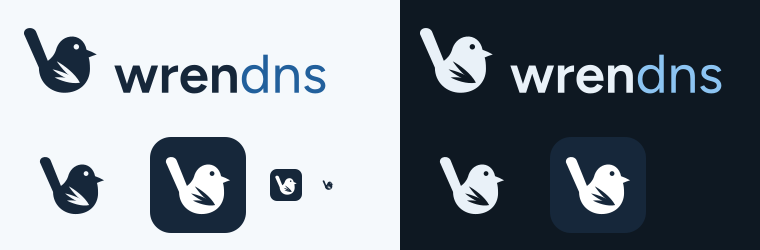

# WrenDNS brand

The source of truth for the product's name, voice, colours, type and logo (owner, 2026-11-19; ADR-1026, spec/10 T33.2). The rename and every later UI, site, README and Home Assistant change follow it.

## Files

- `tokens.json`: every colour (Day `light` and Night `dark`), the type scale, spacing, radius and shadow. Every text pairing passes WCAG 2.2 AA in both themes. The UI and the site take their CSS variables from it.
- `logos/`: the final logo files. The bird is one solid colour with the eye and wing cut out (transparent).
  - `wrendns-lockup-day.svg` and `-night.svg`: the bird on the wordmark's baseline (360×94). Day: the bird and "wren" `#16273a`, "dns" `#22609c`. Night: `#e9f1f8` and `#8cc4f2`.
  - `wrendns-mark-day.svg` and `-night.svg`: the bird alone, 128×128.
  - `wrendns-wordmark-day.svg` and `-night.svg`: the outlined "wrendns", 255×64.
  - `wrendns-app-icon.svg`: a white bird on a `#16273a` rounded square. `wrendns-icon-256.png` and `wrendns-icon-512.png` are the same, for Home Assistant's `icon.png` and `icon@2x.png`.
- Fonts: **Figtree** (UI and display; npm `@fontsource-variable/figtree`) and **IBM Plex Mono** (domains, IPs, records; npm `@fontsource/ibm-plex-mono`). Both are under the SIL Open Font License.

## Rules to keep

- Colours: sky, navy and white only; no browns or earth tones. `sky-strong` (`#22609c` / `#8cc4f2`) is the only interactive colour. The status colours (`ok`, `warn`, `alert`) always come with a word or an icon.
- Name: **WrenDNS** in prose; the lowercase **wrendns** only in the logo. Never retype or recolour the logo.
- Voice: calm and specific, sentence case, no emoji. The tagline, **Put a bird on it!**, is the only exclamation mark.
- Keep upstream's attribution and licence notice for `paimonsoror/telltaledns` (ADR-1026).

## Brand book

WrenDNS is a small, fast DNS resolver and ad blocker that explains every answer and keeps a live inventory of every device on the network. It runs as a cluster across a Raspberry Pi and Kubernetes. The brand is a wren: a tiny bird with a big, clear voice that flies with a flock. Four words set every decision: **light, airy, together, in sync.** The tagline is **Put a bird on it!**

## Voice

- Explain, don't alarm. Lead with the device's name, then what happened, then why: "kitchen-tablet asked for ads.example.net. Blocked by the Kids list."
- Be specific and calm. Use real names, counts and times ("pi-02 is 40 s behind. Answers still come from pi-01 and k8s-a."), never vague dread ("Threat detected!").
- Write in sentence case, with no emoji in the product. The tagline is the brand's only exclamation mark; product copy never uses one.
- Use the tagline as written, "Put a bird on it!", on the site hero, the README banner, the cover and merch. Keep it out of the product UI.
- Call the product **WrenDNS** in sentences. The lowercase **wrendns** is the logo's form only.
- Say "your network" and "your devices". The product never says "I".
- Name the flock plainly: a resolver is a **node**, the nodes together are the **cluster**, a named set of devices is a **group**.

## Color

The palette is sky, navy and white: no browns, tans or earth tones. Two themes ship with every surface: **Day** (`light`, the default) and **Night** (`dark`). Every text pairing below meets WCAG 2.2 AA (4.5:1) in both themes, and every control border, focus ring and meaningful mark meets 3:1. Night is its own palette, tuned separately, not an inverted Day.

- Set pages on `surface`. Put cards, menus and dialogs on `surface-raised`. Use `surface-sunken` for DNS records, query logs and code.
- Set body text in `ink` and secondary text in `ink-muted`. Both read on all three surfaces in both themes. `ink` is also the logo bird's color.
- `sky-strong` is the only interactive color: links, primary buttons, toggles in the on state, the selected node. Put `on-sky-strong` on its fills. Never use it for decoration.
- `sky` is the identity tint for big, calm fields such as heroes and empty states. Put text on it in `on-sky`, never `ink`, which fails on Night's `sky`.
- Status uses `ok`, `warn` and `alert`, each on its `-soft` tint as a badge. Always pair a status color with a word or icon ("In sync", "Degraded", "Node down"), never color alone. `ok` is a blue-leaning green and `alert` a vermillion, so they stay apart for red-green color blindness.
- Device groups take `flock-1` to `flock-5` in fixed order (sky, tangerine, plum, leaf, rose), then `flock-other`. A group keeps its color when filters change. Text beside a group color stays in `ink`. Don't reuse status colors for groups or flock colors for status. The five passed a color-blind separation check in both themes.
- Use `line` for hairlines between content and `line-strong` for the edge of anything you can click or type into.
- Keep it airy. No gradients, no glows, no colored left-border cards. Big pale fields with crisp ink beat many small colored ones.

## Type

- Set everything in **Figtree** (`sans`), shipped as a variable font (300–900).
- Set domains, IPs, MACs, record types, TTLs and anything a person might copy in **IBM Plex Mono** (`mono`, `mono-sm`), on `surface-sunken` when it is a block.
- Use `display` once per page at most. Its 350 weight is deliberately light, so give it room: `space-12` above and below.
- Headings are `h1` to `h3`, sentence case, never all caps. `label` is the one style that can sit on buttons and badges.
- Body is `body` (16/24); dense tables and side panels drop to `body-sm`.

## Space, shape and depth

- Space comes from a 4px base: `space-1` to `space-12`. When in doubt, add air. Cards breathe at `space-4`, sections at `space-8`.
- Corners are soft: `radius-sm` on badges and chips, `radius-md` on buttons, inputs and cards, `radius-lg` on dialogs and hero panels, `radius-full` on pills, toggles and node dots.
- One shadow, `shadow-float`, for things that float above the page (cards, menus, dialogs). Things float; they never stack in layers of shadow.

## Focus and states

- Keyboard focus is a solid 2px `focus-ring`, 2px outside the element, on every interactive element. It is at least 3:1 on every surface in both themes. Never remove it.
- Selected rows and active nav items use `sky-soft` with `ink` or `sky-strong` text.
- Disabled controls drop to `ink-muted` text with a `line` border. They aren't faded with opacity, which breaks contrast.

## Motion

- Things that belong together move together. When the cluster changes state, every node marker updates in the same 160 ms ease-out, never one after another in a cascade.
- Respect reduced motion: swap movement for an instant change.

## Iconography

- No icon set ships with WrenDNS yet. Use **Lucide** at 20px with a 1.75px stroke, in `ink` or `ink-muted`, until a custom set exists. This is a recommendation, not a bundled asset.
- Never use the wren as an icon inside the product UI. It is the logo only.

## Logo

The logo is the wren alone, in one color: `ink` on Day surfaces and Night's `ink` on Night surfaces. In the lockup it sits on the baseline of the **wrendns** wordmark. All files are in the Logos group; see the Logo section for clear space, sizes and don'ts. Never redraw, recolor or re-type it.

## Social preview

`social-preview.png` (1280×640, PNG) is the GitHub repository's social preview image, uploaded in Settings, General. It is the owner's design: the Day lockup, "Put a bird on it!", the one-line description and the repository address, on the Day surface with the sky panel and the brand swatches.
