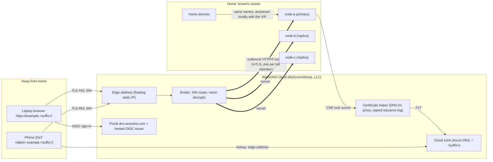

# WrenDNS Cloud (M36) — design

Status: design only (T36.1, fork #41, with #40 and #28). ADR-1047 to ADR-1052, all Proposed. M32's research and tasks are merged into M36. No code is written by T36.1. "WrenDNS Cloud" is a working name. Revised 2026-11-19 after an adversarial review (8 HIGH, 17 MEDIUM and 9 LOW findings; every HIGH and MEDIUM is addressed below).

WrenDNS Cloud is a hosted service run by MySummitKeep, LLC. It lets a household or small business reach its own WrenDNS nodes from anywhere, gives each tenant a public name and a roaming resolver, and makes one device setting work at home and away. The node stays the product: every answer, every policy decision, every secret and the authoritative audit trail stay on the tenant's own hardware.

## Goals and non-goals

### Goals

1. **Configure once, works anywhere.** A device is set up once with one name. At home that name reaches the local node directly. Away it reaches the same node through the cloud. The UI bookmark, the DoH URL and Android's Private DNS hostname are the same in both places. This holds for Android, Apple devices, Chrome and Edge, and Windows through a client; it does not hold for Windows 11's built-in DoH (see Client setup).
2. **The remote UI.** A tenant signs in once and opens any of their nodes' own UI from anywhere, with no port forwarding, no inbound firewall rule and no VPN.
3. **RBAC with create, update and remove per object kind,** enforced by the node on every request, with every change audited on the node under the hosted user's identity.
4. **A roaming resolver per tenant.** DoH and DoT at the tenant's name, with the tenant's own policy, device identity and privacy level, closed to everyone who does not hold a device key.
5. **Location-scoped names, managed names, dynamic DNS and DNS-provider integrations** (#40), split between the open-source node and the paid service.
6. **The cloud is never trusted with more than the signed-in user's role** (#41). A compromise of the hosted issuer alone must not let an attacker sign in to any node, because every sign-in over the relay also needs a factor the node holds. A compromise of the whole cloud must not give admin, node secrets or guarded work by default, and its one remaining attack (a man-in-the-middle with a certificate it mints) must be visible and must switch remote access off. The threat model states exactly what remains.
7. **Leaving is safe.** Cancelling, a billing lapse or the end of the service never breaks DNS at home: certificates and local records for hosted names keep renewing for every tenant that ever linked, until the tenant unlinks and moves their devices off (the "home keep-alive", ADR-1051).
8. **Cheap to run at launch.** Tens of dollars a month for the first tenants, and a cost per tenant that stays well under the price of the cheapest paid tier at 10,000 tenants.

### Non-goals

- **DNS never depends on the cloud** (AGENTS rule 5, CLU-004). Nothing on the answer path reads cloud state. A device at home never touches the cloud, and when one does by accident (a second resolver, IPv6 router advertisements, a guest VLAN), the node detects it and says so (Failure modes).
- **The cloud is not a cluster member,** not even an ephemeral one (ADR-1048). A cluster member can vouch for any user's role on a forwarded write (ADR-054), so a cloud member could forge admin writes for every tenant.
- **No second UI.** The cloud does not re-implement the node's pages. It has a small portal for tenant-level objects and links out to each node's own UI (the "UI for every feature" rule and spec/13's "no separate business logic").
- **No support access by default.** MySummitKeep staff cannot sign in to a tenant's node. A node admin can grant time-boxed access, audited on the node (phase 3).
- **No UDP 53 in the cloud.** The roaming resolver speaks only DoH and DoT (and DoQ later), so it cannot be used for reflection.
- **No LDAP** (owner priority). **No WireGuard overlay in the product** (ADR-1047). Bring-your-own Tailscale or Cloudflare Tunnel stays documented as the free self-hosted alternative.
- **Not a public authoritative DNS service** for tenant domains. That is M34 (#30). The cloud serves only its own zone.

## User stories

1. **The owner's configure-once story.** The owner runs a three-node Raspberry Pi cluster at home behind the VIP `dns.home.example.net`. They link the cluster to WrenDNS Cloud once and pick the vanity slug `example`. On their phone they set Android Private DNS to `p7kq3xw2mzr5tb4nhv6cjd2ys4.example.<suffix>` (the device's DoT name: a 26-character random label, shown as a QR code so nobody types it) and bookmark `https://example.<suffix>/`. At home, the phone's lookups of those names are answered by the cluster with the VIP, so DNS and the UI go straight to the Pis. On mobile data, public DNS answers the cloud's edge address, and the broker passes the same TLS connection through the tunnel to the same cluster. The phone gets the same device identity and the same entry in the query log in both places; away over DoT it gets public answers only, unless the owner allows internal names for that device (Device keys). They never touch the setting again. On a hotel network that blocks port 853, the phone shows "Private DNS server cannot be accessed" until the owner switches Private DNS to Automatic for that stay (Failure modes).
2. **Keep my own name.** The owner prefers `dns.home.example.net`. They add it as a custom name in the portal, publish an A and AAAA record (never a CNAME) from `dns.home.example.net` to the cloud's edge address at their DNS host (or let WrenDNS do it through the Azure DNS integration, #40), prove ownership with a TXT record, and publish a CAA record that lets only their own ACME account issue, by DNS-01. The broker then routes that SNI too, with the node's existing Let's Encrypt wildcard, and the node checks the CAA record before it calls the name "protected from the cloud" (phase 2).
3. **Fix a block from a café.** A parent at a café sees that a homework site is blocked on the child's tablet. They open the bookmark, sign in with the hosted account (single sign-on) and the passkey they registered on the node at home, and add an allow rule from the device's panel. The rule is written on the primary, audited as `oidc:https://id.<portal>/` with the client address the relay reported and the relay's correlation ID.
4. **A family member who can only pause.** The owner invites a partner as a tenant member. On the node, the owner maps that hosted user to a custom role that may update schedules and pause filtering, but not create or remove lists, records or clients. Until the owner maps them, the partner's sign-in waits with no access.
5. **A small office with two sites.** An office links two clusters (Office and Warehouse) to one tenant, each with its own slug. Each device is named `<device>.<location>.<domain>`. Staff laptops use the DoH URL of the cluster they belong to; at either site they reach the local cluster, and away they reach their own cluster.
6. **Dynamic DNS (premium).** A tenant wants `vpn.home.example-dev.<suffix>` to follow the home WAN address for a WireGuard endpoint. The primary reports its WAN address over the tunnel and the cloud updates the record. Names that point at anything but a WrenDNS node live under the separate `<slug>-dev.<suffix>` site (Names).
7. **An agent from anywhere.** The owner's agent manages the cluster through `/mcp` over the relay, with a node-issued agent token, its scopes and the kill switch, after an admin has turned remote MCP on (off by default).
8. **Unlink.** The owner clicks Disconnect on the node. The node first shows which devices still use hosted names and how to move each of them off (Unlink and move off). Then the tunnel closes, the cloud key is deleted, and the portal shows the cluster as unlinked. DNS at home does not notice.

## Architecture

The cloud has five parts. None of them sees a node's plaintext traffic, holds a node's secret, or can command a node.

- **The portal** (`dns.wrendns.com`): tenants, members, slugs, enrolled clusters and nodes (online state, role, version and last heartbeat from tunnel metadata), enrolment codes, device keys (IDs and DoT labels only), custom names, billing and the abuse contact. It is also the **hosted OIDC issuer**. It never renders node data.
- **The edge:** one stable public address pair (IPv4 and IPv6) for every tenant name and for `tunnel.<suffix>`. At launch it is a static public IP that is moved to the standby broker VM on failover; later a Standard Load Balancer frontend. Devices and nodes never see a broker VM's own address, so a failover changes nothing on any device (Platform).
- **The broker** (behind the edge): terminates each node's outbound tunnel, and routes each public TCP connection by its TLS SNI into the right tunnel without decrypting it.
- **The certificate helper:** completes ACME DNS-01 challenges in the cloud's own zone for CSRs that nodes send over the tunnel, limited to that tenant's names, and keeps a signed issuance log the node can read.
- **The cloud zone** (Azure DNS): one wildcard `*.<suffix>` pointing at the edge, and per-tenant records only where a wildcard cannot serve: `_acme-challenge` TXT records and dynamic DNS records (premium).

**Trust boundaries.** The browser and device TLS sessions end on the node, so the broker sees encrypted bytes, the SNI, timing and volume. The tunnel's own TLS ends at the broker; inside it, each stream is the raw bytes of one public connection, preceded by a PROXY v2 header the broker writes. The portal holds identities and tenant objects. The node holds everything else.

**Every frame from a node is untrusted input to the cloud.** The node is AGPL, so a tenant may run a modified one. Heartbeat strings are escaped wherever the portal shows them, CSRs are checked name by name against the tenant, dynamic DNS updates are checked against the tenant's records and ranges, and role and epoch claims are never believed alone (Cluster-aware routing). This rule is part of `spec/14` and T36.9's acceptance criteria. The same holds the other way: every byte the broker writes, including the PROXY header, is untrusted input to the node (below).

**Why not proxy HTTP.** A cloud that terminates TLS and proxies HTTP sees session cookies, CSRF tokens, query-log pages and every secret typed into a form, and could replay sessions. The UI also assumes it owns its host: base path `/` (`ui/vite.config.ts`), absolute `/api/v1` calls (`ui/src/lib/api.ts`), a CSP with `connect-src 'self'` and `frame-ancestors 'none'` (`crates/wrendns-api/src/ui.rs`), per-node sessions and a per-node `public_url` (ADR-045). With SNI passthrough nothing in the UI changes. A path-prefix proxy (`dns.wrendns.com/t/<slug>/`) would break the UI, and an iframe portal is blocked by the CSP.

## Node enrolment and the outbound tunnel

### The tunnel (ADR-1047)

- **Transport:** HTTP/2 over TLS to `tunnel.<suffix>:443`. TCP 443 outbound passes nearly everywhere, and `h2`, `hyper` and `rustls` are already linked, so the tunnel adds no runtime crate (AGENTS rule 8, the 25 MiB gate of ADR-916). QUIC (`quinn` is linked for DoQ and DoH3) is added later as the preferred transport with HTTP/2 as the fallback, the way Cloudflare Tunnel does, because UDP is often blocked.
- **Who dials:** every full member of a linked cluster opens one tunnel. Resolver pods and witnesses never do (they hold no secrets and serve no UI, ADR-1027 and the ADR-054 amendment).
- **Framing:** each public connection the broker accepts becomes one HTTP/2 stream. The stream starts with a PROXY v2 header carrying the caller's address and port and the SNI, then carries raw bytes in both directions. Control messages (hello, heartbeat, certificate requests, dynamic DNS updates) use the 4-byte length-prefixed prost frames of the cluster channel (ADR-044) on a control stream.
- **Heartbeats:** every 20 s, below the 4-minute idle timeout of Azure's and most middleboxes' defaults. Each carries `{node_id, cluster_id, role, epoch, ready, version, maintenance}`, and the primary's carries a role lease (Cluster-aware routing).
- **Reconnect:** full-jitter backoff from 1 s to a 5-minute cap, longer than ADR-044's 30 s, so a broker restart does not cause a thundering herd.
- **Stream budgets on the node.** Android, iOS and Chrome keep their DoT and DoH connections open, so each roaming device holds one or two streams all the time. DNS and UI streams therefore have separate budgets: up to 128 DNS streams (DoT and DoH to `/dns-query`) with HTTP/2 windows of 4 to 16 KiB, and up to 32 UI, API and MCP streams with windows of 64 to 256 KiB; a 1 MiB frame limit as in ADR-044. A stream beyond its budget is refused with a counted reason, never queued. Targets: at most 2 MiB more RSS idle and 12 MiB with both budgets full, measured in T36.4 against the 32 and 128 MiB gates (ADR-1031). The tiers' device limits are set from that measurement, not the other way round (Tiers).
- **Isolation from DNS:** the tunnel runs as its own task, with bounded queues and no lock shared with the pipeline (spec/02 §3 and §8). Its CPU use during a UI burst must not show in DNS p99 (bench-smoke covers it; Pi 4 lacks the ARMv8 crypto extensions, so ChaCha20-Poly1305 is preferred there and both suites are benchmarked).
- **"The tunnel is a socket, not an API."** Down the tunnel the cloud may only open a relayed byte stream, return certificate chains the node asked for, and acknowledge updates. Up the tunnel the node sends health and its own requests. There is no RPC through which the cloud can change a node's configuration.

### How the node treats a relayed stream

The PROXY header is written by the broker, so the node uses the address in it only to describe and limit, never to authorize.

- **Injected in-process.** A relayed stream is handed to the node's TLS acceptors as an in-memory stream carrying a "relayed" context flag and the header's fields. It is never a real socket, and no listener needs `proxy_protocol = true`; ADR-039's rule for PROXY on sockets ("mandatory when enabled, no source allowlist") is untouched.
- **Always remote.** A relayed stream is never loopback, never inside `allowed_admin_networks`, never break-glass (ADR-944), whatever its socket address.
- **Identity by key or label only.** A relayed stream never matches an IP or MAC client rule (ADR-976), never satisfies a wall display's network binding, and is never inside `[access] allowed_networks`. Its device is the one its DoH key or DoT label names, and nothing else; a relayed stream with neither is a browser or an agent and must sign in.
- **Header sanity.** The node refuses a relayed stream whose PROXY address is private (RFC 1918, RFC 4193), loopback, link-local, shared address space (RFC 6598) or inside the tenant's own LAN ranges, and counts it as `relay_header_refused`. The broker never has a reason to send one.
- **What the address is used for.** Rate limits, lockout, the audit log and the query log record the reported client address, so one person's failed sign-ins do not lock out everyone behind the broker. Because the broker could rotate that address, step-up lockout is also kept per account: 10 failed second-factor attempts in 15 minutes lock that account's relayed sign-in for 15 minutes, whatever the addresses.
- **Correlation.** The audit entry records the relay's correlation ID, so the cloud's log and the node's log can be joined without either holding the other's data.
- **Refused over the relay unless the node opts in:** local password sign-in, HTTP Basic, the setup token, sessions created on the LAN (below), secret writes (`PUT`/`DELETE /api/v1/secrets`), guarded settings, backups, user and token management, and the `[cloud]` settings themselves. Over the relay, sign-in is OIDC through the hosted issuer plus the node's own factor (below). Each opt-in is a guarded, admin-only setting, and admin and guarded work over the relay has the extra conditions of "Admin work from away".

### Enrolment (ADR-1048)

1. An admin on the primary opens **Settings → WrenDNS Cloud** and clicks **Link this cluster**, or runs `wrendns cloud link`.
2. The node calls the portal (outbound) and gets a short user code such as `WREN-7K3Q` and the URL `dns.wrendns.com/link` (RFC 8628 device authorization grant). The code lives 10 minutes, is single use and is rate limited.
3. A tenant admin signs in to the portal and enters the code. **The confirmation page shows what is asking to join:** the cluster's name, its node names, the source address and its rough region, and the WrenDNS version, and says "only continue if you are standing next to this cluster". This is the defence against device-code phishing, in which an attacker starts `link` on their own node and talks a tenant admin into entering the code.
4. The admin picks the tenant and confirms the slug. **Each slug is bound to one cluster.** Binding a second cluster to a tenant gives it its own slug; moving a slug to another cluster needs confirmation on a node of the cluster that holds it. The helper issues a slug's names only to the cluster bound to it.
5. The node, polling, receives the tenant binding: the tenant ID, the slug, the hosted issuer's URL and the tunnel CA's public keys (below).
6. For headless and Kubernetes installs, the portal issues an enrolment token (`wren_enrol_...`, single tenant, expiring, only its hash stored) that is set through a secret file, like the existing join token.

**Keys.** Each full member generates its own cloud key (Ed25519) in `<data_dir>/cloud/`, mode 0600, node-local and never replicated, like `node.key` (ADR-903's node-identity row). The cloud CA issues it a client certificate of about 30 days, carrying tenant, cluster and node IDs, renewed over the tunnel at two thirds of its life (as ADR-057 does for the cluster). The primary countersigns each member's first request over the cluster channel, so joining the cluster is enough to bring a member online.

**Coming back after a long time offline.** A node powered off for longer than its certificate's life presents an expired certificate signed by its own cloud key plus a fresh countersignature from the current primary. The cloud accepts that within a 180-day grace period from expiry, if the node has not been removed; after that, or for a single-node cluster whose key is lost, the cluster links again. It is a failure-table row.

**Why not the cluster certificate.** Reusing the node's cluster certificate with a pinned cluster CA needs no new key, but a cluster CA compromise would also be a cloud compromise, the cloud could not revoke one node without the others, and resolver pods hold cluster certificates too.

**Mutual authentication.** The broker presents, for `tunnel.<suffix>`, a certificate from a private tunnel CA run by the cloud (not a WebPKI certificate, whose key may change at every renewal). The node pins that CA's public key and a backup key, both delivered at enrolment; a rollover to a new CA key is announced in the hello message, signed by the current CA key, at least 30 days ahead. The broker checks the node's client certificate.

**Revocation and removal.**
- Remove node in the portal closes the tunnel and denies the certificate serial at once.
- Disconnect on the node deletes the cloud key and tells the cloud.
- When a member is removed from the cluster registry (ADR-143), **the primary tells the cloud at once** over its tunnel. The cloud denies that node's cloud certificate serial, closes its tunnel, and the helper revokes the node's TLS certificates for the tenant names with Let's Encrypt. A removed or stolen node therefore stops receiving relayed streams within seconds, not at its next renewal.
- Every enrol, renew, revoke and slug change is audited on both sides.

### Cluster-aware routing

- `<slug>.<suffix>` routes **primary first and sticky**: to the connected member that holds a valid primary lease, else a ready replica in a stable order (lowest node ID). Reads work on any member (ADR-053), and writes on a replica are forwarded (ADR-054); with no primary, writes get the existing 503 and read-only banner. The broker re-routes only when the target disconnects, turns unready, enters maintenance (ADR-118) or a new lease is seen.
- **A primary claim needs proof.** A heartbeat's `role = primary` and epoch are not believed alone, since a removed or modified node could claim them to capture the cluster name and collect sessions. The primary's heartbeat carries a lease `{cluster_id, node_id, epoch, expires}` signed with the primary's cloud key, and the broker routes the cluster name to it only when a majority of the tenant's connected tunnels report the same primary and epoch (for a one-node cluster, the node itself; spec/12 §5's fencing rule supplies the epoch).
- `<node>.<slug>.<suffix>` always reaches that node (node comparison, drills, support). Node names must not look like a device label: a node name of 26 base32 characters is refused.
- **OIDC redirects.** Users arrive at `<slug>.<suffix>`, at home through the VIP and away through the broker, so a callback sent to the node's own name would miss the sign-in state cookie (host-only, `SameSite=Lax`, `Path=/api/v1/auth/oidc`, `crates/wrendns-api/src/auth/routes.rs`). Each node therefore registers two redirect URIs with the hosted issuer, `https://<slug>.<suffix>/api/v1/auth/oidc/callback` and `https://<node>.<slug>.<suffix>/api/v1/auth/oidc/callback`, and picks the one matching the request's Host header when that host is on its allowlist (its own names and any verified custom name); any other Host gets the node name. `auth.oidc.public_url` (ADR-045) becomes a short list for the hosted provider. When the routed node changes, single sign-on is a silent redirect. T36.6 tests both entries.
- Cluster-signed sessions (ADR-045's named follow-up) are a later improvement, not needed for v1.

### The `[cloud]` section

Node-local and admin-only, with a UI panel (Settings → WrenDNS Cloud), a help topic and Playwright tests, per the "UI for every feature" rule. It holds: linked or not, tenant and slug (read-only), remote UI on or off, remote MCP on or off (off by default), the hosted-provider role cap, the opt-ins listed above, remote admin (off by default, below), the roaming listeners on or off, internal names over relayed DoT (off by default), and the CT watch with its state. MCP gets a read tool `cloud_status`; linking and unlinking are never for agents (they join spec/13 §3.2's list), because linking changes who can reach the node.

## The remote UI

- **The portal** at `dns.wrendns.com` lists the tenant's clusters and nodes and links out to `https://<slug>.<suffix>/` (the cluster, primary first) and `https://<node>.<slug>.<suffix>/` (one node). It shows only what the tunnel metadata tells it: online, role, version, last heartbeat, certificate expiry, and the reason a node is unreachable.
- **The node's own UI** does everything else, unchanged: the same pages, the same streaming Queries, Map and Wall pages, the same CSP. A node shows a small "Reached through WrenDNS Cloud" note in the header when the request came over the relay, so the user knows which path they are on.
- **Cookies.** The session cookie becomes `__Host-wrendns_session` (`Secure`, `Path=/`, no `Domain`), so a web server at a sibling name cannot set or shadow it, and the OIDC state cookie becomes `__Host-` as well with the callback path checked on the server. The old name is read for one release (ADR-1028's pattern). This also helps LAN-only nodes.
- **Bandwidth:** the UI is about 510 KiB gzipped on first load (within its 512 KiB budget, T33.2) and cached afterwards; dashboards are small JSON; the live tail and the map streams are bounded by their existing page limits. The broker caps each node at a configurable rate (2 to 5 Mbit/s) to protect home uplinks and the broker.
- **Latency:** each UI request adds the cloud-to-home round trip (about 20 to 80 ms in-region). HTTP/2 multiplexing avoids per-request handshakes.
- **A fleet view across clusters** (story 5) is deferred. If it comes, it is an opt-in mode in which the portal reads summaries the nodes push, never node pages.

## Identity, tenancy and RBAC (ADR-1049)

### Tenancy

- A **tenant** is an account: a household or a business. It has **members** (hosted users), one or more **slugs** (one per cluster), linked **clusters**, **device keys**, **custom names** and a billing state.
- Portal roles govern portal objects only: **owner** (billing, delete the tenant, transfer), **admin** (members, slugs, enrolment, device keys, custom names), **member** (sees the tenant's clusters and links). Each portal object kind has create, update and remove permissions held by these roles, and every portal change is in the cloud's append-only tenant log.
- The cloud's checks decide only who may reach which tenant's relay. They are a convenience gate, never the security boundary for node data.

### Sign-in on the node

- The portal is an OIDC issuer. Linking adds it to each node as a node-managed `[[auth.oidc.provider]]` (ADR-968), with PKCE, `aud` and `azp` checks and JWKS rotation already built (ADR-951).
- The hosted token asserts identity only: `sub`, email and the tenant ID. **For this provider the node ignores group claims.** The role comes from a node-local table that maps hosted subjects to node roles, set by a node admin, or approved by one after a user's first sign-in. **Until then the subject is pending and has no access**, not even `viewer` (which reads the query log, docs/running.md Roles). The pending list is shown to admins with the email and time; pending entries expire after 7 days.
- **A node-held factor on every relayed sign-in.** Over the relay, a hosted sign-in completes only with a second factor that the node holds and the user enrolled on the LAN: a passkey (WebAuthn, the preferred factor, added in T36.6) or TOTP (built). Split horizon makes the WebAuthn relying-party ID `<slug>.<suffix>` the same at home and away, so a passkey registered at home works away. A hosted subject with no node factor enrolled cannot sign in over the relay at all; at home, on the LAN, the hosted sign-in works without it (the LAN is the enrolment place). This is what makes an issuer compromise on its own useless.
- **Sessions remember where they were made.** Each session records how it was created (password, hosted OIDC, with or without the node factor) and whether over the relay or the LAN. Over the relay, the node accepts only sessions created over the relay with the hosted issuer and the node factor; a session made at home with a password is refused there and the user is asked to sign in again. A session never exceeds `max_role` over the relay.
- **Role cap:** a node setting `max_role` for the hosted provider, default `operator`.
- **Agents** through the relay use node-issued tokens (AGT-004) with their scopes, rate limit and kill switch. The hosted issuer may later act as the OAuth authorization server for MCP (AGT-008), but the node always issues and scopes the token.

### Admin work from away

A second factor does not stop a man-in-the-middle who holds a valid certificate for the same name: they relay the TOTP code in real time, and a passkey's origin check passes because the origin is the same. The cloud can mint such a certificate for hosted names, because it controls their zone (ADR-1051). So:

- **Admin and guarded work over the relay is off by default.** Over hosted names, the node refuses admin-only and guarded routes from relayed sessions, whatever the role and the cap. Operator work (the café story) is allowed.
- **It can be turned on in two ways**, each a guarded admin setting made on the LAN:
  1. on a **verified custom name** only (story 2): the tenant's own domain, an A/AAAA record (no CNAME), the tenant's own certificate, and a CAA record with the tenant's own `accounturi` and `validationmethods=dns-01` that the node has checked. The cloud cannot get a certificate for that name, so it cannot sit in the middle;
  2. or with **out-of-band approval**: each admin action from away waits until a session already signed in on the LAN (a phone at home, the wall display's owner) approves it, with the action shown in full.
- **The CT watch blocks remote access** as soon as it sees a certificate for the node's names with a key that is not the node's (ADR-1051): relayed sign-in and relayed sessions are refused, health turns severe, and an admin on the LAN must acknowledge before remote access resumes. DNS is not affected.

### Create, update and remove per object kind

- A **custom role** is a set of `(kind, verb)` permissions: kinds are the node's object kinds (clients, groups, lists, quick rules, records, forwards, upstreams, schedules, CMDB items, locations and the rest of the managed kinds), verbs are `create`, `update`, `remove` and `read`.
- `viewer`, `operator` and `admin` become built-in presets of the same table. Existing roles behave exactly as today.
- The verbs map onto routes in the deny-by-default table agent tokens already use (`required(method, path)` in `crates/wrendns-api/src/auth/agent.rs`). A token's effective permissions stay the intersection of its scopes and its owner's role (ADR-064).
- **Create versus update.** The API's `PUT` is an upsert, so the primary decides which verb applies by checking whether the object exists under the `If-Match` version, inside the same write. A forwarded write carries the user's role name; the primary resolves the role to its permissions (roles replicate like users, ADR-045).
- Guarded routes and the never-for-agents list (spec/13 §3.2) stay admin-only whatever a custom role says.
- Custom roles are useful without the cloud and ship in the AGPL node first (T36.3).

### Audit across both sides

- **The node's hash-chained audit stays authoritative.** Hosted sign-ins are recorded as `oidc:<issuer>/`, with the hosted email, the factor used, the client address the relay reported (marked as reported by the relay), and the relay correlation ID.
- **The cloud keeps its own append-only log** of tenant events: sign-ins, enrolment, slug changes, device-key issue and revoke, custom names, certificate issuance, support grants. It never records node content.

## The roaming resolver (ADR-1050)

### Path: home relay first

In v1 the broker routes DoH (443) and DoT (853) for a tenant's names by SNI into the tunnel, and the **home node answers**. Policy, device identity and the query log are exactly the home ones, and the cloud runs no resolver per tenant.

- Cost: one cloud-to-home round trip per query. DoH and DoT keep their connections open, so this is one round trip per query, not per handshake. Volume per device is small (about 2,000 to 5,000 queries a day at 200 to 300 bytes each way, 1 to 3 MB a day).
- **Roaming DNS fails closed when home is unreachable.** When the home uplink, the tunnel or the whole home cluster is down, devices with a strict Private DNS setting or a DNS Settings profile have no DNS at all, even on mobile data, until they reach a working network or the user switches the setting off. The Cloud tier says so in plain words where it is sold (Tiers), and the setup page says so before the device is configured.
- **Later (a paid tier):** the broker falls back to a **cloud resolver** when a tenant's tunnel is down. It runs the tenant's policy from signed snapshots the primary pushes over the tunnel (spec/02 §5's manifest signature and content-addressed blobs), which the cloud verifies but cannot forge. It is multi-tenant (one process per tenant does not fit at scale under the 32/128 MiB gates of ADR-1031), never a cluster member, shares a cache only for unmodified public answers, keeps per-tenant partitions for any answer policy changed, and never serves a tenant's local records. Its design is its own task (T36.12), and it absorbs M32's stateless cloud profile and Azure templates. Whether a minimal "tunnel down" fallback (public answers with the tenant's block lists only) comes before the paid tier is an owner decision.

### Device keys and the open-resolver gate

- Every roaming query must carry a known **device key** or **DoT label**. Both are at least 128 random bits, encoded as 26 base32 characters so they fit one DNS label.
- **DoH:** `https://<slug>.<suffix>/dns-query/<device-key>`. The key travels inside TLS and is a secret.
- **DoT (Android Private DNS):** the hostname `<dot-label>.<slug>.<suffix>`, covered by the node's `*.<slug>.<suffix>` wildcard. The label is as long and random as a key, but it is sent in clear in the SNI and in the bootstrap lookup, which every café or carrier resolver on the path sees. It is therefore a **leaked credential by design**, and relayed DoT is limited to match:
  - **Public answers only by default.** A relayed DoT query gets the device's filtering policy, but no local records, no CMDB or location names, no answers for the hosted names other than the edge, and no PTR answers for private ranges. Internal names away from home need DoH with a key, or an admin's opt-in for that device ("internal names over DoT").
  - The broker refuses a DoT label it does not know before any byte reaches the node (it routes by label already).
  - A label used from two networks (different ASNs) at once raises a health note on the device's panel and offers rotation.
  - The device is matched by its label (ADR-039's client ID from SNI), never by its address.
- **The gate on the node** is T32.1's known-ID gate (`require_client_id`, now T36.2), keyed on the stream's "relayed" (or public-listener) context flag, not on a listener as a whole, because relayed streams enter the same TLS acceptors that serve LAN DoH without keys. Unknown, revoked and missing IDs are refused identically within each transport: DoH answers 404, as ADR-039 already does for an invalid client ID (the HTTP layer refuses before the resolver), and DoT answers REFUSED with an extended DNS error. Both are counted, never say whether an ID exists, and are rate limited per address and per ID.
- The broker also refuses connections for slugs that do not exist, before any byte reaches a node. A suspended tenant keeps its home keep-alive (ADR-1051) but its relay is refused.
- Device keys and labels are created on the node (the device's panel: Add a device away from home), so the node's CMDB device identity is the anchor (#41). The node tells the cloud the key's ID and its DoT label, never the DoH key itself; the cloud needs only the labels it routes.

### Client setup per OS

| Platform | Native support | Setup WrenDNS generates | Configure once? |
|---|---|---|---|
| Android 9 and later | Private DNS is DoT only, on port 853, by hostname | the hostname `<dot-label>.<slug>.<suffix>`, shown with a QR code | **Yes, on networks that allow port 853.** The hostname is resolved through the current network's DNS: the node at home, public DNS away. Captive-portal sign-in works (Android lets the portal check bypass Private DNS), but a network that blocks 853 leaves strict mode with no DNS ("Private DNS server cannot be accessed"); the escape is switching to Automatic, which does not use the hostname. For DoH on 443, a permissive client such as Rethink DNS (Apache-2.0) with the DoH URL. Android 11+ upgrades only well-known resolvers to DoH3. |
| iOS and iPadOS 14+, macOS 11+ | DoH and DoT through a DNS Settings profile | a `.mobileconfig` with the DoH `ServerURL` carrying the device key and OnDemand rules, without `ProhibitDisablement`, so the user can always turn it off. Declarative configuration needs MDM and is not used. On an unsupervised iPhone the user installs the profile and then turns it on under Settings → General → VPN & Device Management (the wording varies by version) | **Yes, except on captive portals.** The ServerURL host is resolved through the current network. DNS Settings profiles are known to break some captive portals (hotel and in-flight Wi-Fi), and OnDemand rules do not reliably fix it; the escape is turning the DNS setting off under Settings → General → VPN & Device Management → DNS until signed in. |
| Windows 11 | DoH, but only for a server **IP address** paired with a template; Windows will not resolve a DoH server from its name | Chrome or Edge's Secure DNS template (recommended), or dnscrypt-proxy (ISC) as on Windows 10 | **Not with the built-in DoH.** Pointing the adapter at the edge's IP would send every home query through the cloud and fail when the cloud fails, and DDR (ADR-904) cannot help because it needs a certificate with an IP address, which Let's Encrypt cannot issue for the home VIP. T36.8 tests DNR (DHCP option 162, RFC 9463; Windows Insider builds only as of the last check) and documents the built-in DoH only as a manual "away only" profile. |
| Windows 10 | No native DoH | a dnscrypt-proxy (ISC) configuration | Yes, through the client. |
| Chrome and Edge on any OS | Secure DNS with a custom template | the DoH URL | Yes. |

**The "Add a device away from home" page** on the node creates the key or label, shows the per-OS setup with its limits (port 853, captive portals, home down), a QR code and a single-use setup link that expires, and works through the API and MCP (plan-only for agents, AGT-007). This is M32's T32.6, now T36.8. Client apps of our own (M32's T32.7) are not planned; the recommendation is to document permissive third-party clients first. T36.8 also tests the edge over IPv6, including NAT64 on IPv6-only carriers, and the edge is dual-stack.

## Configure-once names and certificates (ADR-1050, ADR-1051)

### Names

- **The portal is `dns.wrendns.com`** (the owner's name for the public website). **Tenant names live under a dedicated suffix**, working name `<suffix>`, on a separate registrable domain listed in the private section of the Public Suffix List. Each `<slug>.<suffix>` is then its own registrable domain:
  - browsers treat each tenant as its own site, so one tenant's cookies can never reach another tenant or `wrendns.com`;
  - Let's Encrypt's limit of 50 new certificates per registered domain per 7 days applies per tenant, not to the whole service;
  - Safe Browsing reputation of one tenant does not touch the brand domain.
  Nabu Casa (`ui.nabu.casa`), DuckDNS, ngrok and trycloudflare all do this. A PSL entry is slow to add and hard to remove, the domain must have at least two years left on its registration, and the PSL guidelines refuse entries whose main purpose is to get around Let's Encrypt's limits: the request must lead with cookie isolation between tenants. So the domain is the first decision.
- **Until the PSL entry is live, the whole suffix shares 50 new certificates a week.** With one certificate per node, that is about 16 three-node tenants a week. Phase 2 therefore files the PSL request and Let's Encrypt's rate-limit adjustment request (its form says to allow a few weeks) at the same time, before the beta opens, and the beta admits tenants within the limit until one of them is granted.
- **The names a tenant gets.** Every name under `<slug>.<suffix>` resolves only to a WrenDNS node of that cluster (at home) or to the edge (away):
  - `<slug>.<suffix>`: the cluster (UI, API, MCP, DoH);
  - `<node>.<slug>.<suffix>`: one node;
  - `<dot-label>.<slug>.<suffix>`: a device's DoT name;
  - `<location>.<slug>.<suffix>`: a location's node (below).
- **Names for anything else live on a separate site,** `<slug>-dev.<suffix>`: managed device names (`<device>.<location>.<slug>-dev.<suffix>`) and dynamic DNS records (`vpn.<location>.<slug>-dev.<suffix>`). Under the PSL, `<slug>-dev.<suffix>` is a different site from `<slug>.<suffix>`, so a camera's or printer's web page at a managed name cannot set cookies for the node UI or send it same-site requests. Slugs may not end in `-dev`.
- **Split horizon, created automatically.** Linking creates node-managed local records (ADR-968) that answer those names at home with the cluster's VIP or the node's own LAN address (the owner's words: "the local DNS record to be created that would resolve to the local node"). Publicly, the cloud zone's one wildcard `*.<suffix>` answers every tenant name with the edge, so a new tenant needs no record and a deleted one leaves none behind. A node keeps answering its local copies when the cloud is down. The node requires that it is the only resolver its LAN uses for hosted names: the docs say to give WrenDNS as the only DNS server in both DHCPv4 and IPv6 router advertisements (RDNSS) and on every VLAN, and the node detects a home device that uses the cloud path anyway (Failure modes).
- **Slug rules:** lowercase `a-z`, `0-9` and hyphen, 6 to 32 characters, no `xn--`, not ending in `-dev`; a reserved list (wrendns, admin, www, api, mail, tunnel, edge, brands, the most visited sites) and a confusable check. **Opaque by default** (a random slug), vanity opt-in, because the slug is public in CT logs. **Never recycled**: a released slug is quarantined for good, so old devices' DNS can never go to a new owner (and their device keys would be refused anyway).
- **Custom names** (story 2, phase 2): a tenant publishes an A and AAAA record (not a CNAME) for its own name to the edge address and proves ownership with a TXT record; the broker routes that SNI too, and the node presents its own certificate for it. A CNAME into the cloud's zone would let the cloud complete TLS-ALPN-01 (and HTTP-01, if it ever served port 80) for the tenant's name, and a name holding a CNAME cannot carry its own CAA record (a CAA lookup follows the CNAME, RFC 8659). So the tenant also publishes CAA with its own `accounturi` and `validationmethods=dns-01`, and the node checks both before it marks the name "protected from the cloud". The edge address is stable (Platform), so an A record does not go stale; if it ever changes, the portal warns 90 days ahead.

### Certificates (ADR-1051)

- Each node needs a certificate for `<slug>.<suffix>`, `*.<slug>.<suffix>` (one wildcard level covers node names, DoT labels and location names) and its own `<node>.<slug>.<suffix>`. Naming the node explicitly makes each node's set of names different, so Let's Encrypt's limit of 5 certificates per exact set of names per 7 days applies per node and re-enrolling a rebuilt node does not use up the cluster's allowance; renewals through ARI are exempt from the limits, first issuances are not.
- **The node makes its own key and CSR** (with `rcgen`, already linked). The CSR goes over the tunnel to the certificate helper, which checks that every name belongs to that tenant's slug and cluster, completes the DNS-01 challenge in the cloud zone and returns the chain. The private key never leaves the node, no DNS credential sits on customer hardware (#40), and the node needs no ACME client for this path. Three nodes renewing at once share one `_acme-challenge` record set, so the helper adds and removes its own TXT values with Azure DNS etags and never replaces the set.
- **Lifetimes are shrinking.** Let's Encrypt's opt-in `tlsserver` profile issues 45-day certificates from 2026-05-13; the default becomes 64 days on 2027-02-10 and 45 days on 2028-02-16, with a 7-hour authorization reuse period. Renewal is timed by ARI, not a fixed 60 days.
- **The home keep-alive.** Configured devices use the hosted names at home too, so if a node's certificate expired, strict-mode devices would fail TLS at home. Renewal through the helper therefore never depends on the tenant's billing state: a tenant that ever linked keeps free renewal of its nodes' certificates, and its local records keep working, through suspension, cancellation and non-payment, until it unlinks. Suspension stops only the relay. A node whose renewal has failed raises a health warning at 30 days before expiry and a severe reason at 7 days.
- **DNS-PERSIST-01, to take the cloud off the renewal path.** Let's Encrypt announced DNS-PERSIST-01 on 2026-02-18; it works in staging, and production was targeted for Q2 2026 but has not been confirmed as of this design. When it is in production, the cloud publishes one standing validation record per node's ACME account, and the node renews directly with Let's Encrypt using the on-node ACME client from T36.10, with no live cloud needed. T36.7 includes a spike against staging, and the keep-alive stays until it lands.
- **Unlink and move off.** Before Disconnect, the node lists the devices that used hosted names in the last 30 days (from its own query log) with the steps to move each one to the tenant's own domain or the plain VIP, and keeps serving the hosted names with the current certificate until it expires.
- **CAA** on the suffix: RFC 8657 `accounturi` for the service's ACME accounts and `validationmethods=dns-01`, so no other ACME account and no HTTP-01 hijack can issue. CAA does nothing against a compromised cloud, which controls the zone and those accounts.
- **CT watch.** The operator controls the zone and the helper, so a compromised cloud could mint a certificate for a tenant name and run a man-in-the-middle on the relay. Each node watches for certificates covering its names whose key is not its own:
  - **Source:** SSLMate's Cert Spotter API (`/v1/issuances?domain=<slug>.<suffix>&include_subdomains=true`, free for 100 queries an hour per address), polled once an hour per slug by the primary, with `after` paging; never the cloud itself. Wildcards mean one query covers a cluster. No new crate (`hyper` and `serde_json` are linked).
  - **The cloud's side:** the helper keeps a signed issuance log, and the node compares the two: a CT entry that is neither its own key nor in the signed log is a breach; one in the log but not requested by the node is too.
  - **On a hit:** remote access is blocked (Admin work from away), health turns severe, an event marker is set, and the docs say plainly that the operator could mint such a certificate and that this watch is how it would be seen. CT logs can take up to about a day to show a certificate, so the watch shortens a man-in-the-middle; it does not prevent the first hours of one.
  - The watch is an outbound call off the DNS path; its failure is a degraded health reason only.
- Existing hot reload of certificate files applies; the node writes the new chain atomically next to its key.

## Location-scoped names, dynamic DNS and DNS-provider integrations (#40)

### Locations (AGPL node)

- A **location** (Home, Work, Site1) is a first-class object: a label, the networks or VLANs that belong to it (CMDB network CIs and router reads), the nodes that serve it, and an optional parent domain.
- Device names become `<device>.<location>.<domain>`. A device's location follows its network; a device that moves keeps one CMDB identity and its name follows it. Each location answers its own names and may see the others' (a shared or private setting, split horizon by location).
- With the cloud, `<domain>` for device names is `<slug>-dev.<suffix>` (managed names); `<location>.<slug>.<suffix>` names only that location's node. Without the cloud, the tenant's own domain.
- UI: a Locations page; the map, the inventory and the CMDB group by location; a help topic; Playwright.
- Locations do not change how a query is answered beyond the records they create; they are names, not policy.

### DNS-provider integrations (AGPL node)

- A `[[dns_provider]]` table, with a UI under Settings → DNS providers, through which a node writes records at the operator's own DNS host: Azure DNS, Cloudflare, Route 53, GoDaddy and others. The provider list is a plug-in table.
- Uses: ACME DNS-01 for the node's own certificates (M32's T32.5 for self-hosters, replacing the owner's hand-run lego), dynamic DNS for the tenant's own domain, publishing a custom name's A, AAAA and CAA records (story 2), and optionally publishing chosen local names publicly.
- Each credential is a stored secret (ADR-903, ADR-917), scoped as narrowly as the provider allows: Azure RBAC on one record set (the owner's service principal limited to `_acme-challenge.home` is the model), a Cloudflare token for one zone, a Route 53 policy on one record name. When a provider cannot scope a token, the docs recommend a CNAME delegation of `_acme-challenge` to a narrowly scoped zone.
- Provider notes to verify in T36.10: GoDaddy restricted its DNS API in 2024 to large accounts and has since loosened the rule (sources disagree on today's terms); Network Solutions has no documented public DNS API that this research found, so it is supported through CNAME delegation only.
- Every write is audited. Provider writes are never for agents (they join spec/13 §3.2's list), because a provider credential can change public DNS.
- An on-node ACME client needs a crate (for example `instant-acme`, permissive) after `cargo-deny` and with its image delta reported. The hosted path needs none today; DNS-PERSIST-01 would reuse it.

### Managed names and dynamic DNS (paid)

- **Managed names:** `<device>.<location>.<slug>-dev.<suffix>`, served at home by the node and publicly (when the tenant chooses) by the cloud zone, with certificates through the helper. No public DNS zone or credential on the tenant's side.
- **Dynamic DNS:** a public A/AAAA record such as `vpn.<location>.<slug>-dev.<suffix>` that follows a location's WAN address.
  - **One reporter:** only the primary reports, so nodes with policy routing or several WANs do not make the record flap. The IPv4 address is the tunnel's source address as the broker sees it (no third-party "what is my IP" call); the IPv6 address is the node's global address for the location, reported separately and checked against the tunnel's IPv6 source prefix when there is one.
  - **CGNAT:** many home links (Starlink, T-Mobile Home Internet and others) sit behind carrier-grade NAT, where the address the broker sees cannot be reached inbound. The node compares it with the router's WAN address (read from UniFi or another router integration, ADR-976); when they differ, or the router's WAN is in 100.64.0.0/10, the IPv4 record is not published and the panel says why. Without a router read, the record is published with a "not verified reachable" note.
  - The cloud rate limits updates (one a minute, TTL 60 s) and refuses addresses in private or reserved ranges.
- For a tenant's own domain, dynamic DNS goes through the DNS-provider integration instead, with no cloud involved (free, AGPL).

## The threat model

Assets: node secrets and stored query logs; home policy; sign-in sessions; device keys; tenant identities and billing data; the brand domain's reputation.

| Component | Threat | Mitigation |
|---|---|---|
| Portal and issuer | Account takeover of a tenant admin, or a compromised issuer minting subjects | WebAuthn or TOTP required for portal owners and admins; unmapped subjects are pending with no access; every relayed sign-in also needs a factor the node holds, enrolled on the LAN; the node maps and caps roles itself |
| Portal | Forged enrolment, device-code phishing, slug transfer | The confirmation page shows the requesting cluster's name, nodes, source and region; one cluster per slug; moving a slug is confirmed on the cluster that holds it |
| Portal | Disclosure of the tenant list, emails, billing | Minimal data, encrypted at rest; Stripe holds card data |
| Portal | Malicious node data shown in the portal (a modified AGPL node) | Every node frame is untrusted input: escaped, length-limited, checked against the tenant (spec/14) |
| Tunnel | A stolen cloud key lets an attacker pose as the node and receive relayed streams | The streams are TLS to the node's own certificate, so an attacker without the node's TLS key gets ciphertext only; cloud certificates are short-lived and revocable from both sides |
| Tunnel | A removed or stolen member keeps serving, or claims primary to capture the cluster name | The primary reports removals at once; the cloud denies the node's serial and the helper revokes its TLS certificates; primary claims need a signed lease and a majority of the tenant's tunnels |
| Tunnel | The cloud commands the node | No command channel exists; the cloud can open byte streams and return certificates the node asked for |
| Tunnel | The broker writes a false PROXY address to borrow a LAN device's policy, a display's network binding or `allowed_networks`, or to dodge lockout | The address never authorizes; relayed streams match only keys and labels; private, loopback and LAN addresses refused; per-account step-up lockout |
| Broker | Cross-tenant routing | Routing by SNI only, to the tunnel whose client certificate holds that slug; never by a header |
| Broker | Reconnect storms, floods | Full-jitter backoff, per-tenant caps on streams, bandwidth and connections; DDoS IP Protection on the edge from the beta (Platform) |
| Certificate helper | Issuing for another tenant's names | The helper checks every CSR name against the tenant's slug and its bound cluster; every issuance in a signed log; CT watch on the node. CAA keeps other ACME accounts out, but does nothing against a compromised cloud |
| Certificate helper | Operator man-in-the-middle with a certificate minted by the cloud | Admin and guarded work off over hosted names by default; the CT watch compares CT with the signed log and blocks remote access on a hit; verified custom names with the tenant's own CAA (no CNAME) are out of the cloud's reach |
| Roaming resolver | Open-resolver abuse | No UDP 53; DoH and DoT only; a known key or label on every query; unknown labels refused at the broker; refused without saying whether a key exists; per-key and per-tenant rate limits |
| Roaming resolver | A leaked DoT label (it is in clear in SNI) used to read internal names or sweep PTR | 128-bit labels; relayed DoT gets public answers only by default; concurrent use from two networks flagged; rotation from the device's panel |
| Roaming resolver | A guessed or leaked DoH key | 128 random bits, inside TLS, revocable from the device's panel |
| Roaming resolver (cloud fallback, later) | Forged policy; cache snooping across tenants | Signed snapshots the cloud cannot forge; per-tenant partitions for policy-changed answers |
| Names | Cookie tossing or same-site requests from a device's page at a sibling name | `__Host-` cookies; names that point at anything but a node live on the separate `<slug>-dev` site |
| Names | Slug squatting, impersonation, phishing pages under the suffix | Reserved and confusable lists; verified or paid tenants only for public routing; abuse contact; Safe Browsing monitoring; kill-switch revocation; the PSL keeps abuse off `wrendns.com` |
| Names | A dangling slug after deletion | Never recycled |
| Node | The internet-facing sign-in page | Only OIDC through the hosted issuer plus the node's factor over the relay; passwords, Basic, setup token, LAN-made sessions and break-glass refused there; lockout per reported address and per account |

**Blast radius, stated honestly.**
- **A compromised issuer alone** can mint identities, but none of them signs in over the relay without the node-held factor of an already-mapped user, and new subjects stay pending with no access. It cannot read query logs, the CMDB or the live tail.
- **A compromise of the whole cloud** (issuer, broker, zone and helper) can deny service, see metadata (SNI, timing, volume, the client addresses of roaming devices), refuse to renew certificates (the keep-alive is a promise the attacker can break, which DNS-PERSIST-01 removes), serve wrong roaming answers from a cloud fallback resolver until devices return home, and mint a certificate for hosted names to run a live man-in-the-middle. With that, it can capture the traffic of users who sign in while it lasts, and act as them up to `max_role` and the operator level (it relays their factor in real time); that includes reading the query log and the CMDB pages they open. The CT watch reports it, usually within a day, and then blocks remote access. It cannot do admin or guarded work over hosted names while those stay off by default, read node secrets, forge cluster writes, reach a node that has unlinked, or touch a verified custom name with the tenant's own CAA.
- With an HTTP proxy design, or with the cloud as a cluster member, the same attacker would be admin on every node at once, with nothing to detect: that is why neither is chosen.

The docs say this in plain words: roaming queries and remote UI traffic pass through MySummitKeep's broker encrypted, the broker sees which device connected from where, a cloud fallback resolver would see queries in clear, and the operator could in principle mint a certificate for hosted names, which the node is built to notice.

## Privacy and data residency

- **Roles.** For relayed UI traffic and roaming queries, the tenant is the controller of their household's or business's data and MySummitKeep, LLC is a processor. That needs terms of service with a data processing agreement (GDPR Art. 28), a subprocessor list (Microsoft Azure, Stripe, the email provider, SSLMate for nothing personal: the CT watch sends only the slug), and breach notification.
- **No query log at rest in the cloud.** In home-relay mode the cloud never sees a query in clear. A later cloud fallback resolver streams its query events home over the tunnel (the `ship` telemetry mode, CLU-007) through a small bounded memory buffer that is dropped if the node stays offline, after applying the tenant's privacy level (ADR-102). The cloud keeps counters per tenant and device key only.
- **Roaming devices' addresses are location data**, including children's. The broker keeps a connecting device's address only in memory, for rate limiting and the PROXY header, and logs no per-connection or per-device address. It stores counters per tenant and device-key ID (connections, bytes, refusals) by the hour. The node's own query log holds the address the relay reported, under the tenant's privacy level, like any LAN query.
- **What the cloud stores:** tenant and member identities (email, OIDC subject), slugs, cluster and node IDs, device key IDs and DoT labels (never DoH keys), custom names, certificate issuance records, tunnel metadata (each node's tunnel source address, connect and disconnect times, version), the hourly counters, billing state through Stripe, and its own tenant event log. Retention: the event log 1 year, tunnel metadata and counters 30 days, deleted tenants purged within 30 days except what tax law requires.
- **Residency at launch:** one US region, disclosed in the terms and the privacy policy. EU tenants mean a transfer to the US under Standard Contractual Clauses. The EU-US Data Privacy Framework survived the General Court in Latombe (3 September 2025) but the appeal (C-703/25 P) is pending, so SCCs are the steadier basis. An EU region with tenant pinning comes when demand justifies it.
- **CCPA:** MySummitKeep is likely under the thresholds at launch; the privacy policy already grants state-law rights to every US user. Revisit at tens of thousands of tenants.
- **Children.** A family's devices produce children's queries and children's locations. `docs/legal/privacy.md` §2.4 says the site is not for minors, but the hosted service processes minors' data on a parent's behalf. Counsel looks at COPPA and GDPR Art. 8; the design keeps no profiles, no query log at rest and no per-device address log.
- **Policy edits before launch:** `docs/legal/privacy.md` §3 says none of the software's data is sent to MySummitKeep LLC. That stays true for the self-hosted node and becomes false for a linked one, so a hosted-service section is added (what is collected, including roaming addresses held in memory only, residency, retention, the processor role) and the terms gain the DPA (T36.13).
- **CT logs** show the slug, node names (each node's certificate names it) and location labels if used, never device names or DoT labels, because those are covered by the wildcard.

## Failure modes (DNS never depends on the cloud)

"Configured devices" are devices set up the configure-once way: they use the hosted names at home too.

| What fails | DNS at home | Local UI and cluster | Remote UI and MCP | Roaming DNS | Certificates | Shown as |
|---|---|---|---|---|---|---|
| Broker or whole cloud down | unaffected, including configured devices while certificates are valid | unaffected | unavailable | unavailable in home-relay mode (strict devices fail closed); served by the cloud fallback resolver where a tenant has one | renewal paused; at 45 to 64 days a renewal at two thirds of life leaves about 15 to 20 days; warning at 30 days left, severe at 7 | `cloud_unreachable` (degraded, never severe, after 60 s), an event marker |
| Cloud down for longer than the remaining certificate life | plain DNS unaffected; configured devices fail TLS at home (strict mode fails closed) | the UI on the VIP and other names works | unavailable | unavailable | expired; escape: the unlink-and-move-off steps, or a DNS-provider integration on the tenant's own domain; DNS-PERSIST-01 removes this row | severe health on certificate expiry, as today |
| Tenant suspended or cancelled (billing, abuse) | unaffected: the home keep-alive keeps renewing certificates and local records | unaffected | refused at the broker | refused at the broker (fails closed away) | still renewed until the tenant unlinks | portal and node health note |
| Home uplink down | unaffected | unaffected | unavailable | unavailable (fails closed; fallback resolver where present) | renewal paused | the portal shows the cluster offline |
| Whole home cluster down | configured devices and every device lose DNS (as today without the cloud) | unavailable | unavailable | unavailable even on mobile data for strict devices, until the user switches the setting off or T36.12 exists | not renewed | the portal shows the cluster offline; the setup page warns of this before setup |
| Primary down, replicas up | unaffected | as today (read-only banner) | routed to a ready replica; writes get 503 | answered by the replica | each node renews its own | as today |
| Tunnel flaps | unaffected | unaffected | reconnect with backoff | reconnect | unaffected | `wrendns_cloud_tunnel_up`, `_reconnects_total`, `_streams`, `_streams_refused_total{budget}` |
| A node offline longer than its 30-day cloud certificate | unaffected | as today | that node unavailable until it renews | other members answer | renewed on return within the 180-day grace (node key plus the primary's countersignature); later, link again | `cloud_certificate_expired` (degraded) |
| Captive portal away | n/a | n/a | after sign-in | Android: the portal check bypasses Private DNS, then works; Apple: profiles can block the portal, the user turns the DNS setting off until signed in | n/a | documented per OS on the setup page |
| Port 853 blocked away | n/a | n/a | works (443) | Android strict Private DNS has no DNS; switch to Automatic, or use a DoH client on 443 | n/a | documented per OS |
| A home device uses the cloud path (second resolver, IPv6 RDNSS, guest VLAN) | that device's DNS runs through the cloud and fails with it | unaffected | n/a | n/a | n/a | the broker marks relayed streams whose source equals the tenant's own tunnel address; the node shows "a device at home is using the cloud path" with the device |
| CT watch sees an unknown certificate | unaffected | unaffected | relayed sign-in and sessions refused until a LAN admin acknowledges | keeps working (DNS answers carry no session to steal; the device panel notes the alert) | unaffected | severe health, event marker |
| Portal down, broker up | unaffected | unaffected | existing sessions work; new hosted sign-ins fail | unaffected | unaffected | portal status page |

Local names keep resolving at home in every case, because the node holds its own copies of the split-horizon records. Nothing on the DNS path waits on the tunnel, the issuer or the helper.

## The platform and the cost model

### Platform at launch

- **Portal and issuer:** Azure Container Apps, Consumption plan, HTTP ingress with a managed certificate. It can scale to zero between sign-ins.
- **Broker:** two small Azure VMs (one active, one warm standby), because SNI passthrough and DoT on 853 need raw TCP ingress. Container Apps' HTTP ingress terminates TLS, and its TCP ingress needs a VNet environment and cannot expose 80 or 443. Long-lived tunnels mean the broker cannot scale to zero.
- **The edge address:** one Standard static public IPv4 and one IPv6, attached to the active VM. On failover, a watchdog moves them to the standby (disassociate and associate, about a minute, no extra charge), so devices, tenant records, custom names' A records and `tunnel.<suffix>` never change. This replaces DNS failover of `tunnel.`, which Windows clients and A records pinned to one VM could not follow. With more broker VMs, a Standard Load Balancer frontend takes over the same addresses (its rule and data-processed charges are priced in T36.9; they could not be confirmed through the retail prices API).
- **B-series VMs** earn CPU credits and fall back to a baseline when they run out, and the broker handles every byte (it terminates the tunnel's outer TLS). T36.9 measures credit use under load; a sustained deficit moves the broker to a non-burstable size.
- **DDoS:** Azure's always-on infrastructure protection is not tuned per customer. Public DoT and DoH endpoints will draw floods, so the edge IPv4 gets **DDoS IP Protection** from the beta (about $199 a month per IP); at launch, for the owner's own tenant, it is off.
- **Database:** Azure Database for PostgreSQL Flexible Server, Burstable B1ms, for tenants, members, slugs and the event log.
- **Zone:** Azure DNS for `<suffix>`, with one wildcard record for every tenant name. Azure allows 10,000 record sets per zone by default (Azure Support can raise it); per-tenant record sets exist only for ACME challenges (transient) and dynamic DNS, so the limit is reached only past several thousand dynamic DNS tenants, and the increase is requested in phase 2.
- **Later:** more broker VMs behind a Load Balancer and a tenant-to-broker routing table, or AKS; QUIC ingress; an EU region.

### Prices (Azure retail prices API, East US, pay as you go, checked 2026-11-19)

| Item | Price |
|---|---|
| VM B2pts v2 (Arm, 2 vCPU, 1 GiB), Linux | $0.0084 an hour, about $6.13 a month |
| VM B2als v2 (2 vCPU, 4 GiB), Linux | $0.0376 an hour, about $27.45 a month |
| Standard static public IPv4 | $0.005 an hour, about $3.65 a month |
| DDoS IP Protection | $0.2726 an hour per protected IP, about $199 a month |
| PostgreSQL Flexible B1ms | $0.017 an hour, about $12.41 a month, plus storage |
| Azure DNS public zone | $0.50 a month for each of the first 25 zones, $0.10 after |
| Azure DNS queries | $0.40 a million for the first billion, $0.20 after |
| Data out to the internet | first 100 GB a month free, then $0.087 a GB (Microsoft network routing) or $0.08 a GB (Internet routing preference), falling with volume |
| Container Apps Consumption | $0.40 a million requests and per-second vCPU and memory, above a monthly free grant |
| Let's Encrypt | free |
| Cert Spotter API (CT watch, called by nodes) | free within 100 queries an hour per address |

### Assumptions per tenant

Two to three nodes, five roaming devices at about 2 MB a day each, plus about 50 MB a month of remote UI. Real egress is about 0.35 GB a tenant a month; the model uses **0.65 GB**, counting both the leg to the device and the leg down the tunnel as egress, which is deliberately conservative (traffic into Azure is free, and only one leg of each direction leaves Azure). Tunnel memory on the broker about 64 KiB per idle tunnel and 1 MiB per busy one. Public lookups of tenant names: a few thousand a month per tenant.

| | Launch (≤ 100 tenants) | 1,000 tenants | 10,000 tenants |
|---|---|---|---|
| Broker VMs | 2 × B2pts v2: $12 | 2 × B2als v2: $55 | 6 × B2als v2 (3 active, 3 standby) or AKS: $165 |
| Edge and public IPs | 2 (IPv4 and IPv6): $7 | 2: $7 | 2 on a Standard Load Balancer: $7 plus the balancer (about $25, to confirm) |
| DDoS IP Protection | off: $0 | 1 IP: $199 | 2 IPs: $398 |
| Egress (conservative) | under 100 GB: $0 | (650 − 100) GB × $0.087: about $48 | (6,500 − 100) GB × $0.087: about $557 (about $512 with Internet routing) |
| Portal (Container Apps) | within the free grant: $0 | about $10 | about $40 |
| Database | B1ms: $16 | B1ms: $16 | General Purpose 2 vCore: about $130 |
| Azure DNS zone and queries | about $1 | about $2 | about $10 |
| Monitoring, backups, email | about $5 | about $25 | about $100 |
| **Total a month** | **about $41** | **about $362** | **about $1,432** |
| **Per tenant a month** | — | **about $0.36** | **about $0.14** |

DDoS protection is the largest fixed cost at 1,000 tenants; without it the totals are about $163 and $1,034. Stripe's fees (2.9% plus $0.30 per US card charge) are the largest variable cost at a low price point: 12.9% of a $3 monthly charge, 3.9% of a $30 yearly one, which favours yearly billing for the cheapest tier. A cloud fallback resolver (T36.12) adds compute that this table does not include; it is priced as its own tier once its design measures it. Prices change; the T36.9 task rechecks them in the calculator before launch.

## Commercial tiers and open core (ADR-1052)

### The boundary

- **The node stays fully AGPL** (ADR-1033) and fully usable without the cloud. Everything that runs on customer hardware is in the open repository: the tunnel client, enrolment, the hosted-provider role mapping, `max_role`, the node-held factor and step-up, the relayed-stream restrictions, the CT watch, custom roles, locations, DNS-provider integrations, on-node ACME, device keys and onboarding. The enforcement that protects tenants is therefore auditable even though the service is closed.
- **The broker, portal, issuer, certificate helper and the cloud fallback resolver's multi-tenant shell** are separate programs that speak a documented protocol (`spec/14`, written in T36.4), in a separate repository, under a proprietary licence or FSL. They contain no AGPL code from outside the CLA and no AGPL third-party crates. MySummitKeep, LLC holds the copyright and contributions come in under the CLA (ADR-1033), so it can also run modified WrenDNS code in the cloud resolver; publishing that resolver's source is good practice and costs nothing.
- **Self-hosters** may run their own reverse access with Tailscale or Cloudflare Tunnel (documented). Whether they may run their own broker is an owner decision; the recommendation is to publish the protocol but not the broker at launch.
- Counsel confirms before the first sale (ADR-1033 item 6).

### Tiers (proposal; prices are the owner's)

| Tier | What | Price idea |
|---|---|---|
| **Self-hosted** | Everything on the node, AGPL, free; DNS-provider integrations, locations, on-node ACME, dynamic DNS on your own domain | free |
| **Cloud** | Remote UI, single sign-on, one slug, configure-once names and certificates, roaming DoH and DoT through the home relay, up to 3 nodes and 10 roaming devices, 3 members. **Roaming DNS works only while home is reachable:** when the home uplink or cluster is down, strictly configured devices have no DNS away from home | about $3 a month or $30 a year |
| **Cloud Plus** | Everything in Cloud, plus dynamic DNS, managed location names, custom names, the cloud fallback resolver, 10 nodes, up to 50 devices (final number from T36.4's stream-budget measurement), 10 members, a longer cloud event log | about $8 a month |
| **Business** | Several clusters per tenant, SSO from the business's own IdP federated through the issuer, an EU region, priority support, a DPA signed by both parties | quoted |

There is no free cloud tier for the roaming resolver: every query needs a device key, and a paid account makes abuse expensive. A 30-day trial needs a card or a verified email and phone. The home keep-alive is free for every tenant that ever linked, paid or not.

## Phased delivery

**Phase 0 — the node, without the cloud (AGPL, useful on its own).** T36.2 (the known-ID gate keyed on the relayed or public context), T36.3 (custom roles with create, update and remove per kind), T36.10 (locations and DNS-provider integrations with on-node ACME). These help self-hosters now and are prerequisites for the cloud.

**Phase 1 — the MVP: the owner's configure-once story, for the owner's tenant only.** T36.4 (tunnel client and protocol, relayed-stream rules and the untrusted-header tests, stream budgets), T36.5 (enrolment, keys, the phishing-resistant confirmation, removals and leases), T36.6 (hosted sign-in: pending by default, the node-held factor, LAN-made sessions refused, both redirect URIs, `__Host-` cookies, admin from away off), T36.7 (names, local records and certificates through the helper, the keep-alive, unlink and move off, the CT watch, a DNS-PERSIST-01 spike), T36.8 (roaming DoH and DoT through the home relay, device keys and labels, public-only DoT, onboarding with every OS's limits), T36.9 (the broker, portal, issuer and helper in their own repository, one region, the floating edge address, one broker plus a warm standby). Exit: story 1 works on the owner's three Pis and phone, and every failure mode in the table is shown by a test with a fake broker or a drill.

**Phase 2 — a private beta.** Filed first, because they take weeks: the PSL request and Let's Encrypt's rate-limit adjustment request, and the Azure DNS record-set increase. Then custom names (story 2, A/AAAA plus CAA), invitations and member roles in the portal, slug rules and abuse handling, DDoS IP Protection on the edge, the privacy policy, terms and DPA (T36.13), billing through Stripe, and cost and latency measured with real tenants.

**Phase 3 — paid tiers.** Dynamic DNS and managed location names (T36.11), the cloud fallback resolver (T36.12), QUIC transport, support grants, more broker capacity behind a load balancer, and an EU region on demand.

## Open questions for the owner

Asked together at the start of M36, with "accept all recommendations". Ordered by how much they block.

1. **The domain for tenant names, and slug rules.** A dedicated domain on the PSL, with `<slug>-dev.<suffix>` for device and dynamic names, `dns.wrendns.com` as the portal, opaque slugs by default with vanity opt-in, never recycled (recommended); or `<slug>.dns.wrendns.com` with `dns.wrendns.com` itself on the PSL; or plain subdomains of `wrendns.com` without a PSL entry (about 50 certificates a week for the whole service).
2. **How the hosted site shows a node's UI.** SNI passthrough to the node's own UI with a thin portal (recommended), a cloud HTTP proxy, or a separate hosted app.
3. **Sign-in over the relay.** A node-local subject-to-role table with pending as the default, a node-held factor (passkey or TOTP, enrolled on the LAN) on every relayed sign-in, `max_role` operator (recommended); or the factor for admin only; or group claims from the issuer.
4. **Admin and guarded work from away, and remote MCP.** Off over hosted names; on only for a verified custom name with the tenant's own CAA, or with approval from a LAN session; remote MCP off by default with an admin opt-in (recommended); or allowed with the node factor alone.
5. **Leaving the service.** The home keep-alive: free certificate renewal for every tenant that ever linked until it unlinks, and DNS-PERSIST-01 as soon as Let's Encrypt offers it (recommended); or renewal for a fixed grace period (for example 90 days) after cancellation, then stop.
6. **Roaming when home is down.** Home relay only in v1, with the fail-closed limit stated in the Cloud tier and on the setup page, and the fallback resolver in Cloud Plus later (recommended); or a minimal fallback (public answers with the tenant's block lists) in every paid tier before launch.
7. **Where the broker runs, and DDoS protection.** Two VMs with a floating static edge address, the portal on Container Apps, DDoS IP Protection from the beta (recommended); or Container Apps on a VNet; or AKS; and with or without the $199 a month per IP protection.
8. **The open-core boundary and licence of the service.** Node pieces AGPL, the service proprietary or FSL in a separate repository, the protocol published but not the broker (recommended); or everything AGPL.
9. **Tiers and prices.** The three tiers above, device limits from the measured stream budget, no free cloud tier for roaming, a card-backed trial, yearly billing encouraged (recommended); or a free cloud tier with limits.
10. **Data residency and the cloud's data.** US only under SCCs, no query log and no per-device address log at rest in the cloud, counters only (recommended); or US and EU at launch; or cloud retention by privacy level.

## Sources

- Issues: [#41](https://github.com/nbacheller/wrendns/issues/41), [#40](https://github.com/nbacheller/wrendns/issues/40), [#28](https://github.com/nbacheller/wrendns/issues/28).
- Repository: spec/02 §3, §5, §8; spec/12 §5; spec/13 §3.2; ADR-039, ADR-044, ADR-045, ADR-053, ADR-054, ADR-057, ADR-064, ADR-102, ADR-118, ADR-903, ADR-904, ADR-917, ADR-944, ADR-951, ADR-968, ADR-976, ADR-1026, ADR-1027, ADR-1028, ADR-1031, ADR-1033; `crates/wrendns-api/src/ui.rs`, `crates/wrendns-api/src/auth/agent.rs`, `crates/wrendns-api/src/auth/routes.rs` (cookie attributes), `crates/wrendns/src/forward.rs`, `ui/vite.config.ts`, `ui/src/lib/api.ts`, `docs/running.md` (Roles, users and sign-in, wall displays), `docs/legal/privacy.md`, `brand/README.md`.
- Comparable services: [Nabu Casa remote UI](https://nabucasa.com/config/remote) and [SniTun](https://github.com/NabuCasa/snitun/); [Cloudflare Tunnel](https://developers.cloudflare.com/cloudflare-one/networks/connectors/cloudflare-tunnel/) and [its QUIC transport](https://blog.cloudflare.com/getting-cloudflare-tunnels-to-connect-to-the-cloudflare-network-with-quic/); [Tailscale DERP](https://tailscale.com/kb/1232/derp-servers) and [Funnel](https://tailscale.com/blog/introducing-tailscale-funnel/).
- Let's Encrypt: [rate limits](https://letsencrypt.org/docs/rate-limits/), [certificate lifetimes](https://letsencrypt.org/docs/cert-lifetimes/), [from 90 to 45 days](https://letsencrypt.org/2025/12/02/from-90-to-45.html), [DNS-PERSIST-01 (2026-02-18)](https://letsencrypt.org/2026/02/18/dns-persist-01), [DNS-PERSIST-01 deployment status](https://community.letsencrypt.org/t/dns-persist-01-deployment-status-and-timeline/246468).
- CT: [Cert Spotter API v1](https://sslmate.com/certspotter/api/docs-v1), [SSLMate CT search API (free tier)](https://sslmate.com/ct_search_api/).
- Public Suffix List: [the list](https://publicsuffix.org/list/public_suffix_list.dat), [submission guidelines](https://github.com/publicsuffix/list/wiki/Guidelines).
- Azure: [retail prices API](https://prices.azure.com/api/retail/prices) (queried 2026-11-19 for the prices above), [Container Apps ingress](https://learn.microsoft.com/azure/container-apps/ingress-overview), [Container Apps ingress settings](https://learn.microsoft.com/azure/container-apps/ingress-how-to#ingress-settings), [premium ingress](https://learn.microsoft.com/azure/container-apps/premium-ingress), [DNS pricing](https://azure.microsoft.com/pricing/details/dns/), [DNS zone limits](https://learn.microsoft.com/azure/dns/dns-zones-records).
- Clients: [Windows DoH client and `Add-DnsClientDohServerAddress`](https://learn.microsoft.com/en-us/powershell/module/dnsclient/add-dnsclientdohserveraddress), [Windows DoH support](https://learn.microsoft.com/windows-server/networking/dns/doh-client-support), [DNR for Windows Insiders](https://techcommunity.microsoft.com/blog/networkingblog/introducing-dnr-support-for-windows-insiders/3959895), [DDR on Windows](https://techcommunity.microsoft.com/blog/networkingblog/making-doh-discoverable-introducing-ddr/2887289), [DNS-over-HTTP/3 in Android](https://security.googleblog.com/2022/07/dns-over-http3-in-android.html), [Android 9 Private DNS](https://www.internetsociety.org/blog/2018/08/dns-privacy-in-new-android-9/), [Private DNS server cannot be accessed](https://www.privateinternetaccess.com/blog/private-dns-server-cannot-be-accessed/), [NextDNS: no internet with Private DNS on Android](https://help.nextdns.io/t/60hzcn3/no-internet-connection-network-when-nextdns-private-dns-enabled-android), [Apple forums: DNS Settings and captive portals](https://developer.apple.com/forums/thread/704833), [Apple forums: OnDemandRules probe](https://developer.apple.com/forums/thread/764878), [Jamf: DoH blocking an in-flight captive portal](https://community.jamf.com/general-discussions-2/secure-dns-doh-blocking-captive-portal-on-inflight-wi-fi-any-solutions-58512).
- DNS providers: [GoDaddy API access](https://www.godaddy.com/en/help/how-do-i-access-domain-related-apis-42424), [the 2024 restriction](https://domainnamewire.com/2024/06/03/developers-frustrated-by-recent-godaddy-api-restrictions/).
