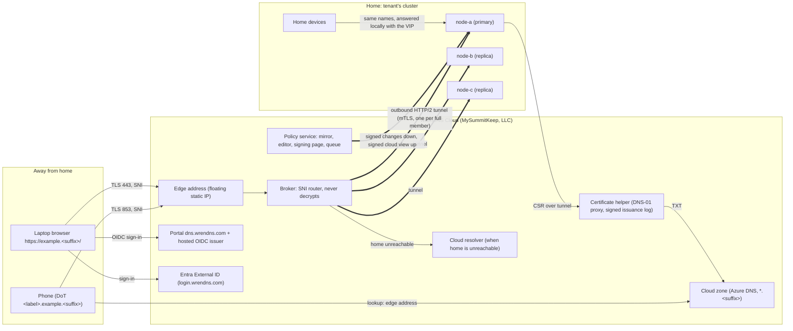
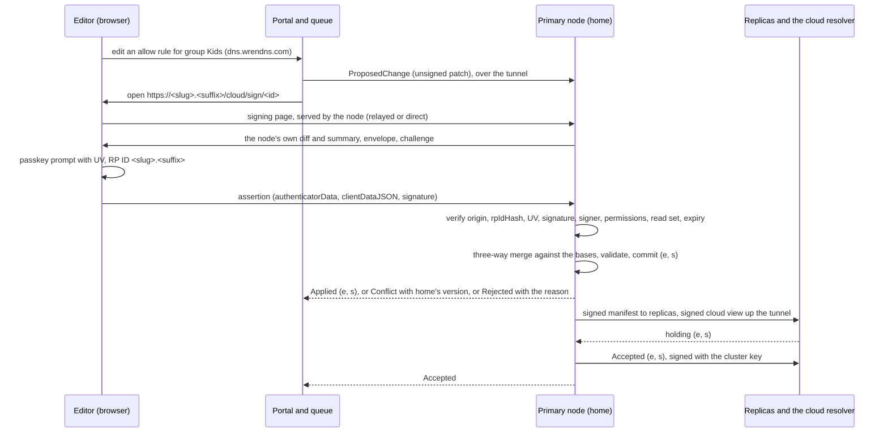

# WrenDNS Cloud (M36) — design

Status: design only (T36.1, fork #41, with #40 and #28). ADR-1047 to ADR-1052 Accepted 2026-11-19 and amended the same day per the owner decisions on cloud writes (A to D, "Owner decisions on cloud writes" below); ADR-1061 to ADR-1066 Proposed, implementing those decisions. M32's research and tasks are merged into M36. No code is written by T36.1. "WrenDNS Cloud" is a working name. Revised 2026-11-19 after an adversarial review (8 HIGH, 17 MEDIUM and 9 LOW findings; every HIGH and MEDIUM is addressed below). Revised again 2026-11-19 after a security review of the cloud-write design (4 HIGH, 10 MEDIUM and 10 LOW findings; every HIGH and MEDIUM and the cheap LOWs addressed; the choices that review left to the owner are listed under "Open owner decisions from the security review").

WrenDNS Cloud is a hosted service run by MySummitKeep, LLC. It lets a household or small business reach its own WrenDNS nodes from anywhere, gives each tenant a public name and a roaming resolver, and makes one device setting work at home and away. It also lets the tenant edit filtering in the cloud and keeps it in sync with what is set at home, both ways. The node stays the product and the authority: every answer, every policy decision and the authoritative audit trail are made on the tenant's own hardware, every secret stays there, and a change from the cloud applies only when someone the node trusts has signed it.

## Goals and non-goals

### Goals

1. **Configure once, works anywhere.** A device is set up once with one name. At home that name reaches the local node directly. Away it reaches the same node through the cloud. The UI bookmark, the DoH URL and Android's Private DNS hostname are the same in both places. This holds for Android, Apple devices, Chrome and Edge, and Windows through a client; it does not hold for Windows 11's built-in DoH (see Client setup).
2. **The remote UI.** A tenant signs in once and opens any of their nodes' own UI from anywhere, with no port forwarding, no inbound firewall rule and no VPN.
3. **RBAC with create, update and remove per object kind,** enforced by the node on every request, with every change audited on the node under the hosted user's identity.
4. **A roaming resolver per tenant.** DoH and DoT at the tenant's name, with the tenant's own policy, device identity and privacy level, closed to everyone who does not hold a device key. Home answers while it is reachable; the cloud resolver answers from the last Accepted policy when it is not (ADR-1064), so roaming devices keep their filtering when home is down.
5. **Location-scoped names, managed names, dynamic DNS and DNS-provider integrations** (#40), split between the open-source node and the paid service.
6. **The cloud is never trusted with more than the signed-in user's role** (#41). A compromise of the hosted issuer alone must not let an attacker sign in to any node, because every sign-in over the relay also needs a factor the node holds. A compromise of the whole cloud must not give admin, node secrets or guarded work by default, and its one remaining attack (a man-in-the-middle with a certificate it mints) must be visible and must switch remote access off. The threat model states exactly what remains.
7. **Leaving is safe.** Cancelling, a billing lapse or the end of the service never breaks DNS at home: certificates and local records for hosted names keep renewing for every tenant that ever linked, until the tenant unlinks and moves their devices off (the "home keep-alive", ADR-1051).
8. **Edit from anywhere, in sync both ways** (owner request 2026-11-19). Everyday filtering policy edited in the portal reaches the home nodes, and policy edited at home reaches the cloud, with home preferred on a conflict and nothing lost silently (ADR-1063). Every cloud-originated change is signed by the editor's passkey and verified on the node (ADR-1061).
9. **Cheap to run at launch.** Tens of dollars a month for the first tenants, and a cost per tenant that stays well under the price of the cheapest paid tier at 10,000 tenants.

### Non-goals

- **DNS never depends on the cloud** (AGENTS rule 5, CLU-004). Nothing on the answer path reads cloud state. A device at home never touches the cloud, and when one does by accident (a second resolver, IPv6 router advertisements, a guest VLAN), the node detects it and says so (Failure modes).
- **The cloud is not a cluster member,** not even an ephemeral one (ADR-1048). A cluster member can vouch for any user's role on a forwarded write (ADR-054), so a cloud member could forge admin writes for every tenant.
- **No second UI, except the policy editor.** The cloud does not re-implement the node's pages. It has a small portal for tenant-level objects, links out to each node's own UI, and (since the owner decisions on cloud writes) edits the synced policy kinds only; the node validates and decides every change (the "UI for every feature" rule and spec/13's "no separate business logic").
- **The cloud never changes guarded settings** (listeners, TLS, cluster, secrets, auth) and never creates a change on its own: every cloud change carries an editor's signature, and every platform action is one the node's owner turned on at home.
- **No support access by default.** MySummitKeep staff cannot sign in to a tenant's node. A node admin can grant time-boxed access, audited on the node (phase 3).
- **No UDP 53 in the cloud.** The roaming resolver speaks only DoH and DoT (and DoQ later), so it cannot be used for reflection.
- **No LDAP** (owner priority). **No WireGuard overlay in the product** (ADR-1047). Bring-your-own Tailscale or Cloudflare Tunnel stays documented as the free self-hosted alternative.
- **Not a public authoritative DNS service** for tenant domains. That is M34 (#30). The cloud serves only its own zone.

## User stories

1. **The owner's configure-once story.** The owner runs a three-node Raspberry Pi cluster at home behind the VIP `dns.home.example.net`. They link the cluster to WrenDNS Cloud once and pick the vanity slug `example`. On their phone they set Android Private DNS to `p7kq3xw2mzr5tb4nhv6cjd2ys4.example-dns.<suffix>` (the device's DoT name: a 26-character random label, shown as a QR code so nobody types it) and bookmark `https://example.<suffix>/`. At home, the phone's lookups of those names are answered by the cluster with the VIP, so DNS and the UI go straight to the Pis. On mobile data, public DNS answers the cloud's edge address, and the broker passes the same TLS connection through the tunnel to the same cluster. The phone gets the same device identity and the same entry in the query log in both places; away over DoT it gets public answers only, unless the owner allows internal names for that device (Device keys). When the home uplink is down, the same connection is answered by the cloud resolver with the last Accepted policy, so the phone keeps its filtering (ADR-1064). They never touch the setting again. On a hotel network that blocks port 853, the phone shows "Private DNS server cannot be accessed" until the owner switches Private DNS to Automatic for that stay (Failure modes).
2. **Keep my own name.** The owner prefers `dns.home.example.net`. They add it as a custom name in the portal, publish an A and AAAA record (never a CNAME) from `dns.home.example.net` to the cloud's edge address at their DNS host (or let WrenDNS do it through the Azure DNS integration, #40), prove ownership with a TXT record, and publish a CAA record that lets only their own ACME account issue, by DNS-01. The broker then routes that SNI too, with the node's existing Let's Encrypt wildcard, and the node checks the CAA record before it calls the name "protected from the cloud" (phase 2).
3. **Fix a block from a café.** A parent at a café sees that a homework site is blocked on the child's tablet. They sign in to the portal, open the Kids group in the policy editor, add an allow rule for `homework.example.com` and click Sign. The portal opens the cluster's own signing page at `https://<slug>.<suffix>/`, served by the node through the relay, which shows the change as the node reads it; they confirm with the signing passkey they enrolled on the node at home. The change is applied at once, merged and committed on the primary, audited as `oidc:<issuer>/ via cloud` with the change ID and the signer, and the portal shows Applied, then Accepted when every node and the cloud resolver have it. (They can also open the node's own UI through the relay, as before.)
4. **A family member who can only pause.** The owner invites a partner as a tenant member. On the node, the owner maps that hosted user to a custom role that may update schedules and pause filtering, but not create or remove lists, records or clients. Until the owner maps them, the partner's sign-in waits with no access.
5. **A small office with two sites.** An office links two clusters (Office and Warehouse) to one tenant, each with its own slug. Each device is named `<device>.<location>.<domain>`. Staff laptops use the DoH URL of the cluster they belong to; at either site they reach the local cluster, and away they reach their own cluster.
6. **Dynamic DNS (premium).** A tenant wants `vpn.home.example-dev.<suffix>` to follow the home WAN address for a WireGuard endpoint. The primary reports its WAN address over the tunnel and the cloud updates the record. Names that point at anything but a WrenDNS node live under the separate `<slug>-dev.<suffix>` site (Names).
7. **An agent from anywhere.** The owner's agent manages the cluster through `/mcp` over the relay, with a node-issued agent token, its scopes and the kill switch, after an admin has turned remote MCP on (off by default).
8. **Edit while home is offline.** A storm takes the home uplink down while the owner is away. In the portal they block `games.example.net` for the Kids group and sign it on the portal's signing page (`sign.wrendns.com`, used only while home is unreachable), with their portal signing passkey; the change shows Pending, with its expiry (24 hours by default) and the mark "signed in the portal". The child's phone is on mobile data and the cloud resolver keeps answering it from the last Accepted policy, so the owner clicks **Apply to roaming now** and signs again; the block applies to roaming devices at once, for at most 24 hours. When the uplink returns, the queued change is delivered, Applied and Accepted, and the roaming overlay is dropped because the policy now holds it.
9. **A conflict.** At home a partner edits the Kids schedule to end at 21:00; at the same time the owner, away, edits the same schedule's end to 20:30 from a copy taken before the partner's edit. Home wins: the partner's 21:00 stays, and the portal shows the owner a Conflict with both versions and the choices Keep home's, Apply mine (signed again) or Edit and merge. Had the owner changed a different field of the schedule, the two edits would have merged by themselves.
10. **Unlink.** The owner clicks Disconnect on the node. The node first shows which devices still use hosted names and how to move each of them off (Unlink and move off). Then the tunnel closes, the cloud key is deleted, and the portal shows the cluster as unlinked. DNS at home does not notice.
11. **A business onboards with SSO and SCIM.** An IT admin at example.com moves the company's tenant to Business, verifies `example.com` with a TXT record, presses "Connect Microsoft Entra ID", consents once in the company's tenant and sets up SCIM provisioning from the new WrenDNS Cloud enterprise application, assigning the groups `DNS Operators` and `Help Desk`. On the office cluster, signed in on the LAN, a node admin signs two group rules: `DNS Operators` gets `operator` and `Help Desk` gets `viewer`. The next morning each operator opens the cluster's name in the office, signs in with their work account and registers one passkey; two remote staff get invitations with codes the admin sends through the company's own chat. When an operator leaves, IT disables them in Entra; within a minute their portal account is disabled and the node has ended their sessions and disabled their signer (Cloud identity).

## Architecture

The cloud has these parts. None of them holds a node's secret or can change a node's configuration without a signature the node trusts; only the cloud resolver sees DNS queries in clear, and only while it answers for a home that is unreachable.

- **The portal** (`dns.wrendns.com`): tenants, members, slugs, enrolled clusters and nodes (online state, role, version and last heartbeat from tunnel metadata), enrolment codes, device keys (IDs and DoT labels only), custom names, billing and the abuse contact. It is also the **hosted OIDC issuer**. It renders no node data except the synced policy kinds in its policy editor (from its mirror) and the Shadow AI pages (ADR-1047 point 8); never the query log, the CMDB or anything else.
- **The edge:** one stable public address pair (IPv4 and IPv6) for every tenant name and for `tunnel.<suffix>`. At launch it is a static public IP that is moved to the standby broker VM on failover; later a Standard Load Balancer frontend. Devices and nodes never see a broker VM's own address, so a failover changes nothing on any device (Platform).
- **The broker** (behind the edge): terminates each node's outbound tunnel, and routes each public TCP connection by its TLS SNI into the right tunnel without decrypting it.
- **The certificate helper:** completes ACME DNS-01 challenges in the cloud's own zone for CSRs that nodes send over the tunnel, limited to that tenant's names, and keeps a signed issuance log the node can read.
- **The cloud zone** (Azure DNS): one wildcard `*.<suffix>` pointing at the edge, and per-tenant records only where a wildcard cannot serve: `_acme-challenge` TXT records and dynamic DNS records (premium).
- **Identity:** Microsoft Entra External ID holds consumer accounts, MFA, passkeys and recovery at `login.wrendns.com` (behind Azure Front Door); the portal's issuer signs consumers in through it (ADR-1065) and organization members through their own IdP as a federation broker, with SCIM provisioning on `scim.wrendns.com` (ADR-1067 to ADR-1069).
- **The policy service:** the per-tenant mirror of the synced policy, the policy editor, the offline signing page on `sign.wrendns.com` (used only while home is unreachable; changes are normally signed on the node's own page), the ordered change queue and parked conflicts (ADR-1061, ADR-1063).
- **The cloud resolver** (in the MVP, ADR-1064): multi-tenant DoH and DoT for roaming devices whose home is unreachable, from the last signed cloud view that the primary has also signed as Accepted, on the broker VMs.
- **The platform signer:** the content key and the timestamp key in an HSM-backed Azure Key Vault, which sign the class map, subscribed lists and the freshness statement; the release key stays in the release workflow, and the offline root and the hardware update key (the second signature on releases that may install automatically) stay with the owner (ADR-1062, ADR-1066).

**Trust boundaries.** The browser and device TLS sessions end on the node, so the broker sees encrypted bytes, the SNI, timing and volume. The one exception is roaming DNS while home is unreachable, which ends at the cloud resolver under its own certificate for the DNS names only (ADR-1064). Policy changes cross the boundary only as signed objects: changes signed by an editor's passkey going down, and cloud views signed by the cluster key going up. The tunnel's own TLS ends at the broker; inside it, each stream is the raw bytes of one public connection, preceded by a PROXY v2 header the broker writes. The portal holds identities and tenant objects. The node holds everything else.

**Every frame from a node is untrusted input to the cloud.** The node is AGPL, so a tenant may run a modified one. Heartbeat strings are escaped wherever the portal shows them, CSRs are checked name by name against the tenant, dynamic DNS updates are checked against the tenant's records and ranges, and role and epoch claims are never believed alone (Cluster-aware routing). This rule is part of `spec/14` and T36.9's acceptance criteria. The same holds the other way: every byte the broker writes, including the PROXY header, is untrusted input to the node (below).

**Why not proxy HTTP.** A cloud that terminates TLS and proxies HTTP sees session cookies, CSRF tokens, query-log pages and every secret typed into a form, and could replay sessions. The UI also assumes it owns its host: base path `/` (`ui/vite.config.ts`), absolute `/api/v1` calls (`ui/src/lib/api.ts`), a CSP with `connect-src 'self'` and `frame-ancestors 'none'` (`crates/wrendns-api/src/ui.rs`), per-node sessions and a per-node `public_url` (ADR-045). With SNI passthrough nothing in the UI changes. A path-prefix proxy (`dns.wrendns.com/t/<slug>/`) would break the UI, and an iframe portal is blocked by the CSP.

## Node enrolment and the outbound tunnel

### The tunnel (ADR-1047)

- **Transport:** HTTP/2 over TLS to `tunnel.<suffix>:443`. TCP 443 outbound passes nearly everywhere, and `h2`, `hyper` and `rustls` are already linked, so the tunnel adds no runtime crate (AGENTS rule 8, the 25 MiB gate of ADR-916). QUIC (`quinn` is linked for DoQ and DoH3) is added later as the preferred transport with HTTP/2 as the fallback, the way Cloudflare Tunnel does, because UDP is often blocked.
- **Who dials:** every full member of a linked cluster opens one tunnel. Resolver pods and witnesses never do (they hold no secrets and serve no UI, ADR-1027 and the ADR-054 amendment).
- **Framing:** each public connection the broker accepts becomes one HTTP/2 stream. The stream starts with a PROXY v2 header carrying the caller's address and port and the SNI, then carries raw bytes in both directions. Control messages (hello, heartbeat, certificate requests, dynamic DNS updates) use the 4-byte length-prefixed prost frames of the cluster channel (ADR-044) on a control stream.
- **Heartbeats:** every 20 s, below the 4-minute idle timeout of Azure's and most middleboxes' defaults. Each carries `{node_id, cluster_id, role, epoch, ready, version, maintenance}`, and the primary's carries a role lease (Cluster-aware routing).
- **Reconnect:** full-jitter backoff from 1 s to a 5-minute cap, longer than ADR-044's 30 s, so a broker restart does not cause a thundering herd.
- **Stream budgets on the node.** Android, iOS and Chrome keep their DoT and DoH connections open, so each roaming device holds one or two streams all the time. DNS and UI streams therefore have separate budgets: up to 128 DNS streams (DoT and DoH to `/dns-query`) with HTTP/2 windows of 4 to 16 KiB, and up to 32 UI, API and MCP streams with windows of 64 to 256 KiB; a 1 MiB frame limit as in ADR-044. A stream beyond its budget is refused with a counted reason, never queued. Targets: at most 2 MiB more RSS idle and 12 MiB with both budgets full, measured in T36.4 against the 32 and 128 MiB gates (ADR-1031). The tiers' device limits are set from that measurement, not the other way round (Tiers).
- **Isolation from DNS:** the tunnel runs as its own task, with bounded queues and no lock shared with the pipeline (spec/02 §3 and §8). Its CPU use during a UI burst must not show in DNS p99 (bench-smoke covers it; Pi 4 lacks the ARMv8 crypto extensions, so ChaCha20-Poly1305 is preferred there and both suites are benchmarked).
- **Two trusted channels, nothing unsigned** (ADR-1047 point 3, amended). Down the tunnel the cloud may open a relayed byte stream, return certificate chains the node asked for, acknowledge updates, deliver **proposed changes** (unsigned patches that the node only displays on its own signing page; they change nothing), deliver **signed changes** (the user channel) and deliver **signed content and hints** (the platform channel); up the tunnel the node sends health, its own requests and its signed cloud view. Nothing the cloud sends unsigned changes a node's configuration or starts anything on it (Cloud writes).

### How the node treats a relayed stream

The PROXY header is written by the broker, so the node uses the address in it only to describe and limit, never to authorize.

- **Injected in-process.** A relayed stream is handed to the node's TLS acceptors as an in-memory stream carrying a "relayed" context flag and the header's fields. It is never a real socket, and no listener needs `proxy_protocol = true`; ADR-039's rule for PROXY on sockets ("mandatory when enabled, no source allowlist") is untouched.
- **Always remote.** A relayed stream is never loopback, never inside `allowed_admin_networks`, never break-glass (ADR-944), whatever its socket address.
- **Identity by key or label only.** A relayed stream never matches an IP or MAC client rule (ADR-976), never satisfies a wall display's network binding, and is never inside `[access] allowed_networks`. Its device is the one its DoH key or DoT label names, and nothing else; a relayed stream with neither is a browser or an agent and must sign in.
- **Header sanity.** The node refuses a relayed stream whose PROXY address is private (RFC 1918, RFC 4193), loopback, link-local, shared address space (RFC 6598) or inside the tenant's own LAN ranges, and counts it as `relay_header_refused`. The broker never has a reason to send one.
- **What the address is used for.** Rate limits, lockout, the audit log and the query log record the reported client address, so one person's failed sign-ins do not lock out everyone behind the broker. Because the broker could rotate that address, step-up lockout is also kept per account: 10 failed second-factor attempts in 15 minutes lock that account's relayed sign-in for 15 minutes, whatever the addresses.
- **Correlation.** The audit entry records the relay's correlation ID, so the cloud's log and the node's log can be joined without either holding the other's data.
- **Refused over the relay unless the node opts in:** local password sign-in, HTTP Basic, the setup token, sessions created on the LAN (below), secret writes (`PUT`/`DELETE /api/v1/secrets`), guarded settings, backups, user and token management, and the `[cloud]` settings themselves. Over the relay, sign-in is OIDC through the hosted issuer plus the node's own factor (below). Each opt-in is a guarded, admin-only setting, and admin and guarded work over the relay has the extra conditions of "Admin work from away".

### Enrolment (ADR-1048)

1. An admin on the primary opens **Settings → WrenDNS Cloud** and clicks **Link this cluster**, or runs `wrendns cloud link`.
2. The node calls the portal (outbound) and gets a short user code such as `WREN-7K3Q` and the URL `dns.wrendns.com/link` (RFC 8628 device authorization grant). The code lives 10 minutes, is single use and is rate limited.
3. A tenant admin signs in to the portal and enters the code. **The confirmation page shows what is asking to join:** the cluster's name, its node names, the source address and its rough region, and the WrenDNS version, and says "only continue if you are standing next to this cluster". This is the defence against device-code phishing, in which an attacker starts `link` on their own node and talks a tenant admin into entering the code.
4. The admin picks the tenant and confirms the slug. **Each slug is bound to one cluster.** Binding a second cluster to a tenant gives it its own slug; moving a slug to another cluster needs confirmation on a node of the cluster that holds it. The helper issues a slug's names only to the cluster bound to it.
5. The node, polling, receives the tenant binding: the tenant ID, the slug, the hosted issuer's URL and the tunnel CA's public keys (below).
6. For headless and Kubernetes installs, the portal issues an enrolment token (`wren_enrol_...`, single tenant, expiring, only its hash stored) that is set through a secret file, like the existing join token.

**Keys.** Each full member generates its own cloud key (Ed25519) in `<data_dir>/cloud/`, mode 0600, node-local and never replicated, like `node.key` (ADR-903's node-identity row). The cloud CA issues it a client certificate of about 30 days, carrying tenant, cluster and node IDs, renewed over the tunnel at two thirds of its life (as ADR-057 does for the cluster). The primary countersigns each member's first request over the cluster channel, so joining the cluster is enough to bring a member online.

**Coming back after a long time offline.** A node powered off for longer than its certificate's life presents an expired certificate signed by its own cloud key plus a fresh countersignature from the current primary. The cloud accepts that within a 180-day grace period from expiry, if the node has not been removed; after that, or for a single-node cluster whose key is lost, the cluster links again. It is a failure-table row.

**Why not the cluster certificate.** Reusing the node's cluster certificate with a pinned cluster CA needs no new key, but a cluster CA compromise would also be a cloud compromise, the cloud could not revoke one node without the others, and resolver pods hold cluster certificates too.

**Mutual authentication.** The broker presents, for `tunnel.<suffix>`, a certificate from a private tunnel CA run by the cloud (not a WebPKI certificate, whose key may change at every renewal). The node pins that CA's public key and a backup key, both delivered at enrolment; a rollover to a new CA key is announced in the hello message, signed by the current CA key, at least 30 days ahead. The broker checks the node's client certificate.

**Revocation and removal.**
- Remove node in the portal closes the tunnel and denies the certificate serial at once.
- Disconnect on the node deletes the cloud key and tells the cloud.
- When a member is removed from the cluster registry (ADR-143), **the primary tells the cloud at once** over its tunnel. The cloud denies that node's cloud certificate serial, closes its tunnel, and the helper revokes the node's TLS certificates for the tenant names with Let's Encrypt. A removed or stolen node therefore stops receiving relayed streams within seconds, not at its next renewal.
- Every enrol, renew, revoke and slug change is audited on both sides.

### Cluster-aware routing

- `<slug>.<suffix>` routes **primary first and sticky**: to the connected member that holds a valid primary lease, else a ready replica in a stable order (lowest node ID). Reads work on any member (ADR-053), and writes on a replica are forwarded (ADR-054); with no primary, writes get the existing 503 and read-only banner. The broker re-routes only when the target disconnects, turns unready, enters maintenance (ADR-118) or a new lease is seen.
- **A primary claim needs proof.** A heartbeat's `role = primary` and epoch are not believed alone, since a removed or modified node could claim them to capture the cluster name and collect sessions. The primary's heartbeat carries a lease `{cluster_id, node_id, epoch, expires}` signed with the primary's cloud key, and the broker routes the cluster name to it only when a majority of the tenant's connected tunnels report the same primary and epoch (for a one-node cluster, the node itself; spec/12 §5's fencing rule supplies the epoch).
- `<node>.<slug>.<suffix>` always reaches that node (node comparison, drills, support). Node names must not look like a device label: a node name of 26 base32 characters is refused.
- **OIDC redirects.** Users arrive at `<slug>.<suffix>`, at home through the VIP and away through the broker, so a callback sent to the node's own name would miss the sign-in state cookie (host-only, `SameSite=Lax`, `Path=/api/v1/auth/oidc`, `crates/wrendns-api/src/auth/routes.rs`). Each node therefore registers two redirect URIs with the hosted issuer, `https://<slug>.<suffix>/api/v1/auth/oidc/callback` and `https://<node>.<slug>.<suffix>/api/v1/auth/oidc/callback`, and picks the one matching the request's Host header when that host is on its allowlist (its own names and any verified custom name); any other Host gets the node name. `auth.oidc.public_url` (ADR-045) becomes a short list for the hosted provider. When the routed node changes, single sign-on is a silent redirect. T36.6 tests both entries.
- Cluster-signed sessions (ADR-045's named follow-up) are a later improvement, not needed for v1.

### The `[cloud]` section

Node-local and admin-only, with a UI panel (Settings → WrenDNS Cloud), a help topic and Playwright tests, per the "UI for every feature" rule. It holds: linked or not, tenant and slug (read-only), remote UI on or off, remote MCP on or off (off by default), the hosted-provider role cap, the opt-ins listed above, remote admin (off by default, below), the roaming listeners on or off, internal names over relayed DoT (off by default), and the CT watch with its state. MCP gets a read tool `cloud_status`; linking and unlinking are never for agents (they join spec/13 §3.2's list), because linking changes who can reach the node.

## The remote UI

- **The portal** at `dns.wrendns.com` hosts the policy editor for the synced kinds (Cloud writes), lists the tenant's clusters and nodes and links out to `https://<slug>.<suffix>/` (the cluster, primary first) and `https://<node>.<slug>.<suffix>/` (one node). It shows only what the tunnel metadata tells it: online, role, version, last heartbeat, certificate expiry, and the reason a node is unreachable.
- **The node's own UI** does everything else, unchanged: the same pages, the same streaming Queries, Map and Wall pages, the same CSP. A node shows a small "Reached through WrenDNS Cloud" note in the header when the request came over the relay, so the user knows which path they are on.
- **Cookies.** The session cookie becomes `__Host-wrendns_session` (`Secure`, `Path=/`, no `Domain`), so a web server at a sibling name cannot set or shadow it, and the OIDC state cookie becomes `__Host-` as well with the callback path checked on the server. The old name is read for one release (ADR-1028's pattern). This also helps LAN-only nodes.
- **Bandwidth:** the UI is about 510 KiB gzipped on first load (within its 512 KiB budget, T33.2) and cached afterwards; dashboards are small JSON; the live tail and the map streams are bounded by their existing page limits. The broker caps each node at a configurable rate (2 to 5 Mbit/s) to protect home uplinks and the broker.
- **Latency:** each UI request adds the cloud-to-home round trip (about 20 to 80 ms in-region). HTTP/2 multiplexing avoids per-request handshakes.
- **A fleet view across clusters** (story 5) is deferred. If it comes, it is an opt-in mode in which the portal reads summaries the nodes push, never node pages.

## Identity, tenancy and RBAC (ADR-1049)

### Tenancy

- A **tenant** is an account: a household (a personal tenant) or a business (an organization tenant, with SSO and SCIM; Cloud identity, below). It has **members** (hosted users), one or more **slugs** (one per cluster), linked **clusters**, **device keys**, **custom names** and a billing state.
- Portal roles govern portal objects only: **owner** (billing, delete the tenant, transfer), **admin** (members, slugs, enrolment, device keys, custom names), **member** (sees the tenant's clusters and links). Each portal object kind has create, update and remove permissions held by these roles, and every portal change is in the cloud's append-only tenant log.
- The cloud's checks decide only who may reach which tenant's relay. They are a convenience gate, never the security boundary for node data.

### Sign-in on the node

- The portal is an OIDC issuer. Linking adds it to each node as a node-managed `[[auth.oidc.provider]]` (ADR-968), with PKCE, `aud` and `azp` checks and JWKS rotation already built (ADR-951). The issuer signs consumers in through Microsoft Entra External ID and organization members through their own IdP, and asserts a portal-minted user ID as `sub` (ADR-1065, ADR-1067).
- The hosted token asserts identity only: `sub`, email and the tenant ID. **For this provider the node ignores group claims;** SCIM group memberships count only under a group rule a node admin signed (Cloud identity, ADR-1069). The role comes from a node-local table that maps hosted subjects to node roles, set by a node admin, or approved by one after a user's first sign-in. **Until then the subject is pending and has no access**, not even `viewer` (which reads the query log, docs/running.md Roles). The pending list is shown to admins with the email, labelled "unverified, from the cloud" (the issuer asserts it, so a minted lookalike stands out), and the time; pending entries expire after 7 days.
- **A node-held factor on every relayed sign-in.** Over the relay, a hosted sign-in completes only with a second factor that the node holds and the user enrolled on the LAN: a passkey (WebAuthn, the preferred factor, added in T36.6) or TOTP (built). Split horizon makes the WebAuthn relying-party ID `<slug>.<suffix>` the same at home and away, so a passkey registered at home works away. A hosted subject with no node factor enrolled cannot sign in over the relay at all; at home, on the LAN, the hosted sign-in works without it (the LAN is the enrolment place), except in organization tenants, where `[cloud] factor_on_lan` asks for it on the LAN too once enrolled (Cloud identity, ADR-1069 point 9). This is what makes an issuer compromise on its own useless.
- **Sessions remember where they were made.** Each session records how it was created (password, hosted OIDC, with or without the node factor) and whether over the relay or the LAN. Over the relay, the node accepts only sessions created over the relay with the hosted issuer and the node factor; a session made at home with a password is refused there and the user is asked to sign in again. A session never exceeds `max_role` over the relay. **A session made on the LAN** (the condition every "on the LAN" step in this design uses) is one whose connection was not relayed, whose source address is inside `allowed_admin_networks`, and which did not arrive through a public listener or a listener with `proxy_protocol` on.
- **Role cap:** a node setting `max_role` for the hosted provider, default `operator`.
- **Agents** through the relay use node-issued tokens (AGT-004) with their scopes, rate limit and kill switch. The hosted issuer may later act as the OAuth authorization server for MCP (AGT-008), but the node always issues and scopes the token.

### Admin work from away

A second factor does not stop a man-in-the-middle who holds a valid certificate for the same name: they relay the TOTP code in real time, and a passkey's origin check passes because the origin is the same. The cloud can mint such a certificate for hosted names, because it controls their zone (ADR-1051). So:

- **Admin and guarded work over the relay is off by default.** Over hosted names, the node refuses admin-only and guarded routes from relayed sessions, whatever the role and the cap.
- **Writes to synced kinds over the relay go through signing.** Over hosted names, the node refuses a relayed session's direct write (`PUT`, `PATCH`, `DELETE`) to any kind in the sync allowlist (ADR-1063 point 1) and its UI sends the edit through the node's own signing page instead (Cloud writes), so every remote change to everyday policy carries the editor's signature over a diff the node rendered. On a verified custom name (below) direct writes stay allowed. Operator writes to kinds that are not synced (clients, the CMDB, locations) stay allowed over the relay; a man-in-the-middle with a minted certificate could make those during a user's session, which is stated in the blast radius. Agent tokens over the relay (story 7) keep their scopes, including synced kinds; remote MCP is off by default, and the setting's help says that a man-in-the-middle could use a token it captures until the CT watch blocks remote access.
- **It can be turned on in two ways**, each a guarded admin setting made on the LAN:
  1. on a **verified custom name** only (story 2): the tenant's own domain, an A/AAAA record (no CNAME), the tenant's own certificate, and a CAA record with the tenant's own `accounturi` and `validationmethods=dns-01` that the node has checked. The cloud cannot get a certificate for that name, so it cannot sit in the middle;
  2. or with **out-of-band approval**: each admin action from away waits until a session already signed in on the LAN (a phone at home, the wall display's owner) approves it, with the action shown in full.
- **The CT watch blocks remote access** as soon as it sees a certificate for the node's names with a key that is not the node's (ADR-1051): relayed sign-in and relayed sessions are refused, health turns severe, and an admin on the LAN must acknowledge before remote access resumes. DNS is not affected.

### Create, update and remove per object kind

- A **custom role** is a set of `(kind, verb)` permissions: kinds are the node's object kinds (clients, groups, lists, quick rules, records, forwards, upstreams, schedules, CMDB items, locations and the rest of the managed kinds), verbs are `create`, `update`, `remove` and `read`.
- `viewer`, `operator` and `admin` become built-in presets of the same table. Existing roles behave exactly as today.
- The verbs map onto routes in the deny-by-default table agent tokens already use (`required(method, path)` in `crates/wrendns-api/src/auth/agent.rs`). A token's effective permissions stay the intersection of its scopes and its owner's role (ADR-064).
- **Create versus update.** The API's `PUT` is an upsert, so the primary decides which verb applies by checking whether the object exists under the `If-Match` version, inside the same write. A forwarded write carries the user's role name; the primary resolves the role to its permissions (roles replicate like users, ADR-045).
- Guarded routes and the never-for-agents list (spec/13 §3.2) stay admin-only whatever a custom role says.
- Custom roles are useful without the cloud and ship in the AGPL node first (T36.3).

### Audit across both sides

- **The node's hash-chained audit stays authoritative.** Hosted sign-ins are recorded as `oidc:<issuer>/`, with the hosted email, the factor used, the client address the relay reported (marked as reported by the relay), and the relay correlation ID.
- **The cloud keeps its own append-only log** of tenant events: sign-ins, enrolment, slug changes, device-key issue and revoke, custom names, certificate issuance, support grants. It never records node content.

## Cloud identity: consumers, organizations, SSO and SCIM (ADR-1065, ADR-1067 to ADR-1070)

The owner's requirement of 2026-11-19: "The sign-in or auth for the cloud endpoint should allow for SCIM provisioning from an External ID source. We will need to design around that. In the commercial space, a single sign on/Enterprise app onboarding would be preferrable. The external ID could be used for all consumer users." This section is the design for it. Nothing in it changes what a node trusts: **nodes still trust one issuer, the portal's** (ADR-1049 point 1), and that issuer still cannot grant node access on its own. The new parts are where people come from (Entra External ID for consumers, the customer's own IdP for organizations), how a customer's IdP provisions people and groups (SCIM 2.0), and how a node lets those group memberships take effect under a rule its own admin signed.

**How "from an External ID source" is read.** The design reads it as the customer's identity provider (Entra ID, Okta, Google Workspace and others) provisioning users and groups into WrenDNS Cloud over SCIM, because that is what goes with "SSO/Enterprise app onboarding" for commercial customers. Two other readings are possible and are not chosen: (2) WrenDNS's own External ID tenant pushing consumer accounts to the portal over SCIM (Entra's outbound provisioning is listed as supported in external tenants; it adds little, since the portal already creates an account at first sign-in, but the same SCIM server would accept it later); (3) a business that runs its own Entra External ID tenant provisioning its own consumers (unlikely). Owner decision 1 below confirms the reading.

### Tenant types and the people in them (ADR-1067)

| | **Personal tenant** (consumer) | **Organization tenant** (Business) |
|---|---|---|
| Who | a household; every Cloud and Cloud Plus tenant | a business; the Business tier only (ADR-1070) |
| How members sign in | Entra External ID: local accounts (email and password, MFA required, passkey offered; ADR-1065), social sign-in later | the organization's **enterprise connection** to its own IdP (OIDC; SAML, below); plus its break-glass owners and any invited outside members through External ID |
| How members arrive | invitation by a tenant admin | SCIM provisioning from the IdP, or just-in-time at first SSO sign-in, or invitation (outside members only) |
| Verified domains, home-realm discovery, "enforce SSO" | no | yes |
| Portal roles | owner, admin, member, set by hand | the same, set by hand or by a portal group mapping (never owner) |
| Node roles | the node's subject-to-role table (ADR-1049 point 2) | the same, plus node-side group rules signed by a node admin (below) |

- A personal tenant can become an organization tenant when it moves to Business; it cannot go back while it has a connection or SCIM credentials.
- **One person, two accounts.** An enterprise user belongs to exactly one organization and is owned by it: the organization's IdP and SCIM decide whether that account exists. A consumer account with the same email is a different account. **Accounts are never linked by email**, automatically or on request, because email is mutable and an organization's IdP can assert any address. A person who works in two organizations has two enterprise accounts.

### The subject nodes see: a portal user ID (amends ADR-1065 point 2)

Enterprise users have no External ID `oid`, so the issuer can no longer assert Entra's `oid` as `sub`. Instead **the portal mints an immutable user ID for every account** (`usr_` and 26 characters of a random 128-bit value; never reused, kept as a tombstone after deletion) and asserts it as `sub`, with the email and the WrenDNS tenant ID as before. The portal stores it against the account's upstream identity, which is the pair (upstream issuer, upstream immutable ID):

| Upstream | Immutable ID the portal keys on | Never keyed on |
|---|---|---|
| Entra External ID (consumers, break-glass, outside members) | the external tenant's `oid` | `sub` (it differs from `oid` in External ID), email |
| Entra ID through the WrenDNS Enterprise app | (`tid`, `oid`), with `tid` pinned to the organization | `upn`, `preferred_username`, email |
| Generic OIDC (Okta, Google Workspace, Ping, Auth0, Keycloak) | (`iss`, `sub`), with `iss` pinned to the connection | email, `preferred_username` |
| SAML (later, below) | (IdP entity ID, a persistent NameID) | a transient or email-format NameID |
| SCIM | (organization, SCIM `id`) and the IdP's `externalId`, which must equal the immutable ID the connection asserts and is immutable once the account has signed in (Entra's setup maps it to `objectId`; Entra's default `mailNickname` never equals an `oid`, so it links nothing) | `userName` (shown, used for filters, never for linking) |

Nothing is built yet, so nothing migrates. **The upstream key of an account never changes silently** (security review H1). Once an account has signed in, its SCIM `externalId` is fixed: `/Schemas` marks it immutable and a SCIM write that changes it is refused with 400 `mutability`; an IdP that must change it deprovisions the user and provisions a new one, who gets a new portal user ID. A user who moves to a new IdP keeps their portal user ID only when an organization **owner** re-links the account to the new upstream ID (audited, recent sign-in, every owner alerted). Because a re-link keeps `sub`, which is what the node maps and what signers and grants hang on, the cloud sends each cluster a `SubjectRelinked` notice and the node treats it exactly as a disable (Deprovisioning, below): sessions end, signers and grants are disabled, and a node admin restores the subject after checking it is the same person. Without that, one portal action (or one SCIM `PATCH` with a stolen credential) would hand a node identity, with its hand-mapped role and its signers, to someone else.

### Enterprise connections (ADR-1067)

The portal's issuer becomes a small **federation broker**: each organization tenant has one or more enterprise connections, and the broker turns a sign-in through any of them into a portal session and, for nodes, the portal's own token. Consumers keep going through External ID unchanged. Three kinds, in the order they are built:

1. **Entra ID: the WrenDNS Cloud Enterprise app.** Apps registered in an external tenant are always single-tenant, so the multi-tenant app lives in a **separate WrenDNS workforce tenant** (`<workforce-tenant>.onmicrosoft.com`, owned by MySummitKeep, holding nothing but the product's app registrations and its publisher verification). The app is a confidential client on the v2.0 endpoint that authenticates to Entra with a certificate (`private_key_jwt`), never a secret, and asks only for `openid`, `profile` and `email` (no `offline_access`: the broker keeps no refresh token from a customer's IdP). The workforce tenant has no users but its administrators, who use PIM and phishing-resistant MFA; any change to the app's credentials, redirect URIs or owners alerts MySummitKeep's security contact; a compromise of that tenant is a compromised issuer (threat model).
   - **Onboarding** is the Enterprise app experience the owner asked for: an organization admin presses "Connect Microsoft Entra ID" in the portal, signs in to their own tenant and grants admin consent once. That creates the WrenDNS Cloud enterprise application (service principal) in their tenant, where they assign users and groups, turn on "assignment required" (the portal's setup page says why: otherwise every user in their tenant can sign in, and with JIT on gets an account) and set up SCIM provisioning from the same enterprise application. No secret changes hands for SSO.
   - **The `tid` pin.** A multi-tenant app accepts tokens from every Entra tenant. The broker records the consenting tenant's `tid` on the connection and accepts a token for that organization only when its issuer is exactly `https://login.microsoftonline.com/<tid>/v2.0` and its `tid` claim is that value. "Any valid Entra token" never means membership of any organization. Guest accounts in the customer's tenant (the `acct` optional claim is 1) are refused unless the organization owner allows them. Sign-in requests go to the tenant-specific endpoint `https://login.microsoftonline.com/<tid>/oauth2/v2.0/authorize`, which also avoids the domain confirmation dialog External ID shows.
   - **Listing in the Entra app gallery** (publisher verification with a Partner One ID, the gallery's SSO and provisioning validation) comes after general availability (T36.27, ADR-1070).
2. **Generic OIDC** for Okta, Google Workspace, Ping, Auth0, Keycloak and any OIDC IdP: the organization admin enters the issuer URL, a client ID and either a client secret or a key for `private_key_jwt`, made in their IdP from the portal's instructions; the broker reads discovery once and pins the issuer and its JWKS URI. Authorization code with PKCE, `state`, `nonce`, exact `iss`, `aud` and `azp` checks, and JWKS rotation reuse the relying-party logic the node already has (ADR-951, ADR-968).
   - **Shared issuers** (security review H3). An issuer that also serves people outside the customer cannot be a connection's trust anchor on its own, or with JIT on any of its accounts would become a member of the organization. Microsoft issuers (`common`, `organizations`, `consumers`, the consumer-account tenant and any `login.microsoftonline.com` issuer) are refused as generic connections: Entra customers use the Enterprise app. A Google connection (`https://accounts.google.com`) accepts a token only when its `hd` claim is one of the organization's verified domains and `email_verified` is true. Every other issuer must be specific to the customer (an Okta org's own issuer URL, a Keycloak realm); the setup page says so, and a shipped list of shared issuers is checked at setup.
   - **Mix-up** (RFC 9207): each connection has its own callback path (`/sso/cb/<connection-id>`); `state` binds the connection ID, the browser session, the `nonce` and the PKCE verifier; the broker checks the authorization response's `iss` parameter where the IdP sends one; a code is only ever sent to the token endpoint of the connection the sign-in was started for.
   - The client secret is held encrypted under a key in Key Vault, shown never again, and rotatable; the portal warns 30 days before an expiry the admin entered.
3. **SAML-only IdPs** (ADFS, older appliances). Native SAML means XML signature handling, a classic attack surface (signature wrapping, XXE, comment injection in NameID); Rust's options bring in `libxmlsec1` as a C dependency. It is cloud-side only, so the node's image gate (ADR-916) is not affected, but it waits for its own security review (T36.26). **Until then** a SAML-only organization is federated through Entra External ID's SAML federation: the organization's IdP is added to the external tenant, the broker sends its users there with `domain_hint`, and the broker accepts the result only when the External ID token's `idp` claim names that organization's federation and the account is linked to the organization. These accounts are keyed on (the federation's ID that WrenDNS assigns, the External ID `oid` of the federated user), linked first by SCIM `externalId` or, with JIT, by the persistent NameID if External ID passes it through; an IdP entity ID that another organization's federation already uses is refused at setup; the Conditional Access exclusion from External ID's MFA is by the federation's identity issuer, never by email domain or by a group the portal writes; and before the route opens, T36.26 checks that External ID never joins a federated sign-in to an existing local account with the same email. Its limits are stated on the setup page: External ID passes only standard profile claims, so authorization still comes from SCIM and the mappings below; and the IdP may show as a button on the consumer sign-in page. Most organizations do not need this, because Okta, Google Workspace and Entra all speak OIDC. **Native SAML, when built,** follows these rules (security review M6): only a `Response` with exactly one `Assertion`; the assertion signed (a signed `Response` alone is not enough), with the signing key taken only from the connection's pinned certificates, never from `KeyInfo` in the message; RSA-SHA256 or stronger, no SHA-1; the code then reads only the element the verifier returns as signed, never the original document again by ID or XPath (the defence against signature wrapping); exclusive canonicalization, with NameID and attributes read after it so comments cannot split a value; no DTD and no external entities; `Destination`, `Recipient`, `Audience` and `Issuer` exact; `InResponseTo` equal to a request this browser session started (so no IdP-initiated responses); `NotBefore`, `NotOnOrAfter` and `SubjectConfirmationData` within 3 minutes of skew; each assertion ID kept until it expires and refused a second time; an encrypted assertion decrypted first and then verified as above; a persistent NameID only. A metadata refresh that changes the signing certificate waits for an owner's approval.

**MFA for enterprise users** is the customer IdP's. The External ID Conditional Access policy that requires MFA (ADR-1065 point 3) covers the accounts External ID holds; it excludes users federated through External ID's SAML route, who would otherwise be asked twice. The broker records the `amr` and `acr` values the IdP asserts, where it asserts them, in the tenant log. An organization may require a value (for example `acr` from a list it enters, or `amr` containing `mfa`), refused at sign-in when missing; the default is to record only, because IdPs name these differently. The portal cannot require phishing-resistant MFA from a customer IdP; node access does not depend on it, because every relayed sign-in still needs the node-held factor (ADR-1049 point 2).

### Verified domains, home-realm discovery and enforcing SSO (ADR-1067)

- **Domain verification.** An organization proves a domain by publishing a TXT record `_wrendns-verify.example.com` with the value `wrendns-verify=<32 random bytes, base32>` that the portal issued to that organization. The portal checks it through two public validating resolvers, rechecks every 24 hours, and after 7 days of failures marks the domain unverified (home-realm discovery and enforcement stop; the connection still works from the organization's own sign-in URL). A domain is verified by at most one organization; a second claim needs support and the first organization's notice. Subdomains are verified separately, and a subdomain of a domain another organization has verified needs that organization's consent. Public mail domains (a shipped list: `gmail.com`, `outlook.com` and the like) and the product's own domains cannot be claimed.
- **Home-realm discovery.** The portal's sign-in page asks for an email first. If its domain is verified by an organization with an active connection, the browser goes to that connection (Entra with `login_hint` at the tenant-specific endpoint; OIDC with `login_hint`); otherwise to External ID with `login_hint`. Each organization also has its own sign-in URL, `https://dns.wrendns.com/sso/<org-slug>`, for users whose email domain is not verified, and Entra's My Apps tile points at the initiate-login URI of the app, which starts an ordinary SP-initiated sign-in. **The email routes; it never authorizes.** Who the user is comes only from the connection's immutable ID, and unsolicited (IdP-initiated) responses are refused.
- **Enforce SSO** (per verified domain, off by default, an organization owner's setting): External ID sign-up with an address in the domain is refused and sent to the organization's connection, and an External ID account with such an address cannot be invited into, or sign in to, the organization tenant. It does not touch personal tenants: a personal account that happens to use a work address keeps its own household tenant, and the organization never sees it.
- **Break-glass owners.** Every organization keeps at least one owner who is an External ID local account (email and password, MFA required, a passkey required), exempt from "enforce SSO" and from SCIM, ideally with an address outside the verified domains. Email with password plus an email one-time code is in effect one factor (the mailbox), so a break-glass owner must have a passkey and each break-glass sign-in must use it: the portal checks the `amr` value External ID sends for a passkey (T36.22 confirms the value) and refuses an email one-time code there. Owners are asked every 90 days to confirm the break-glass list, and a break-glass owner unconfirmed or unused for 180 days alerts every owner. The portal refuses to remove, deprovision or demote the last one. A break-glass sign-in alerts every owner and is marked in the tenant log. Two are recommended. This covers a broken or deleted connection and an IdP outage. **On the nodes the break-glass is local, as today:** node-local users on the LAN (and ADR-944's loopback break-glass) never depend on the cloud, SSO or SCIM.
- **Who changes identity settings** (security review M9). Connections, verified domains, enforcement, SCIM credentials, portal group mappings and re-links are owner-only, need a recent sign-in and alert every owner. A portal `admin`, which a group mapping can grant (so a stolen SCIM credential can reach it), cannot change them, and SCIM never writes owners. A connection's issuer and `tid` cannot be edited: a new issuer is a new connection, whose accounts are new.

### SCIM 2.0 provisioning (ADR-1068)

The portal runs a SCIM 2.0 service provider (RFC 7643, RFC 7644) on its own host, so it shares no cookies or origin with the portal: one base per organization, `https://scim.wrendns.com/scim/v2/<org-id>/`.

- **Resources:** `/Users`, `/Groups`, `/Schemas`, `/ResourceTypes` and `/ServiceProviderConfig`. `POST`, `GET` by ID, `GET` with `filter`, `PUT` and `PATCH` (both, because Okta's wizard apps use `PUT` for everything), and `DELETE`. Filters: `eq` on `userName`, `externalId` and `emails[type eq "work"].value` for users and on `displayName` and `externalId` for groups; a filter that matches nothing returns 200 with an empty `ListResponse` (Entra's Test Connection queries a random GUID). Pagination with `startIndex` and `count` (at most 100), integer `totalResults`, `startIndex` and `itemsPerPage`, in a stable order. `excludedAttributes=members` honoured; `GET /Groups/{id}` returns members (Okta needs it). Multi-member `PATCH` add and remove, answered 204 without the member list. Bulk is not offered at first (`ServiceProviderConfig` says so).
- **What a SCIM client may write:** user identity attributes (`userName`, `externalId` until the account first signs in, `name`, `displayName`, `emails`, `active`), groups (`displayName`, unique per organization as Entra requires; `externalId`) and their members. Nothing else: not portal roles, not connections, not mapping rules, not node anything. Unknown attributes and extension schemas are accepted and dropped.
- **Lifecycle.** `active=false` disables the account at once (below, Deprovisioning) and keeps it, so `GET` still returns it until it is deleted, as Entra requires; `active=true` re-enables the portal account only. `DELETE` disables it the same way, then removes the record after 30 days, leaving the portal user ID as a tombstone that is never reused. Okta never deletes and suspending a user in Okta sends nothing, which the setup page says.
- **Compatibility with Entra's known deviations:** `op` values in any case ("Replace"), `Operations` in any case, a path-less `replace` with a value object, string booleans, and the `aadOptscim062020` behaviour.
- **Credentials, each scoped to one organization's base and to SCIM only:**
  1. **Entra workload identity federation** (preferred for Entra customers): Entra presents a JWT signed by the customer's tenant (RFC 7523); the SCIM token endpoint checks it against that tenant's JWKS: `iss` exactly the pinned tenant's issuer, `tid` pinned, `aud` the SCIM audience registered for that organization, and the subject (`oid` and `sub`) the enterprise application's service principal recorded at consent, so a token that any other user or workload in the same tenant can get is refused; it then issues a SCIM access token for one hour. No secret is stored anywhere.
  2. **OAuth 2.0 client credentials:** a client ID and secret per organization (one client for every customer is not supported), tokens for one hour.
  3. **A long-lived header token** for Okta's header auth and Google Workspace's beta SCIM (bearer only): 256 random bits, shown once, stored as a SHA-256 hash, at most two active at once for rotation, an expiry of at most a year with a warning 30 days before. New Entra gallery apps may not use one; the portal offers it to Entra customers only for a non-gallery setup.
- **Transport and limits:** TLS 1.2 or later with Microsoft's published cipher list, an ECDSA P-256 or RSA 2048 certificate; requests at most 1 MiB and 1,000 members per `PATCH`; about 25 requests a second per organization sustained (Entra's minimum for gallery apps), with 429 and `Retry-After` above it; per-tier caps on users and groups (ADR-1070). An optional allowlist of source ranges (for example Entra's `AzureActiveDirectory` service tag) per organization. Failed authentications are rate limited per source and per organization and alert the organization's owners after 10 in an hour.
- **What a SCIM credential can never do:** sign in to the portal, reach a node, sign a change (ADR-1061), or change who has node access by itself. A stolen SCIM credential can create, change and disable accounts and memberships in that one organization. It cannot sign anyone in, because sign-in needs the IdP to assert the matching immutable ID; what it can do to node access is bounded by the node-side limits below.
- **Validation:** Microsoft's SCIM validator and the provisioning validation run, and Okta's SCIM test suites, pass before the first organization uses it (T36.23).

**Just-in-time provisioning and SCIM together** (ADR-1069). JIT creates an enterprise account at the first SSO sign-in through a connection; it is on by default only for connections whose issuer is the organization's own (the Entra connection with its pinned `tid`, an Okta org's issuer) or whose tokens carry a restricting claim (Google's `hd` in a verified domain), and JIT accounts get the portal role `member` and nothing on any node. When an organization enables SCIM, **SCIM becomes authoritative**: sign-in only links to SCIM-provisioned accounts (by the immutable ID equal to the SCIM `externalId`, never by email), and a JIT account that no SCIM user matches within 7 days is disabled, with notice to the organization's admins. A SCIM user with no matching sign-in yet is simply not active; a sign-in that matches no SCIM user is refused with "ask your administrator". Google Workspace customers will mostly use JIT, deprovision by hand, or provision from Okta or Entra.

### Group mappings: portal roles in the cloud, node roles on the node (ADR-1069)

SCIM can create people and memberships in the cloud. It must not be able to grant node access, because the cloud is not trusted with that (ADR-1049). Two separate mappings:

- **Portal group mappings** (cloud only): an organization admin maps an IdP group, by its SCIM group ID and `externalId`, never by display name, to the portal role `member` or `admin`. Never `owner`, which is set by hand. Portal roles remain a convenience gate (ADR-1049, Tenancy), so this needs no signature. Every change from a mapping is in the tenant log.
- **Node group rules** (on the node): a rule says **"members of IdP group X of organization O get node role Y on clusters Z"**. It is a new replicated, guarded node kind, `hosted_group_rule`:
  - **Fields:** rule ID; the organization ID and connection ID; the group's SCIM ID and `externalId` (immutable; the display name is kept for display only, labelled "from the cloud"); the role; the cluster IDs it applies to (roles replicate cluster-wide, ADR-045, so the scope is a cluster, and a node of another cluster ignores it); the onboarding mode (below); who signed it, the envelope and the assertion; the cool-off end.
  - **Who makes one: a node admin, signing it with their node signing passkey (ADR-1061 point 2) on the node's own page, in a session made on the LAN,** or through the admin-from-away routes ADR-1049 point 3 already allows (a verified custom name, or a LAN approval of the action). Over hosted names without those, a rule cannot be made, changed or removed from away, because it is an authorization setting (ADR-1049 point 3's guarded list). The portal may draft a rule (an unsigned proposal, as for changes) so that the admin picks the group from the organization's SCIM groups, but only the node's signed, rendered rule counts. A rule's signature uses its own challenge prefix (`wrendns-group-rule-v1`), as invitation batches use `wrendns-invitation-v1`, so an assertion over a change, a rule or a batch never counts as another. A cluster accepts a rule only while it has at least one enabled node-local admin account (health warns otherwise), so a mass disable can never leave it without an admin who does not depend on the cloud. A tenant with several clusters signs one rule per cluster, each verified against that cluster's own signers.
  - **Limits written into the rule kind:** the role is `viewer`, `operator` or a custom role whose permissions are a subset of `operator`'s; **never `admin`**, which stays per subject, set by hand. The subset check is made again at every use, not only at signing: a custom role later edited beyond `operator`'s permissions makes every rule that names it inert and raises `group_rule_invalid` (security review M1). At use, the role is also capped by the hosted provider's `max_role` (default `operator`). A subject mapped by hand in the subject-to-role table is governed by that entry only; rules apply to subjects with no hand mapping, and where two rules match, the higher role wins, still under the cap.
  - **A new rule waits out a cool-off** (4 hours by default, as signers do) and raises a guarded `group_rule_added` alert to every destination the node holds, which cannot be turned off while the cloud is linked.
- **Membership updates.** The cloud learns which groups the node's rules name (the node lists their IDs in its heartbeat; the IDs are not secret), and sends the node a `MembershipUpdate` frame for every SCIM change to those groups only: organization, group, subject (portal user ID), `add` or `remove`, the SCIM event ID and a per-organization sequence number. The node accepts updates and notices only for its own tenant and a rule's organization and ignores a sequence number it has already seen, and a subject granted by a rule signs in only with tokens whose tenant claim is that organization. The node applies them as follows:
  - **A `remove`** takes effect at once and needs no signature (below).
  - **An `add`** makes the subject **granted by rule**: it gets the rule's role (capped) only once it has been onboarded on this cluster (below), and until then it is listed, not active. Granted subjects still need the node-held factor on every relayed sign-in (ADR-1049 point 2) and a signer enrolled at home for signed changes (ADR-1061 point 3).
  - **Velocity limit on adds:** at most 20 subjects granted by rule per cluster per hour and 200 per day (guarded settings, set on the LAN). Adds beyond it are held as pending for a node admin, and the node raises `group_grant_burst` (degraded) with the count.
  - **Audit and alerts:** every grant and removal is a node audit entry with the rule, the SCIM event ID and the sequence number, and a `subject_granted_by_rule` event; node admins get a digest of grants at most every 15 minutes.
- **What a compromised cloud can still do with this,** stated in the blast radius: add a real, already-onboarded user to a mapped group, giving them the rule's role up to `max_role` and never admin; or add a minted subject, which then still has to be onboarded on the LAN or by an invitation the admin created. It cannot raise a rule's role, make a rule, reach admin-only or guarded routes, or exceed the velocity limit without a node admin seeing it.

### Deprovisioning: the fast path and its abuse limits (ADR-1069)

Removing access only reduces power, which the cloud may already do (signer suspension in the cloud resolver, ADR-1064 point 6). So deprovisioning flows from the cloud without a signature:

1. **In the portal, at once:** SCIM `active=false` or `DELETE` (or an admin disabling the account, or a break-glass owner removing it) disables the account, revokes its portal sessions and refresh tokens, and the issuer stops issuing tokens for it.
2. **To nodes, through the tunnel:** a `SubjectDisabled` notice (organization, subject, reason, SCIM event ID, sequence; a re-link sends `SubjectRelinked`, handled the same way), and `MembershipUpdate` removes for its groups. They are accepted unsigned because they only remove power, and only from the tenant's authenticated tunnel. On each cluster the primary, within one heartbeat: marks the subject disabled; ends all its sessions, relayed and on the LAN; disables (does not delete) its signers, so its pending and queued changes are refused; withdraws its grants by rule; and keeps its hand mapping, but inactive. The node audit records the notice. A node that is offline applies the notice when it reconnects; until then the subject's portal account is already disabled, so no new hosted sign-in can be made, and only sessions already open on that node last until `[auth]` session expiry.
3. **Reactivation** (`active=true`, or re-adding a deleted user) restores the portal account only. **On nodes the subject stays disabled until a node admin restores it** (one action per subject or "restore all disabled since <time>", in a session made on the LAN or by an admin's signed change under ADR-1049 point 3), because restoring power from the cloud would let a compromised issuer re-grant access. Grants by rule then come back through the normal add path, with its limits.

**The availability risk, stated plainly.** A malicious or compromised cloud, a stolen SCIM credential or the customer's own IdP admin can lock people out: disable every hosted subject, end their sessions and disable their signers. The design accepts this, because the alternative (holding removals for approval) would keep a departed employee's access open, and because the cloud can already deny all remote access by dropping the tunnel. The limits:

- Notices never touch **node-local users** (local accounts and the LAN admin), DNS, the cluster or any setting, so a LAN admin can always sign in and restore.
- Nothing is deleted: mappings, rules and signers are disabled, not removed, and one LAN action restores them.
- **Mass-disable alarm:** when more than 10 subjects, or more than a fifth of a cluster's hosted subjects, are disabled within an hour, the node still applies the notices but raises severe health `cloud_mass_disable` and alerts every destination, so the owner learns of it from their own node, not from the cloud.
- Every notice carries the SCIM event ID, so the organization can match it against its IdP's audit log; a notice with no SCIM event behind it (an admin action in the portal) is marked so.

### Passkey onboarding at scale (ADR-1069)

Every enterprise user who signs in to a node needs the node-held factor, and every one who edits from the portal needs a change-signing passkey enrolled at home (ADR-1049 point 2, ADR-1061 point 3). One node passkey with RP ID `<slug>.<suffix>` can serve as both (ADR-1061 point 2), so onboarding is one ceremony per user per cluster. **Every onboarding needs a signal that does not come from the cloud** (security review H2): a hosted sign-in, on the LAN or not, never enrols the factor that then confirms the signer, because that would be the "hosted sign-in alone" that ADR-1061 point 3 refuses, and a compromised cloud can put minted subjects into a mapped group. A rule's **onboarding mode** chooses one of two ways:

1. **An admin-signed invitation** (`invitation`, the default). A node admin, on the LAN or by a signed admin change, creates invitations for chosen subjects, or for every current member of a rule's group, in one batch signed once with the admin's node signing passkey. Each invitation is bound to one subject (portal user ID), single use, valid 72 hours by default (at most 7 days), and carries a role no higher than the rule's. The node shows each invitation's link and an 8-character code once, and exports them as a CSV, so that the admin hands them out through their own channel, **to the address in the organization's own directory, not the email the cloud reports** (a minted subject in the group would otherwise receive a code); **the cloud never sees the codes.** The batch screen shows each subject's SCIM event ID and when it joined the group, so the admin leaves out a subject they do not recognise. The user signs in with SSO, on the LAN or over the relay, opens the link on the node's own page, enters the code and registers the node passkey, which becomes the node-held factor and, by the invitation, a confirmed signer; the 4-hour cool-off applies, and `signer_added` alerts from onboarding are grouped into one per 15 minutes per cluster, which keeps the alert on without 200 separate messages. This is the one way a node factor is enrolled from away, and it amends ADR-1049 point 2 for it. Its residual risk: over hosted names a cloud that mints a certificate and sits in the middle at that moment could capture the code and register its own passkey for that subject; the CT watch reports such a certificate, the cool-off and the grouped `signer_added` alert give the admin time, and on the LAN or a verified custom name the risk does not exist.
2. **Admin approval** (`confirm`). Each granted subject is pending until a node admin approves it in a session made on the LAN, on a bulk-approve screen that shows the group, the email (labelled "unverified, from the cloud"), the SCIM event ID and the time. An approved subject then registers the node passkey at its first sign-in in a session made on the LAN; the admin's approval is the signal from outside the cloud, and the subject's signer is confirmed by that factor. Residual: a compromised cloud with a device on the office LAN could race an approved subject to the enrolment; the real user then finds a factor already registered, and the `signer_added` alert and cool-off apply.

Self-service onboarding on the LAN with nothing but the SSO sign-in, as first designed, is not offered. Personal tenants keep ADR-1049's flow unchanged: one subject at a time, pending by default, mapped by a node admin.

**In organization tenants the node factor is needed on the LAN too** (security review M10). An office LAN is shared with many people, so ADR-1049 point 2's rule that a hosted sign-in on the LAN works without the node factor would let a compromised issuer plus any device on that LAN sign in as any mapped user. A guarded setting `[cloud] factor_on_lan`, on by default when the linked tenant is an organization and off for personal tenants, requires the node factor on every hosted sign-in of a subject that has one, LAN included; a subject without one, on the LAN, sees only the onboarding page. Node-local users are not affected.

### SCIM endpoint security and the audit (ADR-1068, ADR-1070)

- **Isolation:** the SCIM host serves nothing else, sets no cookies, refuses CORS, logs no request bodies, and runs as its own service identity that can write only identity rows and membership rows; it has no access to the mirror, the queue, the signing pages or the tunnel.
- **Input:** every SCIM payload is untrusted input from the customer's IdP: strict JSON with size and depth limits, strings length-limited and escaped wherever the portal or a node shows them, group display names shown only as labels.
- **Tenant log entries** (the cloud's append-only log, ADR-1049 point 7) for: connection created, changed, tested and removed; domain verification issued, passed and lost; every SSO sign-in (connection, upstream issuer and immutable ID, `amr` and `acr` when present); JIT creations; every SCIM write (method, resource, ID, result, which credential, the source address); SCIM credential issue, rotation and failed use; portal group mapping changes; every `MembershipUpdate` and `SubjectDisabled` sent, with its sequence; break-glass sign-ins; account re-links.
- **Node audit entries:** group rules made, changed and removed (with the envelope and assertion), grants and removals by rule (with SCIM event ID and sequence), disable notices, restores, invitations created and redeemed, onboarding.
- **Audit export** in Business (ADR-1070): an NDJSON download of the tenant log and a webhook (each delivery signed with an HMAC key per organization, retried with backoff). SIEM connectors come later.

### Tiers (ADR-1070)

SSO (OIDC, then SAML), SCIM, verified domains, enforcement, node group rules and audit-log export are **included in Business**, with no separate Enterprise add-on and no "SSO tax": business buyers expect all of them, and the market has moved that way (sso.tax; Tailscale removed its SSO premium in April 2024). The plan is named "Business: SSO and SCIM included". Cloud and Cloud Plus are personal tenants on External ID. Listings in the Entra app gallery and the Okta Integration Network come after general availability (T36.27). Business keeps the tenant log for at least 400 days; the exact figure and the user and group caps per organization are the owner's.

## Cloud writes: two trusted channels and two-way sync (ADR-1061 to ADR-1066)

The owner's request of 2026-11-19: "The cloud control plane needs to be able to update the connected home nodes. Cloud based filtering needs to be in sync with what is on-prem and vice-versa." The owner's decisions A to D (below, "Owner decisions on cloud writes") set the shape. The node stays the authority: it verifies, authorizes, merges, applies and audits every change, and home wins a conflict. The cloud can only bring changes that someone with a key the node trusts has signed.

| Channel | Who signs | What it may carry | What it may never do |
|---|---|---|---|
| **User channel** (ADR-1061, ADR-1063) | the editor's signing passkey, used on the node's own signing page (or, only while home is unreachable, a portal signing passkey on `sign.wrendns.com`), enrolled on the node at home | changes to everyday policy (the synced kinds below), each a signed patch with its base versions | touch guarded settings (listeners, TLS, cluster, secrets, auth); act beyond the editor's node role |
| **Platform channel** (ADR-1062, ADR-1066) | MySummitKeep's keys under an offline root: the release key and a new content key | signed releases for opted-in managed updates, the Shadow AI class map, lists the node subscribed to, the certificate keep-alive, version hints | change user policy; start anything the node's owner did not turn on at home |

Nothing unsigned changes a node's configuration, with one exception that only removes power: an organization's deprovisioning notices (`SubjectDisabled`, `SubjectRelinked` and membership removes, Cloud identity), which disable subjects, their sessions, signers and grants, never delete them, and touch nothing else. A membership add is also unsigned, but it counts only under a group rule a node admin signed, within that rule's capped role and the velocity limit. A compromise of the cloud's back end (queue, mirror, broker, database) or of the identity provider can delay or drop a change, but cannot create, alter, replay or reorder one (ADR-1061). What a compromise of the whole cloud can still do is stated under "The display gap" and in the blast radius.

### Identity: Microsoft Entra External ID (ADR-1065)

- **Consumer accounts, MFA, passkeys and recovery** live in a Microsoft Entra External ID tenant (`<external-tenant>.onmicrosoft.com`); so do organizations' break-glass owners and invited outside members. Organization members sign in through their own IdP (Cloud identity, ADR-1067). The portal's OIDC issuer, the one identity nodes trust (ADR-1049 point 1), signs people in only through Entra and stores no password. Nodes keep one issuer with per-tenant redirect URIs on the service side, because one Entra app registration cannot hold a redirect URI per node.
- **Subject:** a portal-minted user ID is asserted to nodes as `sub`, with the email and the tenant ID; for an External ID account the portal keys it on Entra's `oid` (stable; in External ID `sub` differs from it). Amended by ADR-1067 point 2, because enterprise users have no External ID `oid`.
- **Methods:** email with password, MFA required for every External ID account by a Conditional Access policy (users federated through External ID's SAML route are excluded; their MFA is their IdP's, ADR-1067 point 3) (free with the core offer up to 50,000 monthly active users): a passkey, TOTP once it is generally available (end of November 2026, Microsoft-hosted sign-in only), or an email one-time code. Passkey sign-in is offered; Entra supports it only for email+password local accounts, so Google and Apple sign-in come later without Entra passkeys. Entra cannot require phishing-resistant MFA by policy in external tenants (no authentication strengths).
- **The sign-in host** is `login.wrendns.com`, through Azure Front Door Standard (Entra requires a custom URL domain for passkey registration); the default `ciamlogin.com` host is then blocked by a support request. Entra has no built-in passkey registration screen, so the portal builds one on the credential management API, under the login host.
- **Recent sign-in** for sensitive portal actions (members, billing, a signer enrolment request) uses `prompt=login` and checks `iat`; `auth_time` and `acr` are not relied on (not verified in external tenants).
- **Sign-in is not signing.** The Entra passkey (RP ID `login.wrendns.com`) only signs in. Entra runs its own ceremony with its own challenge, exposes no raw assertion and returns no public key from its credential list, so it cannot sign a change. Signing uses a passkey for the node's own name or, offline, for `sign.wrendns.com` (below).

### The user channel: signed changes (ADR-1061)

**Where a change is signed** (revised after the security review). WebAuthn shows the user no trusted description of what is signed, so whatever page shows the change must be one the cloud cannot alter. A page the portal serves cannot be that: the portal also serves any integrity hashes, and it could compute and show any fingerprint it likes. So:

- **On the node's own page, whenever home is reachable (the normal path).** After an edit in the portal's editor, the portal sends the node the **proposed change** (an unsigned patch; it changes nothing) and opens the cluster's own signing page, `https://<slug>.<suffix>/cloud/sign/<change id>`. The node serves that page, through the relay away (TLS ends on the node, so the broker sees ciphertext) and directly at home. The node works out the diff itself, from the patch and its own current entries, renders the summary itself with a fixed rendering of the ops, builds the envelope and asks for the signature with RP ID `<slug>.<suffix>`. The page needs a node session (over the relay: the hosted sign-in plus the node-held factor, ADR-1049 point 2). To show an altered page the cloud would have to mint a certificate for a UI name and sit in the middle, which the CT watch reports (usually within a day) and which then blocks remote access (ADR-1051 point 6).
- **In the portal, only while home is unreachable.** An edit queued while no member of the cluster is connected is signed on `sign.wrendns.com`, a host used for nothing but signing (its own RP ID, a strict CSP with no third-party script, no other content), with the editor's **portal signing passkey**. The envelope says `signed_at: "portal"` (covered by the signature); the node shows the change as **signed in the portal**, counts it as high-risk (below) and alerts on it.

**Signing passkeys.** `userVerification: "required"`, `attestation: "none"`, ES256, EdDSA or RS256; synced passkeys (iCloud Keychain, Google Password Manager, password managers) are fine; two per editor are recommended.
- The **node signing passkey** has RP ID `<slug>.<suffix>`, which is the same at home and away by split horizon. It may be the same credential as the editor's node-held sign-in passkey (ADR-1049 point 2); sign-in challenges are random and signing challenges are the domain-separated hash of an envelope, and only the node's own pages ask for either.
- The **portal signing passkey** (optional, for offline edits) has RP ID `sign.wrendns.com`.

**Enrolment on the node, once, at home.**
1. The editor registers the node signing passkey on the node's own page (Settings → WrenDNS Cloud → Signers → Add), so the node receives the public key from the browser directly and there is no fingerprint to compare. A portal signing passkey is registered on `sign.wrendns.com` and arrives as a pending signer down the tunnel.
2. A pending signer becomes a signer only when confirmed in a **session made on the LAN** (Sign-in on the node) with a step-up: the editor's own node-held factor, or a LAN admin's own factor (passkey, TOTP or local password) plus the 6-character presence code that the editor's enrolment page on the node shows, so an admin confirms only a key whose owner is in front of them. A hosted sign-in alone never confirms a signer.
3. A new signer's first change applies only after a **cool-off** (4 hours by default, 1 to 24 hours per site). The node sends its own alert `signer_added` to every destination it holds, and the rule cannot be turned off while sync is on.
4. A portal signing passkey's public key comes through the cloud, so it is trusted at the moment of registration (as tailnet lock trusts its control plane); this residual is stated in the threat model, and every change it signs is high-risk.
5. Signers replicate with the cluster (a guarded kind, never synced from the cloud, never for agents). Removing a signer: its own signed change, an admin's signed change, or a LAN admin at any time. Unmapping a hosted subject disables its signers. A tenant admin can **suspend** a signer in the cloud resolver from the portal at once; suspending only takes power away, so the cloud may hold it (ADR-1064).

LAN hostnames and addresses (`node1.home.example`, `192.0.2.10`) can never be WebAuthn RP IDs, but the hosted name `<slug>.<suffix>` can, and it reaches the node both at home and away; that is why signing happens there.

**A signed change.**

A change signed in the portal while home is unreachable waits in the queue and reaches the primary as a `CloudChange` (envelope and assertion) when home returns; from verification on, it follows the same path.

- **The envelope** is canonical JSON (RFC 8785) naming the tenant, the cluster, the change ID, `signed_at` (`node` or `portal`), the queue sequence `qseq` (portal-signed changes only), the signer key ID and its subject, the time, `not_after`, a single-use nonce (from the node for node-signed changes, from the cloud for portal-signed ones), the `roaming_now` flag, the summary shown, a **read set** (the base hashes of entries the change refers to without editing them, such as the target group of a device assignment or the list a rule names) and per entry its base revision and a patch (`create`, `delete`, `set` of fields, `add` and `remove` for sets such as domain lists). The challenge is its domain-separated SHA-256, which the node recomputes. The node parses it with a strict I-JSON parser that refuses duplicate keys and unknown fields, and refuses any domain name that is not lowercase A-labels without a trailing dot, instead of normalising it, so what was signed is exactly what applies. A change holds at most 2,000 ops and 1 MiB.
- **The node verifies** `type`, the challenge, the exact origin (`https://<slug>.<suffix>` or `https://<node>.<slug>.<suffix>` with `rpIdHash` of `<slug>.<suffix>` for node-signed changes; `https://sign.wrendns.com` with its `rpIdHash` for portal-signed ones), no cross-origin or top-origin, the UP and UV flags, that the assertion's credential ID is `signer_key_id`, and the signature; then that the signer is enrolled, past its cool-off and not suspended, that the envelope's subject is the signer's enrolled subject and that subject is mapped, that the subject's role (under `max_role`) permits each kind and verb, that each kind is in the sync allowlist, that the read set still matches, that the change has not expired, that `qseq` (when present) is above the high-water mark and the change ID is new, and, for a portal-signed change, that its summary equals the node's own rendering of its ops. The role always comes from the signer's enrolled subject, never from the envelope or a token. A synced passkey's counter is always 0, so replay protection comes from the nonce, the change ID, `qseq`, the expiry and the bases. For `not_after`, the node never treats the time as earlier than the latest authenticated time it has seen (NTS where configured, the platform timestamp, ADR-1062), so a Pi without a clock cannot be fooled into accepting a change the cloud held back past its expiry.
- **High-risk changes:** filtering turned off for a group, a block list removed, an allow rule on a subtree, a cloud allow that overrides a block made at home, a block of a whole top-level domain or a public suffix's subtree, any change to the default group, `[special]` and safe search, alert rules, a group deleted, and every change signed in the portal. **Approval is the editor's signature alone** by default; a per-site option, off by default and set at home, asks for confirmation in a LAN session for high-risk changes.
- **Audit and visibility.** Every applied cloud change is in the node's hash-chained audit with the envelope and the assertion (anyone with the signer's public key can re-verify it), and on the node's **Changes from the cloud** page (signer, subject, where it was signed, time and the node's own rendering of the diff), and is an event. The alert rules `cloud_change_applied` and `signer_added` are guarded and never synced (ADR-1063 point 1), so no cloud change can turn them off or retarget them; turning sync on asks for a destination the node holds, and `cloud_change_applied` then fires for every high-risk change.
- **Losing a passkey.** No cloud escrow and no recovery code: the editor enrols a new passkey at home. Until then that editor's remote changes wait; LAN editing is unaffected.

**The display gap, and what remains.** On the node's own signing page the node renders what is signed, so a compromised portal cannot show one change and obtain a signature over another; to do that it must also mint a certificate for a UI name and sit in the middle while the editor signs, which the CT watch reports. Subresource Integrity is not claimed as a defence anywhere: the portal serves the hashes along with the script. What a compromised cloud can still do: (1) alter a **portal-signed** change, made while home is unreachable, as the editor signs it, or substitute a portal signing key at its registration; (2) with a minted certificate, alter a change signed on the node's page through the relay while it lasts; and (3) with a minted certificate, act through a relayed session on kinds that are not synced (Admin work from away). Each is limited to the synced kinds, the signer's permissions and the role cap, never guarded settings; portal-signed changes are high-risk, so the LAN confirmation option catches them; every applied change is on the node's Changes page in the node's own rendering, in the audit and in the `cloud_change_applied` alert to a destination the node holds.

### Two-way sync, home preferred (ADR-1063)

**What syncs.** `[cloud.sync]` (guarded, set at home, off by default) with a per-kind allowlist. Ticked when sync is turned on: groups' filtering fields, quick rules, lists without credentials (a list source added by a cloud change must be `https` to a public address, so a change cannot make the node fetch an internal URL), schedules, alert rules other than the guarded ones below (destinations by name, never their secrets), categories and profiles, `[special]` and safe search, block responses, device-to-group assignment, and Shadow AI's class rules (ADR-1060). **Device-to-group assignment syncs by opaque device ID, display name and device-key ID only**, never a MAC, IP or hostname matcher, which is inventory data close to the CMDB. **Opt-in on its own, not ticked by default:** local records made through the API, which describe the internal layout. Never synced: guarded settings, users, tokens, roles and signers, the guarded alert rules (`cloud_change_applied`, `signer_added`, and alerts on signer, audit and cloud events), node-managed entries, `node_only` entries, anything with a credential, upstreams and forwards, discovery and the CMDB. Entries defined in files show read-only in the portal ("from the node's files").

**Entries and versions.** Every managed entry gains a revision `(epoch, n)`, a body hash, its origin (`lan:<user>`, `cloud:<change id>`, `adopted:<seq>`) and a 30-day tombstone, as additive fields in the replicated blob. Equality is by hash, never by revision, so a failover's adoption does not make everything look changed. The ETag becomes `"<epoch>.<n>"` with a per-entry `If-Match`, which also closes a stale-tag case found by reading `managed.rs` (a tag from an old primary matching the new primary's counter by coincidence; not yet shown by a test).

**The merge, on the primary, per entry:**

| Home since the base | The cloud patch | Result |
|---|---|---|
| unchanged | anything | applied (the fast path) |
| changed other fields | sets fields home did not touch | merged automatically |
| added or removed other elements of a set | adds or removes different elements | merged automatically |
| changed the same field to another value, removed what the patch edits, or created the same name with another body | — | **Conflict: home wins**, the change is parked in the portal |
| purged (the entry's 30-day tombstone is gone) | names a base revision | **Conflict**, never a create, so a deleted entry cannot come back |
| changed an entry in the change's read set | — | **Conflict** |

**Conflicts between entries.** The per-entry rules alone miss a change whose meaning depends on another entry: the cloud moves a device into group Adults while home has meanwhile turned Adults' filtering off, or a new cloud allow rule quietly overrides a block made at home. So the envelope carries a **read set**, the base hashes of the entries the change refers to without editing them (the target group, a list a rule names), and a mismatch is a Conflict. A cloud allow that overrides a block whose origin is home is high-risk (ADR-1061) and flagged on the node's Changes page.

A change applies whole or not at all, so what the editor signed is never split. A result that fails validation is Rejected with the node's reason, and so is a change past its size cap (2,000 ops, 1 MiB, or a compile that would exceed the node's memory gate, ADR-1031).

**Conflicts in the portal.** A parked change shows home's version beside the editor's, with three choices: **Keep home's** (discard), **Apply mine** (signed again, now based on home's version, so it overwrites home on purpose), or **Edit and merge** (then signed). Unresolved, it expires after 14 days and home's version stays.

**States.** Pending (queued, or delivered and not committed) → **Applied** (the primary committed it in the stable head; "in canary" during a staged rollout) → **Accepted** (every member the `in_sync` check counts, witnesses skipped, and the cloud resolver's copy, when the tenant has one, report that version; the cloud resolver holds the newest verified view so it can report it, and serves only a view for which the primary has signed an Accepted statement, ADR-1064). Terminal: Rejected, Conflict, Expired. After 10 minutes without Accepted the portal shows "Applied, waiting for node-c". Accepted is what the cloud resolver serves, because a version every eligible member holds survives any promotion.

**When home is offline.** Cloud edits queue in order per cluster, signed, each with an expiry (24 h by default; 1 h to 7 days per tenant). This amends ADR-054's "never queued" for cloud-origin changes only: the editor sees Pending, never a failure that later applies. On reconnect they are delivered in order to the primary whose signed lease a majority confirms, naming its epoch; a replica, a node at another epoch, an emergency primary or a pinned cluster refuses and the change waits until it expires. A Git-managed cluster rejects cloud edits (`gitops_managed`) and the portal shows the TOML to commit. LAN edits made while the cloud is unreachable need no queue.

**Failover in the middle of a change.** The change ID is stored in the entry's origin, which replicates, so a re-delivered change never applies twice. If the primary commits and dies before a replica has the version, the cloud sees the new primary's lease, finds the change missing from its view, and delivers it again with its original base; the merge decides. The old primary's orphan (ADR-051) is tagged "re-delivered as cloud change <id>".

**On-prem edits flow up at once.** After each stable version the primary sends the cloud a **cloud view** delta: the changed synced entries, redacted (API-014), with their revisions and origins, plus the signer set with each signer's effective permissions as `(kind, verb)` pairs (after `max_role` and the sync allowlist) and its cool-off state, the high-risk LAN confirmation setting, device bindings by opaque ID, list blob hashes and the timezone, signed with the cluster signing key (domain `wrendns-cloud-view-v1`). When a version becomes Accepted, the primary also signs a short **Accepted statement** `(cluster, e, s)` with the cluster key (domain `wrendns-cloud-accepted-v1`). Hourly, and after each promotion, a full digest reconciles gaps beyond the 20-version history. The cloud subscribes like a replica, but is never a cluster member, uses no cluster channel, and holds no stored secret.

### The platform channel (ADR-1062, ADR-1066)

- **Keys, each limited to its purpose:** an offline root (two Ed25519 keys held by the owner, either may sign) signs a key manifest (yearly, with a sequence number and revocations) that names the **release key** (ADR-1034; scope `release`: `SHA256SUMS` and `releases.json`), the **update key** (an owner-held hardware key, scope `release_auto`: the second signature a release needs before managed updates may install it), the new **content key** (EC P-256, non-exportable, HSM-backed in Azure Key Vault; scopes `class_map` and `lists`; delegated 90 days at a time) and a **timestamp key** (Key Vault, scope `timestamp`). The root's public keys ship in the next release beside `RELEASE_KEY`, so every key can rotate without reinstalling. The node always fetches the manifest from wrendns.com as well as over the tunnel (hourly, off the DNS path), so a cloud that withholds manifests over the tunnel cannot hold back a revocation; self-hosted nodes use wrendns.com only.
- **Freshness.** Every hour the timestamp key signs a short statement of the current manifest's `seq` and the latest `seq` of each content stream, valid 24 hours (the timestamp role of The Update Framework). A node whose freshest statement has expired, or that holds less than the statement names, says so (`platform_stale`, degraded) instead of trusting a frozen view.
- **Revocation undoes what a stolen key signed.** The manifest lists each revoked key with a `compromised_after` time. Content signed by that key after that time is dropped: the node falls back to the last content of that stream signed by a valid key, or, when there is none, to no content for that stream, with severe health. Revocation is the one case in which the freeze rule gives way, because a frozen malicious map would otherwise stay "last good" for ever.
- **Content envelopes** carry scope, tenant (`*` for public), stream, sequence, issue and expiry times and the hash. A node refuses a wrong scope, another tenant's object, an older sequence (rollback) and expired content; when what it holds expires it keeps the last good copy and never empties a list or a map. **The node enforces the scope rules itself**, not only the cloud's validator: a `class_map` must have tenant `*` (so "the same map for everyone" is checked, not promised); the node ships the protected-parent and shared-infrastructure denylist of the catalog validator (generic data, nothing about AI) and refuses a map that puts a subtree under one of them; platform-signed `lists` are never accepted as allow sources, so content can never widen an Allow; and a version that adds more than 1,000 patterns to what the node holds is **held** for 72 hours with a notice on the node, which an admin may release or refuse sooner. On the service side the content key signs only from reviewed catalog commits, through a pipeline with its own identity that is the only principal allowed to call the key's sign operation: misuse of that API by a compromised service is a likelier threat than theft of the key.
- **What it delivers:** the Shadow AI class map (the catalog part, the same for every tenant, with its hash published per version), lists the node subscribed to, signed releases and fleet rings for managed updates, the certificate keep-alive (unchanged), and version hints in heartbeat acknowledgements. A platform signature never authorizes a policy change and a passkey never authorizes content.
- **Opted-in actions only.** **Managed updates** (ADR-1066, amending ADR-046): `[updates] managed` is guarded, set at home and off by default, for native installs only, through a root `wrendns-update` helper that fetches the release from wrendns.com itself and verifies it. Because the release key lives in the online release workflow, a release that may install automatically needs **two signatures**, the release key and the owner's update key, and must have been in the append-only **release log** on wrendns.com (each entry hash-chained to the last and signed) for at least 24 hours, counted from the node's own first sighting, before any node installs it. The helper refuses any version below the one running, except when restoring `.prev`. The cluster rolls itself: canaries, then replicas one at a time, then the primary last after handing over its role (ADR-118), with ADR-116's guard and a bake time, inside the maintenance window; a failed guard stops and restores the previous binary. The cloud never starts an update: it only says one exists. List refreshes and "Update now" are hints the node acts on under its own subscriptions.

### What the editor sees

- **The portal's policy editor** covers the synced kinds only, from the cloud's mirror, with each entry's origin ("edited at home by <user>", "from the node's files", "cloud change <id>"). Every save opens the node's own signing page (or, while home is unreachable, the portal's signing page on `sign.wrendns.com`, marked as such) and tracks the change: Pending, Applied, Accepted, Conflict, Rejected or Expired, and "Applied, waiting for <node>".
- **The node's UI** stays the full UI. Settings → WrenDNS Cloud gains **Sync** (on or off, the per-kind allowlist with local records as a separate opt-in, the LAN confirmation option, the destination for `cloud_change_applied` and `signer_added`), **Signers** (add a node signing passkey on this page, pending and enrolled signers with their kind (node or portal), subject, authenticator model, cool-off and who confirmed them, confirm with a step-up or a presence code, remove) and **Changes from the cloud** (every applied, conflicting or rejected cloud change with its signer, where it was signed and the node's own rendering of its diff), and the node's **signing page** for proposed changes. Each control has a help topic and Playwright tests (the "UI for every feature" rule); MCP gains read tools `cloud_sync_status` and `cloud_changes`; enabling sync and confirming signers are never for agents.

## The roaming resolver (ADR-1050, ADR-1064)

### Path: home relay first

The broker routes DoH (443) and DoT (853) for a tenant's DNS names by SNI into the tunnel, and the **home node answers** while it is reachable. Policy, device identity and the query log are exactly the home ones. When home is unreachable, the broker sends the connection to the **cloud resolver** (in the MVP by owner decision C, ADR-1064).

- Cost: one cloud-to-home round trip per query. DoH and DoT keep their connections open, so this is one round trip per query, not per handshake. Volume per device is small (about 2,000 to 5,000 queries a day at 200 to 300 bytes each way, 1 to 3 MB a day).
- **The cloud resolver when home is unreachable** (ADR-1064). The choice is per connection: while a ready member's tunnel is up, home answers; otherwise the cloud resolver does, and when home is back its idle connections are closed within 5 minutes so devices return home. "Fails closed when home is down" is gone.
  - **Policy:** the last **Accepted** cloud view (ADR-1063): groups' filtering, quick rules, lists, schedules in the cluster's timezone, categories, `[special]`, safe search, block responses, device bindings and class rules. Never local records, CMDB or location names, private-range PTR or credentials. It verifies the view's signature and the primary's signed Accepted statement for that version (both with the cluster key, pinned at enrolment), which the cloud cannot forge.
  - **No rollback.** Older views carry valid signatures too, so the resolver keeps its own high-water mark of `(epoch, seq)` per tenant, in its own store apart from the mirror, and never serves a view below it; a compromised mirror or queue can therefore neither serve a stale view (from before a Block, say) nor have an Applied orphan treated as Accepted.
  - **Upstreams** are MySummitKeep's own; the tenant's upstreams (often private) are not used.
  - **Lists:** the cloud compiles public list sources itself with the same compiler and uses the result only when its hash matches the primary's; otherwise it fetches the compiled blob from home while home is reachable, and keeps it. Lists whose source carries a credential come only as blobs from home.
  - **Identity:** device-key IDs, DoT labels and the SHA-256 of each 128-bit DoH key. The node never sends the key, but a roaming DoH request carries it in its path, so the cloud resolver sees the raw key while it answers; it stores only the hash. Keys are looked up by the tenant named in the SNI together with the key's hash, never by the hash alone.
  - **Apply to roaming now:** offered only while home is unreachable. An editor signs a queued change with `roaming_now`, and the cloud resolver applies it as an overlay on the last Accepted policy after checking the signature and the signer's effective `(kind, verb)` permissions, cool-off and suspension against that view; it refuses a high-risk overlay when the cluster has the LAN confirmation option on (every portal-signed change is high-risk). An overlay lasts at most 24 hours, whatever the change's `not_after`. When home returns the change goes through the normal merge, and the overlay is dropped once it is Accepted, or at once if home parks it as a Conflict or rejects it. A tenant admin can suspend a signer in the cloud resolver from the portal at once, which ends that signer's overlays; suspending only takes power away.
  - **Isolation:** multi-tenant (one process per tenant does not fit under ADR-1031's gates), never a cluster member. Every tenant's view and compiled list blob is untrusted input from a node that may be modified: blobs are validated and capped before use, and each tenant has its own memory and CPU limits. The cache is shared only for unmodified public answers and partitioned per tenant for answers policy changed; `[special]`, safe-search and block-response rewrites never reach the shared cache. Query events are shipped home through a bounded memory buffer after the tenant's privacy level, counters only kept. It absorbs M32's stateless cloud profile and Azure research (T36.12).
  - **Reading roaming DNS while home is up.** The broker could send roaming connections to the cloud resolver even while home is reachable, to read them. The node therefore compares the query events the cloud resolver ships home with its own record of when its tunnel was up and ready, and raises a severe alert, `cloud_resolver_while_home_up`, for any event in such a period beyond a 2-minute grace for failover.
- **The whole cloud down** still leaves roaming devices with no DNS on strict settings, since the broker is the only way in from away (Failure modes).

### Device keys and the open-resolver gate

- Every roaming query must carry a known **device key** or **DoT label**. Both are at least 128 random bits, encoded as 26 base32 characters so they fit one DNS label.
- **DoH:** `https://<slug>-dns.<suffix>/dns-query/<device-key>`. The key travels inside TLS and is a secret. DNS names live on their own site, `<slug>-dns.<suffix>`, so the cloud resolver's certificate never covers a UI name (ADR-1064 point 2).
- **DoT (Android Private DNS):** the hostname `<dot-label>.<slug>-dns.<suffix>`, covered by the `*.<slug>-dns.<suffix>` wildcard that the node's certificate and the cloud resolver's both carry. The label is as long and random as a key, but it is sent in clear in the SNI and in the bootstrap lookup, which every café or carrier resolver on the path sees. It is therefore a **leaked credential by design**, and relayed DoT is limited to match:
  - **Public answers only by default.** A relayed DoT query gets the device's filtering policy, but no local records, no CMDB or location names, no answers for the hosted names other than the edge, and no PTR answers for private ranges. Internal names away from home need DoH with a key, or an admin's opt-in for that device ("internal names over DoT").
  - The broker refuses a DoT label it does not know before any byte reaches the node (it routes by label already).
  - A label used from two networks (different ASNs) at once raises a health note on the device's panel and offers rotation.
  - The device is matched by its label (ADR-039's client ID from SNI), never by its address.
- **The gate on the node** is T32.1's known-ID gate (`require_client_id`, now T36.2), keyed on the stream's "relayed" (or public-listener) context flag, not on a listener as a whole, because relayed streams enter the same TLS acceptors that serve LAN DoH without keys. Unknown, revoked and missing IDs are refused identically within each transport: DoH answers 404, as ADR-039 already does for an invalid client ID (the HTTP layer refuses before the resolver), and DoT answers REFUSED with an extended DNS error. Both are counted, never say whether an ID exists, and are rate limited per address and per ID.
- The broker also refuses connections for slugs that do not exist, before any byte reaches a node. A suspended tenant keeps its home keep-alive (ADR-1051) but its relay is refused.
- Device keys and labels are created on the node (the device's panel: Add a device away from home), so the node's CMDB device identity is the anchor (#41). The node tells the cloud the key's ID, its DoT label and, for the cloud resolver, the SHA-256 of the DoH key, never the key itself.

### Client setup per OS

| Platform | Native support | Setup WrenDNS generates | Configure once? |
|---|---|---|---|
| Android 9 and later | Private DNS is DoT only, on port 853, by hostname | the hostname `<dot-label>.<slug>-dns.<suffix>`, shown with a QR code | **Yes, on networks that allow port 853.** The hostname is resolved through the current network's DNS: the node at home, public DNS away. Captive-portal sign-in works (Android lets the portal check bypass Private DNS), but a network that blocks 853 leaves strict mode with no DNS ("Private DNS server cannot be accessed"); the escape is switching to Automatic, which does not use the hostname. For DoH on 443, a permissive client such as Rethink DNS (Apache-2.0) with the DoH URL. Android 11+ upgrades only well-known resolvers to DoH3. |
| iOS and iPadOS 14+, macOS 11+ | DoH and DoT through a DNS Settings profile | a `.mobileconfig` with the DoH `ServerURL` carrying the device key and OnDemand rules, without `ProhibitDisablement`, so the user can always turn it off. Declarative configuration needs MDM and is not used. On an unsupervised iPhone the user installs the profile and then turns it on under Settings → General → VPN & Device Management (the wording varies by version) | **Yes, except on captive portals.** The ServerURL host is resolved through the current network. DNS Settings profiles are known to break some captive portals (hotel and in-flight Wi-Fi), and OnDemand rules do not reliably fix it; the escape is turning the DNS setting off under Settings → General → VPN & Device Management → DNS until signed in. |
| Windows 11 | DoH, but only for a server **IP address** paired with a template; Windows will not resolve a DoH server from its name | Chrome or Edge's Secure DNS template (recommended), or dnscrypt-proxy (ISC) as on Windows 10 | **Not with the built-in DoH.** Pointing the adapter at the edge's IP would send every home query through the cloud and fail when the cloud fails, and DDR (ADR-904) cannot help because it needs a certificate with an IP address, which Let's Encrypt cannot issue for the home VIP. T36.8 tests DNR (DHCP option 162, RFC 9463; Windows Insider builds only as of the last check) and documents the built-in DoH only as a manual "away only" profile. |
| Windows 10 | No native DoH | a dnscrypt-proxy (ISC) configuration | Yes, through the client. |
| Chrome and Edge on any OS | Secure DNS with a custom template | the DoH URL | Yes. |

**The "Add a device away from home" page** on the node creates the key or label, shows the per-OS setup with its limits (port 853, captive portals, home down), a QR code and a single-use setup link that expires, and works through the API and MCP (plan-only for agents, AGT-007). This is M32's T32.6, now T36.8. Client apps of our own (M32's T32.7) are not planned; the recommendation is to document permissive third-party clients first. T36.8 also tests the edge over IPv6, including NAT64 on IPv6-only carriers, and the edge is dual-stack.

## Configure-once names and certificates (ADR-1050, ADR-1051)

### Names

- **The portal is `dns.wrendns.com`** (the owner's name for the public website). **Tenant names live under a dedicated suffix**, working name `<suffix>`, on a separate registrable domain listed in the private section of the Public Suffix List. Each `<slug>.<suffix>` is then its own registrable domain:
  - browsers treat each tenant as its own site, so one tenant's cookies can never reach another tenant or `wrendns.com`;
  - Let's Encrypt's limit of 50 new certificates per registered domain per 7 days applies per tenant, not to the whole service;
  - Safe Browsing reputation of one tenant does not touch the brand domain.
  Nabu Casa (`ui.nabu.casa`), DuckDNS, ngrok and trycloudflare all do this. A PSL entry is slow to add and hard to remove, the domain must have at least two years left on its registration, and the PSL guidelines refuse entries whose main purpose is to get around Let's Encrypt's limits: the request must lead with cookie isolation between tenants. So the domain is the first decision.
- **Until the PSL entry is live, the whole suffix shares 50 new certificates a week.** With one certificate per node, that is about 16 three-node tenants a week. Phase 2 therefore files the PSL request and Let's Encrypt's rate-limit adjustment request (its form says to allow a few weeks) at the same time, before the beta opens, and the beta admits tenants within the limit until one of them is granted.
- **The names a tenant gets.** Every name under `<slug>.<suffix>` resolves only to a WrenDNS node of that cluster (at home) or to the edge (away):
  - `<slug>.<suffix>`: the cluster (UI, API, MCP);
  - `<node>.<slug>.<suffix>`: one node;
  - `<location>.<slug>.<suffix>`: a location's node (below).
- **DNS names live on a third site,** `<slug>-dns.<suffix>` (ADR-1064 point 2): the DoH host `<slug>-dns.<suffix>` and the DoT names `<dot-label>.<slug>-dns.<suffix>`. At home they resolve to the VIP like the others; away they reach the edge, and the home node or, when home is unreachable, the cloud resolver. Because they are a separate site, the cloud resolver's certificate for them can never be used against the UI or its cookies. Slugs may not end in `-dns`, and `dns` joins the reserved node names.
- **Names for anything else live on a separate site,** `<slug>-dev.<suffix>`: managed device names (`<device>.<location>.<slug>-dev.<suffix>`) and dynamic DNS records (`vpn.<location>.<slug>-dev.<suffix>`). Under the PSL, `<slug>-dev.<suffix>` is a different site from `<slug>.<suffix>`, so a camera's or printer's web page at a managed name cannot set cookies for the node UI or send it same-site requests. Slugs may not end in `-dev`.
- **Split horizon, created automatically.** Linking creates node-managed local records (ADR-968) that answer those names at home with the cluster's VIP or the node's own LAN address (the owner's words: "the local DNS record to be created that would resolve to the local node"). Publicly, the cloud zone's one wildcard `*.<suffix>` answers every tenant name with the edge, so a new tenant needs no record and a deleted one leaves none behind. A node keeps answering its local copies when the cloud is down. The node requires that it is the only resolver its LAN uses for hosted names: the docs say to give WrenDNS as the only DNS server in both DHCPv4 and IPv6 router advertisements (RDNSS) and on every VLAN, and the node detects a home device that uses the cloud path anyway (Failure modes).
- **Slug rules:** lowercase `a-z`, `0-9` and hyphen, 6 to 32 characters, no `xn--`, not ending in `-dev`; a reserved list (wrendns, admin, www, api, mail, tunnel, edge, brands, the most visited sites) and a confusable check. **Opaque by default** (a random slug), vanity opt-in, because the slug is public in CT logs. **Never recycled**: a released slug is quarantined for good, so old devices' DNS can never go to a new owner (and their device keys would be refused anyway).
- **Custom names** (story 2, phase 2): a tenant publishes an A and AAAA record (not a CNAME) for its own name to the edge address and proves ownership with a TXT record; the broker routes that SNI too, and the node presents its own certificate for it. A CNAME into the cloud's zone would let the cloud complete TLS-ALPN-01 (and HTTP-01, if it ever served port 80) for the tenant's name, and a name holding a CNAME cannot carry its own CAA record (a CAA lookup follows the CNAME, RFC 8659). So the tenant also publishes CAA with its own `accounturi` and `validationmethods=dns-01`, and the node checks both before it marks the name "protected from the cloud". The edge address is stable (Platform), so an A record does not go stale; if it ever changes, the portal warns 90 days ahead.

### Certificates (ADR-1051)

- Each node needs a certificate for `<slug>.<suffix>`, `*.<slug>.<suffix>` (one wildcard level covers node and location names), its own `<node>.<slug>.<suffix>`, and the DNS names `<slug>-dns.<suffix>` and `*.<slug>-dns.<suffix>`.
- **The cloud resolver's certificate** covers only `<slug>-dns.<suffix>` and `*.<slug>-dns.<suffix>`, with a key made in the cloud and every issuance in the helper's signed log. The CT watch accepts it only for exactly those names and only when it is in the log; a cloud certificate for any UI name still blocks remote access. Naming the node explicitly makes each node's set of names different, so Let's Encrypt's limit of 5 certificates per exact set of names per 7 days applies per node and re-enrolling a rebuilt node does not use up the cluster's allowance; renewals through ARI are exempt from the limits, first issuances are not.
- **The node makes its own key and CSR** (with `rcgen`, already linked). The CSR goes over the tunnel to the certificate helper, which checks that every name belongs to that tenant's slug and cluster, completes the DNS-01 challenge in the cloud zone and returns the chain. The private key never leaves the node, no DNS credential sits on customer hardware (#40), and the node needs no ACME client for this path. Three nodes renewing at once share one `_acme-challenge` record set, so the helper adds and removes its own TXT values with Azure DNS etags and never replaces the set.
- **Lifetimes are shrinking.** Let's Encrypt's opt-in `tlsserver` profile issues 45-day certificates from 2026-05-13; the default becomes 64 days on 2027-02-10 and 45 days on 2028-02-16, with a 7-hour authorization reuse period. Renewal is timed by ARI, not a fixed 60 days.
- **The home keep-alive.** Configured devices use the hosted names at home too, so if a node's certificate expired, strict-mode devices would fail TLS at home. Renewal through the helper therefore never depends on the tenant's billing state: a tenant that ever linked keeps free renewal of its nodes' certificates, and its local records keep working, through suspension, cancellation and non-payment, until it unlinks. Suspension stops only the relay. A node whose renewal has failed raises a health warning at 30 days before expiry and a severe reason at 7 days.
- **DNS-PERSIST-01, to take the cloud off the renewal path.** Let's Encrypt announced DNS-PERSIST-01 on 2026-02-18; it works in staging, and production was targeted for Q2 2026 but has not been confirmed as of this design. When it is in production, the cloud publishes one standing validation record per node's ACME account, and the node renews directly with Let's Encrypt using the on-node ACME client from T36.10, with no live cloud needed. T36.7 includes a spike against staging, and the keep-alive stays until it lands.
- **Unlink and move off.** Before Disconnect, the node lists the devices that used hosted names in the last 30 days (from its own query log) with the steps to move each one to the tenant's own domain or the plain VIP, and keeps serving the hosted names with the current certificate until it expires.
- **CAA** on the suffix: RFC 8657 `accounturi` for the service's ACME accounts and `validationmethods=dns-01`, so no other ACME account and no HTTP-01 hijack can issue. CAA does nothing against a compromised cloud, which controls the zone and those accounts.
- **CT watch.** The operator controls the zone and the helper, so a compromised cloud could mint a certificate for a tenant name and run a man-in-the-middle on the relay. Each node watches for certificates covering its names whose key is not its own:
  - **Source:** SSLMate's Cert Spotter API (`/v1/issuances?domain=<slug>.<suffix>&include_subdomains=true`, free for 100 queries an hour per address), polled once an hour per slug by the primary, with `after` paging; never the cloud itself. Wildcards mean one query covers a cluster. No new crate (`hyper` and `serde_json` are linked).
  - **The cloud's side:** the helper keeps a signed issuance log, and the node compares the two: a CT entry that is neither its own key nor in the signed log is a breach; one in the log but not requested by the node is too.
  - **On a hit:** remote access is blocked (Admin work from away), health turns severe, an event marker is set, and the docs say plainly that the operator could mint such a certificate and that this watch is how it would be seen. CT logs can take up to about a day to show a certificate, so the watch shortens a man-in-the-middle; it does not prevent the first hours of one.
  - The watch is an outbound call off the DNS path; its failure is a degraded health reason only.
- Existing hot reload of certificate files applies; the node writes the new chain atomically next to its key.

## Location-scoped names, dynamic DNS and DNS-provider integrations (#40)

### Locations (AGPL node)

- A **location** (Home, Work, Site1) is a first-class object: a label, the networks or VLANs that belong to it (CMDB network CIs and router reads), the nodes that serve it, and an optional parent domain.
- Device names become `<device>.<location>.<domain>`. A device's location follows its network; a device that moves keeps one CMDB identity and its name follows it. Each location answers its own names and may see the others' (a shared or private setting, split horizon by location).
- With the cloud, `<domain>` for device names is `<slug>-dev.<suffix>` (managed names); `<location>.<slug>.<suffix>` names only that location's node. Without the cloud, the tenant's own domain.
- UI: a Locations page; the map, the inventory and the CMDB group by location; a help topic; Playwright.
- Locations do not change how a query is answered beyond the records they create; they are names, not policy.

### DNS-provider integrations (AGPL node)

- A `[[dns_provider]]` table, with a UI under Settings → DNS providers, through which a node writes records at the operator's own DNS host: Azure DNS, Cloudflare, Route 53, GoDaddy and others. The provider list is a plug-in table.
- Uses: ACME DNS-01 for the node's own certificates (M32's T32.5 for self-hosters, replacing the owner's hand-run lego), dynamic DNS for the tenant's own domain, publishing a custom name's A, AAAA and CAA records (story 2), and optionally publishing chosen local names publicly.
- Each credential is a stored secret (ADR-903, ADR-917), scoped as narrowly as the provider allows: Azure RBAC on one record set (the owner's service principal limited to `_acme-challenge.home` is the model), a Cloudflare token for one zone, a Route 53 policy on one record name. When a provider cannot scope a token, the docs recommend a CNAME delegation of `_acme-challenge` to a narrowly scoped zone.
- Provider notes to verify in T36.10: GoDaddy restricted its DNS API in 2024 to large accounts and has since loosened the rule (sources disagree on today's terms); Network Solutions has no documented public DNS API that this research found, so it is supported through CNAME delegation only.
- Every write is audited. Provider writes are never for agents (they join spec/13 §3.2's list), because a provider credential can change public DNS.
- An on-node ACME client needs a crate (for example `instant-acme`, permissive) after `cargo-deny` and with its image delta reported. The hosted path needs none today; DNS-PERSIST-01 would reuse it.

### Managed names and dynamic DNS (paid)

- **Managed names:** `<device>.<location>.<slug>-dev.<suffix>`, served at home by the node and publicly (when the tenant chooses) by the cloud zone, with certificates through the helper. No public DNS zone or credential on the tenant's side.
- **Dynamic DNS:** a public A/AAAA record such as `vpn.<location>.<slug>-dev.<suffix>` that follows a location's WAN address.
  - **One reporter:** only the primary reports, so nodes with policy routing or several WANs do not make the record flap. The IPv4 address is the tunnel's source address as the broker sees it (no third-party "what is my IP" call); the IPv6 address is the node's global address for the location, reported separately and checked against the tunnel's IPv6 source prefix when there is one.
  - **CGNAT:** many home links (Starlink, T-Mobile Home Internet and others) sit behind carrier-grade NAT, where the address the broker sees cannot be reached inbound. The node compares it with the router's WAN address (read from UniFi or another router integration, ADR-976); when they differ, or the router's WAN is in 100.64.0.0/10, the IPv4 record is not published and the panel says why. Without a router read, the record is published with a "not verified reachable" note.
  - The cloud rate limits updates (one a minute, TTL 60 s) and refuses addresses in private or reserved ranges.
- For a tenant's own domain, dynamic DNS goes through the DNS-provider integration instead, with no cloud involved (free, AGPL).

## The threat model

Assets: node secrets and stored query logs; home policy and its cloud mirror; sign-in sessions; change-signing keys and the signer set on each node; the platform keys (offline root, release key, content key); device keys; tenant identities and billing data; the brand domain's reputation.

| Component | Threat | Mitigation |
|---|---|---|
| Portal and issuer | Account takeover of a tenant admin, or a compromised issuer or Entra tenant minting subjects | MFA required for every account by Entra Conditional Access, passkeys offered; unmapped subjects are pending with no access; every relayed sign-in also needs a factor the node holds, enrolled on the LAN; the node maps and caps roles itself; a minted subject holds no signer key, so it cannot make a change |
| Broker (enterprise connections) | A token from another Entra tenant or IdP accepted as an organization's member; account takeover by a matching email; an unsolicited IdP response | Per-organization connections pin `tid` and the exact issuer; accounts are keyed on the upstream immutable ID and never linked by email; IdP-initiated responses refused; home-realm discovery only for verified domains, and the email never authorizes; a broker bug is a compromised issuer, which the node's mapping, factor and caps contain |
| Broker (re-link, SCIM `externalId`) | Moving an account to another person's upstream identity, so that a stolen SCIM credential or a portal admin takes over a node identity with its role and signers | `externalId` immutable once the account has signed in; re-link owner-only, audited, every owner alerted; a re-link sends `SubjectRelinked`, which disables the subject on every node until a node admin restores it |
| Broker (shared issuers, mix-up) | Any Google or Microsoft account joins an organization through a generic connection and JIT; a code sent to the wrong IdP | Microsoft issuers only through the Enterprise app; Google only with `hd` in a verified domain; other issuers must be the customer's own; guests refused by default; per-connection callbacks, `state` bound to the connection, RFC 9207 `iss` |
| Workforce tenant | A compromise of the tenant holding the Enterprise app adds a redirect URI or a credential | No users but PIM-protected administrators with phishing-resistant MFA; alerts on any credential, redirect URI or owner change; treated as a compromised issuer, which the node's mapping, factor and caps contain |
| Portal (organization settings) | A portal admin, or a stolen SCIM credential that maps itself into an admin group, rewires connections, SCIM credentials or mappings | Identity settings owner-only, recent sign-in, every owner alerted; a connection's issuer cannot be edited; SCIM never writes owners; break-glass owners sign in with a passkey |
| Broker (verified domains) | An organization claims another's domain to capture its users | TXT proof with a per-organization random value, two validating resolvers, daily recheck, one organization per domain, public mail domains refused |
| SCIM server | A stolen SCIM credential, or a compromised cloud, grants node access through group memberships | Memberships count only under a group rule a node admin signed at home; rule roles never `admin`, rechecked at every use and capped by `max_role`; granted subjects still need an admin-signed invitation code the cloud never sees, or a node admin's approval on the LAN, before any factor is enrolled, plus the node-held factor (on the LAN too in organization tenants); at most 20 grants an hour per cluster before an admin must approve; every grant audited and digested |
| SCIM server | Lockout: a stolen SCIM credential, a compromised cloud or the customer's IdP admin disables everyone | Accepted as an availability risk: removals apply unsigned so a departed employee loses access at once; node-local users, DNS and settings are never touched; nothing is deleted and one LAN action restores; `cloud_mass_disable` (severe) above 10 subjects or a fifth in an hour; break-glass owners in the portal |
| SCIM server | Cross-organization writes, floods, injection through IdP-supplied strings | One base and credential per organization, its own host with no cookies or CORS, hashed header tokens, about 25 requests a second with 429, size and depth limits, strings escaped wherever shown |
| Policy service | A forged, altered, replayed or reordered cloud change (a compromised queue, mirror or database) | Every change is verified on the node against a signer enrolled at home, with the challenge committing to the exact patch, base versions, `qseq`, change ID, expiry and nonce; the `qseq` high-water mark and the change IDs replicate, so a failover does not reopen a replay; the cloud can delay or drop, nothing more |
| Policy service | The display gap: a compromised portal front end shows one change and gets a signature over another while an editor signs | Changes are signed on the node's own page, which renders the diff itself, whenever home is reachable; altering that page needs a minted certificate for a UI name, which the CT watch reports; portal-signed changes (home unreachable) are high-risk, caught by the optional LAN confirmation, and shown on the node in its own rendering; synced kinds only, within the signer's permissions, never guarded settings; `cloud_change_applied` is guarded, so a change cannot switch it off. Residual for portal-signed changes and during a man-in-the-middle |
| Policy service | Substituting a signer key at enrolment | Node signing passkeys are registered on the node's own page, so the node receives the key directly; confirmation needs a LAN session with the node-held factor, or a LAN admin with the editor's presence code; a 4-hour cool-off and a node-sent `signer_added` alert. A portal signing passkey arrives through the cloud and is trusted at registration (residual, as for tailnet lock); its changes are high-risk |
| Policy service | A compromised identity provider plus a foothold on the LAN enrols a signer | A hosted sign-in never confirms a signer: the editor's node-held factor or a LAN admin's factor with the presence code is required; the cool-off and the alert give the owner time to remove it |
| Policy service | A change whose meaning depends on another entry (a device moved into a group home has just changed; a cloud allow that overrides a home block) | The read set in the envelope makes a changed referenced entry a Conflict; a cloud allow over a home-origin block is high-risk and flagged |
| Policy service | Disclosure of the mirror (synced policy) | Redaction (API-014), no credential or stored secret, device bindings by opaque ID with no MAC or IP matchers, local records only when opted in separately, purged within 30 days of unlinking. Per-tenant encryption at rest uses keys the cloud holds: it protects against a storage leak, not against the cloud itself. Query data never leaves the node except through the cloud resolver's bounded buffer home |
| Platform signer | A stolen content key, or misuse of the Key Vault sign operation by a compromised service, adds names to classes or lists | HSM-backed and non-exportable; signed only from reviewed catalog commits by a pipeline with its own identity; scoped to `class_map` and `lists`; delegated 90 days at a time; revocation with `compromised_after` drops what the key signed after that time; the node enforces tenant `*`, public suffixes and the protected-parent denylist itself and holds a version that adds more than 1,000 patterns; platform lists never allow; caps, diffs and the published hash of the catalog part; content can widen a kind-level Block, never an Allow |
| Platform signer | Manifests or content withheld so a revocation never arrives, or a frozen view | The node fetches the manifest from wrendns.com as well as the tunnel; the hourly timestamp statement shows a stale view (`platform_stale`) |
| Platform signer | A compromise of the online release key installs malware on every opted-in node, or a downgrade to an older signed release with known holes | Managed updates are off unless the owner opted in at home; a release that may install automatically needs the owner's hardware update key as well as the release key, and 24 hours in the append-only release log by the node's own clock before any install; the helper fetches the release itself and refuses a version below the running one except to restore `.prev`; canaries first, ADR-116's guard and restore of the previous binary |
| Portal | Forged enrolment, device-code phishing, slug transfer | The confirmation page shows the requesting cluster's name, nodes, source and region; one cluster per slug; moving a slug is confirmed on the cluster that holds it |
| Portal | Disclosure of the tenant list, emails, billing | Minimal data, encrypted at rest; Stripe holds card data |
| Portal | Malicious node data shown in the portal (a modified AGPL node) | Every node frame is untrusted input: escaped, length-limited, checked against the tenant (spec/14) |
| Tunnel | A stolen cloud key lets an attacker pose as the node and receive relayed streams | The streams are TLS to the node's own certificate, so an attacker without the node's TLS key gets ciphertext only; cloud certificates are short-lived and revocable from both sides |
| Tunnel | A removed or stolen member keeps serving, or claims primary to capture the cluster name | The primary reports removals at once; the cloud denies the node's serial and the helper revokes its TLS certificates; primary claims need a signed lease and a majority of the tenant's tunnels |
| Tunnel | The cloud commands the node | No unsigned command exists except an organization's power-reducing notices (disable, re-link, membership remove) and membership adds that count only under a node-signed group rule (Cloud identity): policy changes need an editor's signature and pass the node's own checks; platform content needs the content or release key and runs only actions the owner turned on; guarded settings are never reachable from the cloud |
| Tunnel | The broker writes a false PROXY address to borrow a LAN device's policy, a display's network binding or `allowed_networks`, or to dodge lockout | The address never authorizes; relayed streams match only keys and labels; private, loopback and LAN addresses refused; per-account step-up lockout |
| Broker | Cross-tenant routing | Routing by SNI only, to the tunnel whose client certificate holds that slug; never by a header |
| Broker | Reconnect storms, floods | Full-jitter backoff, per-tenant caps on streams, bandwidth and connections; DDoS IP Protection on the edge from the beta (Platform) |
| Certificate helper | Issuing for another tenant's names | The helper checks every CSR name against the tenant's slug and its bound cluster; every issuance in a signed log; CT watch on the node. CAA keeps other ACME accounts out, but does nothing against a compromised cloud |
| Certificate helper | Operator man-in-the-middle with a certificate minted by the cloud | Admin and guarded work off over hosted names by default; the CT watch compares CT with the signed log and blocks remote access on a hit; verified custom names with the tenant's own CAA (no CNAME) are out of the cloud's reach |
| Roaming resolver | Open-resolver abuse | No UDP 53; DoH and DoT only; a known key or label on every query; unknown labels refused at the broker; refused without saying whether a key exists; per-key and per-tenant rate limits |
| Roaming resolver | A leaked DoT label (it is in clear in SNI) used to read internal names or sweep PTR | 128-bit labels; relayed DoT gets public answers only by default; concurrent use from two networks flagged; rotation from the device's panel |
| Roaming resolver | A guessed or leaked DoH key | 128 random bits, inside TLS, revocable from the device's panel |
| Cloud resolver | Forged or rolled-back policy; a served orphan; cache snooping across tenants; the override abused; a modified node's blobs | Serves only a cloud view signed by the cluster key with the primary's signed Accepted statement, never below its own `(epoch, seq)` high-water mark; overrides at most 24 hours, checked against each signer's `(kind, verb)` permissions in the view, refused when high-risk with LAN confirmation on, and suspendable from the portal; per-tenant partitions for policy-changed answers and rewrites; blobs validated and capped, per-tenant memory and CPU limits; a certificate for the `-dns` site only, accepted by the CT watch only from the signed log |
| Cloud resolver | The broker sends roaming connections to the cloud resolver while home is up, to read roaming DNS | The node compares the resolver's shipped query events with its own tunnel-ready record and raises the severe `cloud_resolver_while_home_up` alert |
| Names | Cookie tossing or same-site requests from a device's page at a sibling name | `__Host-` cookies; names that point at anything but a node live on the separate `<slug>-dev` site |
| Names | Slug squatting, impersonation, phishing pages under the suffix | Reserved and confusable lists; verified or paid tenants only for public routing; abuse contact; Safe Browsing monitoring; kill-switch revocation; the PSL keeps abuse off `wrendns.com` |
| Names | A dangling slug after deletion | Never recycled |
| Node | The internet-facing sign-in page | Only OIDC through the hosted issuer plus the node's factor over the relay; passwords, Basic, setup token, LAN-made sessions and break-glass refused there; lockout per reported address and per account |

**Blast radius, stated honestly.**
- **A compromised issuer alone** can mint identities, but none of them signs in over the relay without the node-held factor of an already-mapped user, and new subjects stay pending with no access. It cannot read query logs, the CMDB or the live tail.
- **A compromised Entra tenant or policy service on its own** can delay, drop or hold back cloud changes and queued edits (the editor sees them stuck in Pending), and read the mirror of the synced policy; it cannot create, alter or replay a change, because it holds no signer key and every change commits to its exact contents. It can alter a portal-signed change at the moment an editor signs it while home is unreachable; those changes are high-risk and shown on the node in its own rendering.
- **A compromised cloud with SCIM in use, or a stolen SCIM credential,** can add a real, already-onboarded user of an organization to a group a node rule names, giving them that rule's role (never admin, never above `max_role`, at most 20 an hour per cluster before an admin must approve); add minted subjects, who still need an invitation code it never saw or a node admin's approval on the LAN; and lock hosted users out (sessions ended, signers disabled) until a LAN admin restores them. It cannot make or change a rule.
- **A compromise of the whole cloud** (issuer, broker, zone, helper and the policy service's front end) can deny service, see metadata (SNI, timing, volume, the client addresses of roaming devices), see the roaming queries the cloud resolver answers while home is down, refuse to renew certificates (the keep-alive is a promise the attacker can break, which DNS-PERSIST-01 removes), serve wrong roaming answers from the cloud resolver until devices return home, send roaming connections to the cloud resolver even while home is up to read roaming DNS (the node reports it with a severe alert), obtain a signature over a different change from an editor who signs in the portal while home is unreachable (the display gap; within that signer's permissions and the synced kinds, high-risk, visible on the node), and mint a certificate for hosted names to run a live man-in-the-middle. With that, it can capture the traffic of users who sign in while it lasts, alter a change signed on the node's page through the relay, and act as them up to `max_role` and the operator level on kinds that are not synced (it relays their factor in real time); that includes reading the query log and the CMDB pages they open, and using an agent token that passes through it. The CT watch reports it, usually within a day, and then blocks remote access. It cannot do admin or guarded work over hosted names while those stay off by default, change a guarded setting by any channel, create a cloud change nobody signed, read node secrets, forge cluster writes, reach a node that has unlinked, or touch a verified custom name with the tenant's own CAA. **A stolen content key** can change which names a class holds within its caps and the node's own denylist until the root revokes it, and the revocation then drops what it signed; it cannot change user policy. **A compromised release key alone** cannot install anything automatically: managed updates also need the owner's update key and 24 hours in the public release log.
- With an HTTP proxy design, or with the cloud as a cluster member, the same attacker would be admin on every node at once, with nothing to detect: that is why neither is chosen.

The docs say this in plain words: roaming queries and remote UI traffic pass through MySummitKeep's broker encrypted, the broker sees which device connected from where, the cloud resolver sees queries in clear while home is unreachable, the cloud keeps a copy of the synced policy, an editor should check the change on the node's signing page (and be most careful with changes signed in the portal while home is down) and on the node's Changes page, and the operator could in principle mint a certificate for hosted names, which the node is built to notice.

## Privacy and data residency

- **Roles.** For relayed UI traffic and roaming queries, the tenant is the controller of their household's or business's data and MySummitKeep, LLC is a processor. That needs terms of service with a data processing agreement (GDPR Art. 28), a subprocessor list (Microsoft Azure, Stripe, the email provider, SSLMate for nothing personal: the CT watch sends only the slug), and breach notification.
- **No query log at rest in the cloud.** While home answers, the cloud never sees a query in clear. The cloud resolver, which answers only while home is unreachable, streams its query events home over the tunnel (the `ship` telemetry mode, CLU-007) through a small bounded memory buffer that is dropped if the node stays offline, after applying the tenant's privacy level (ADR-102). The cloud keeps counters per tenant and device key only.
- **Roaming devices' addresses are location data**, including children's. The broker keeps a connecting device's address only in memory, for rate limiting and the PROXY header, and logs no per-connection or per-device address. It stores counters per tenant and device-key ID (connections, bytes, refusals) by the hour. The node's own query log holds the address the relay reported, under the tenant's privacy level, like any LAN query.
- **What the cloud stores:** tenant and member identities (in Entra External ID and the portal: email, the portal user ID and each account's upstream immutable ID; for organizations, their connections, verified domains, SCIM users and groups, and hashed SCIM credentials), slugs, cluster and node IDs, device key IDs and DoT labels, the SHA-256 of DoH keys for the cloud resolver (it never stores the keys, though it sees one in a request path while it answers that request), signers' public keys, the mirror of the synced policy (redacted, no credentials, device bindings by opaque ID, local records only when opted in; encrypted at rest with keys the cloud holds; purged within 30 days of unlinking or of sync being turned off), the change queue and parked conflicts (at most 14 days after parking), compiled list blobs, custom names, certificate issuance records, tunnel metadata (each node's tunnel source address, connect and disconnect times, version), the hourly counters, billing state through Stripe, and its own tenant event log. Retention: the event log 1 year, tunnel metadata and counters 30 days, deleted tenants purged within 30 days except what tax law requires.
- **Residency at launch:** one US region, disclosed in the terms and the privacy policy. EU tenants mean a transfer to the US under Standard Contractual Clauses. The EU-US Data Privacy Framework survived the General Court in Latombe (3 September 2025) but the appeal (C-703/25 P) is pending, so SCCs are the steadier basis. An EU region with tenant pinning comes when demand justifies it.
- **CCPA:** MySummitKeep is likely under the thresholds at launch; the privacy policy already grants state-law rights to every US user. Revisit at tens of thousands of tenants.
- **Children.** A family's devices produce children's queries and children's locations. `docs/legal/privacy.md` §2.4 says the site is not for minors, but the hosted service processes minors' data on a parent's behalf. Counsel looks at COPPA and GDPR Art. 8; the design keeps no profiles, no query log at rest and no per-device address log.
- **Policy edits before launch:** `docs/legal/privacy.md` §3 says none of the software's data is sent to MySummitKeep LLC. That stays true for the self-hosted node and becomes false for a linked one, so a hosted-service section is added (what is collected, including roaming addresses held in memory only, residency, retention, the processor role) and the terms gain the DPA (T36.13).
- **CT logs** show the slug, the `-dns` site, node names (each node's certificate names it) and location labels if used, never device names or DoT labels, because those are covered by the wildcards.

## Failure modes (DNS never depends on the cloud)

"Configured devices" are devices set up the configure-once way: they use the hosted names at home too.

| What fails | DNS at home | Local UI and cluster | Remote UI and MCP | Roaming DNS | Certificates | Shown as |
|---|---|---|---|---|---|---|
| Broker or whole cloud down | unaffected, including configured devices while certificates are valid | unaffected; LAN edits apply as usual and flow up when the cloud returns | unavailable; cloud edits cannot be made | unavailable (strict devices have no DNS away until the cloud returns or the user switches the setting off) | renewal paused; at 45 to 64 days a renewal at two thirds of life leaves about 15 to 20 days; warning at 30 days left, severe at 7 | `cloud_unreachable` (degraded, never severe, after 60 s), an event marker |
| Cloud down for longer than the remaining certificate life | plain DNS unaffected; configured devices fail TLS at home (strict mode fails closed) | the UI on the VIP and other names works | unavailable | unavailable | expired; escape: the unlink-and-move-off steps, or a DNS-provider integration on the tenant's own domain; DNS-PERSIST-01 removes this row | severe health on certificate expiry, as today |
| Tenant suspended or cancelled (billing, abuse) | unaffected: the home keep-alive keeps renewing certificates and local records | unaffected | refused at the broker | refused at the broker (fails closed away) | still renewed until the tenant unlinks | portal and node health note |
| Home uplink down | unaffected | unaffected | unavailable; cloud edits queue as Pending with their expiry | answered by the cloud resolver from the last Accepted policy; "Apply to roaming now" for a signed queued change | renewal paused | the portal shows the cluster offline and each queued change's expiry |
| Whole home cluster down | configured devices and every device lose DNS (as today without the cloud) | unavailable | unavailable; cloud edits queue | answered by the cloud resolver, as above | not renewed | the portal shows the cluster offline; the setup page says home devices need the home cluster |
| A queued cloud edit outlives its expiry | — | — | — | the roaming overlay, if any, ends | — | Expired in the portal, the editor told; never delivered |
| A cloud edit conflicts with a home edit | home's version keeps serving | unchanged | — | the cloud resolver drops any overlay for it | — | Conflict in the portal with both versions; the node's audit records it |
| A member lags or is offline when a change is Applied | unaffected | as today (lag reasons) | — | the cloud resolver keeps the last Accepted policy | — | "Applied, waiting for <node>" after 10 minutes |
| The cloud resolver answers roaming devices while home's tunnel is up and ready | unaffected | unaffected | — | answered in the cloud, seen in clear there | — | severe `cloud_resolver_while_home_up` alert and event marker |
| A platform key is revoked as compromised | unaffected | content the key signed after `compromised_after` dropped, the last content signed by a valid key restored (or none for that stream) | — | — | — | severe health naming the stream |
| The primary fails mid-change | as today | failover as today | the change is re-delivered to the new primary | last Accepted policy | — | Pending, then Applied on the new primary or a Conflict; the old primary's orphan tagged "re-delivered" |
| An editor loses every signing passkey | unaffected | LAN editing unaffected | that editor's cloud changes cannot be signed until a new passkey is enrolled at home | unaffected | — | the portal says to enrol at home |
| The platform key manifest or content expires (cloud gone a long time, keys not renewed) | unaffected | last good class map and lists kept, never emptied | — | — | — | `platform_keys_expired` or "no longer updated" (degraded) |
| A managed update fails its guard | unaffected on the other members (one node at a time) | the rollout stops and the node restores its previous binary | — | — | — | rollout event and health note |
| Primary down, replicas up | unaffected | as today (read-only banner) | routed to a ready replica; writes get 503; cloud edits stay Pending until a primary holds a confirmed lease | answered by the replica | each node renews its own | as today |
| Tunnel flaps | unaffected | unaffected | reconnect with backoff | reconnect | unaffected | `wrendns_cloud_tunnel_up`, `_reconnects_total`, `_streams`, `_streams_refused_total{budget}` |
| A node offline longer than its 30-day cloud certificate | unaffected | as today | that node unavailable until it renews | other members answer | renewed on return within the 180-day grace (node key plus the primary's countersignature); later, link again | `cloud_certificate_expired` (degraded) |
| Captive portal away | n/a | n/a | after sign-in | Android: the portal check bypasses Private DNS, then works; Apple: profiles can block the portal, the user turns the DNS setting off until signed in | n/a | documented per OS on the setup page |
| Port 853 blocked away | n/a | n/a | works (443) | Android strict Private DNS has no DNS; switch to Automatic, or use a DoH client on 443 | n/a | documented per OS |
| A home device uses the cloud path (second resolver, IPv6 RDNSS, guest VLAN) | that device's DNS runs through the cloud and fails with it | unaffected | n/a | n/a | n/a | the broker marks relayed streams whose source equals the tenant's own tunnel address; the node shows "a device at home is using the cloud path" with the device |
| CT watch sees an unknown certificate | unaffected | unaffected | relayed sign-in and sessions refused until a LAN admin acknowledges | keeps working (DNS answers carry no session to steal; the device panel notes the alert) | unaffected | severe health, event marker |
| Portal down, broker up | unaffected | unaffected | existing sessions work; new hosted sign-ins and cloud edits fail; queued changes wait | unaffected | unaffected | portal status page |
| Entra External ID down | unaffected | unaffected | existing sessions work; new portal and hosted sign-ins fail | unaffected | unaffected | portal status page |
| An organization's IdP down, or its connection broken | unaffected | unaffected | that organization's members cannot start new sign-ins; existing sessions work; break-glass owners sign in through External ID | unaffected | unaffected | portal status for the connection |
| SCIM stops (credential expired, IdP misconfigured) | unaffected | unaffected | accounts and memberships stop changing; deprovisioning waits, so the portal warns the organization's owners after 24 hours without a sync it expected | unaffected | unaffected | the portal's SCIM page and an owner alert |
| Many hosted subjects disabled at once | unaffected | node-local users unaffected | the disabled users are signed out and their signers disabled until a LAN admin restores them | unaffected | unaffected | severe `cloud_mass_disable` and alerts from the node |

Local names keep resolving at home in every case, because the node holds its own copies of the split-horizon records. Nothing on the DNS path waits on the tunnel, the issuer, the helper, the policy service or the platform channel: a signed change is applied through the ordinary write path and snapshot swap, off the query path.

## The platform and the cost model

### Platform at launch

- **Portal and issuer:** Azure Container Apps, Consumption plan, HTTP ingress with a managed certificate. It can scale to zero between sign-ins.
- **Broker:** two small Azure VMs (one active, one warm standby), because SNI passthrough and DoT on 853 need raw TCP ingress. Container Apps' HTTP ingress terminates TLS, and its TCP ingress needs a VNet environment and cannot expose 80 or 443. Long-lived tunnels mean the broker cannot scale to zero.
- **The edge address:** one Standard static public IPv4 and one IPv6, attached to the active VM. On failover, a watchdog moves them to the standby (disassociate and associate, about a minute, no extra charge), so devices, tenant records, custom names' A records and `tunnel.<suffix>` never change. This replaces DNS failover of `tunnel.`, which Windows clients and A records pinned to one VM could not follow. With more broker VMs, a Standard Load Balancer frontend takes over the same addresses (its rule and data-processed charges are priced in T36.9; they could not be confirmed through the retail prices API).
- **B-series VMs** earn CPU credits and fall back to a baseline when they run out, and the broker handles every byte (it terminates the tunnel's outer TLS). T36.9 measures credit use under load; a sustained deficit moves the broker to a non-burstable size.
- **DDoS:** Azure's always-on infrastructure protection is not tuned per customer. Public DoT and DoH endpoints will draw floods, so the edge IPv4 gets **DDoS IP Protection** from the beta (about $199 a month per IP); at launch, for the owner's own tenant, it is off.
- **Database:** Azure Database for PostgreSQL Flexible Server, Burstable B1ms, for tenants, members, slugs and the event log.
- **Zone:** Azure DNS for `<suffix>`, with one wildcard record for every tenant name. Azure allows 10,000 record sets per zone by default (Azure Support can raise it); per-tenant record sets exist only for ACME challenges (transient) and dynamic DNS, so the limit is reached only past several thousand dynamic DNS tenants, and the increase is requested in phase 2.
- **Identity:** Microsoft Entra External ID (free core offer to 50,000 MAU, admins included; no SMS) behind Azure Front Door Standard for `login.wrendns.com`, about $35 a month base (not verified on 2026-11-19).
- **Content signing:** one HSM-backed Azure Key Vault key (EC P-256); a few dollars a month at most at these volumes (to confirm in T36.18).
- **The cloud resolver** runs as its own process on the broker VMs (TCP 853 ingress). Its memory per tenant and its CPU are measured in T36.12; the table below does not include it yet, and the broker VM sizes may grow.
- **Later:** more broker VMs behind a Load Balancer and a tenant-to-broker routing table, or AKS; QUIC ingress; an EU region.

### Prices (Azure retail prices API, East US, pay as you go, checked 2026-11-19)

| Item | Price |
|---|---|
| VM B2pts v2 (Arm, 2 vCPU, 1 GiB), Linux | $0.0084 an hour, about $6.13 a month |
| VM B2als v2 (2 vCPU, 4 GiB), Linux | $0.0376 an hour, about $27.45 a month |
| Standard static public IPv4 | $0.005 an hour, about $3.65 a month |
| DDoS IP Protection | $0.2726 an hour per protected IP, about $199 a month |
| PostgreSQL Flexible B1ms | $0.017 an hour, about $12.41 a month, plus storage |
| Azure DNS public zone | $0.50 a month for each of the first 25 zones, $0.10 after |
| Azure DNS queries | $0.40 a million for the first billion, $0.20 after |
| Data out to the internet | first 100 GB a month free, then $0.087 a GB (Microsoft network routing) or $0.08 a GB (Internet routing preference), falling with volume |
| Container Apps Consumption | $0.40 a million requests and per-second vCPU and memory, above a monthly free grant |
| Let's Encrypt | free |
| Cert Spotter API (CT watch, called by nodes) | free within 100 queries an hour per address |

### Assumptions per tenant

Two to three nodes, five roaming devices at about 2 MB a day each, plus about 50 MB a month of remote UI. Real egress is about 0.35 GB a tenant a month; the model uses **0.65 GB**, counting both the leg to the device and the leg down the tunnel as egress, which is deliberately conservative (traffic into Azure is free, and only one leg of each direction leaves Azure). Tunnel memory on the broker about 64 KiB per idle tunnel and 1 MiB per busy one. Public lookups of tenant names: a few thousand a month per tenant.

| | Launch (≤ 100 tenants) | 1,000 tenants | 10,000 tenants |
|---|---|---|---|
| Broker VMs | 2 × B2pts v2: $12 | 2 × B2als v2: $55 | 6 × B2als v2 (3 active, 3 standby) or AKS: $165 |
| Edge and public IPs | 2 (IPv4 and IPv6): $7 | 2: $7 | 2 on a Standard Load Balancer: $7 plus the balancer (about $25, to confirm) |
| DDoS IP Protection | off: $0 | 1 IP: $199 | 2 IPs: $398 |
| Egress (conservative) | under 100 GB: $0 | (650 − 100) GB × $0.087: about $48 | (6,500 − 100) GB × $0.087: about $557 (about $512 with Internet routing) |
| Portal (Container Apps) | within the free grant: $0 | about $10 | about $40 |
| Database | B1ms: $16 | B1ms: $16 | General Purpose 2 vCore: about $130 |
| Azure DNS zone and queries | about $1 | about $2 | about $10 |
| Monitoring, backups, email | about $5 | about $25 | about $100 |
| **Total a month** | **about $41** | **about $362** | **about $1,432** |
| **Per tenant a month** | — | **about $0.36** | **about $0.14** |

DDoS protection is the largest fixed cost at 1,000 tenants; without it the totals are about $163 and $1,034. Stripe's fees (2.9% plus $0.30 per US card charge) are the largest variable cost at a low price point: 12.9% of a $3 monthly charge, 3.9% of a $30 yearly one, which favours yearly billing for the cheapest tier. The cloud resolver (T36.12, now in the MVP) adds compute that this table does not include, and Front Door adds about $35 a month from launch (so about $76 at launch); both are restated once T36.12 and T36.20 measure them. Prices change; the T36.9 task rechecks them in the calculator before launch.

## Commercial tiers and open core (ADR-1052)

### The boundary

- **The node stays fully AGPL** (ADR-1033) and fully usable without the cloud. Everything that runs on customer hardware is in the open repository: the tunnel client, enrolment, the hosted-provider role mapping, group rules, disable notices and invitations (ADR-1069), `max_role`, the node-held factor and step-up, the relayed-stream restrictions, the CT watch, custom roles, locations, DNS-provider integrations, on-node ACME, device keys and onboarding, and since the owner decisions on cloud writes change verification and signer enrolment, entry revisions, the merge and the cloud view, platform-content verification and the managed-update helper. The enforcement that protects tenants is therefore auditable even though the service is closed.
- **The broker, portal, issuer, certificate helper, the policy service (mirror, editor, signing page, queue), the content signer and the cloud resolver's multi-tenant shell** are separate programs that speak a documented protocol (`spec/14`, written in T36.4), in a separate repository, under a proprietary licence or FSL. They contain no AGPL code from outside the CLA and no AGPL third-party crates. MySummitKeep, LLC holds the copyright and contributions come in under the CLA (ADR-1033), so it can also run modified WrenDNS code in the cloud resolver; publishing that resolver's source is good practice and costs nothing.
- **Self-hosters** may run their own reverse access with Tailscale or Cloudflare Tunnel (documented). Whether they may run their own broker is an owner decision; the recommendation is to publish the protocol but not the broker at launch.
- Counsel confirms before the first sale (ADR-1033 item 6).

### Tiers (proposal; prices are the owner's)

| Tier | What | Price idea |
|---|---|---|
| **Self-hosted** | Everything on the node, AGPL, free; DNS-provider integrations, locations, on-node ACME, dynamic DNS on your own domain | free |
| **Cloud** | Remote UI, single sign-on, one slug, configure-once names and certificates, roaming DoH and DoT (home first, the cloud resolver when home is unreachable), the policy editor with two-way sync, signed changes, offline edits and "Apply to roaming now", up to 3 nodes and 10 roaming devices, 3 members (the design's placement; the owner decides) | about $3 a month or $30 a year, to be rechecked once the cloud resolver's cost is measured |
| **Cloud Plus** | Everything in Cloud, plus dynamic DNS, managed location names, custom names, 10 nodes, up to 50 devices (final number from T36.4's stream-budget measurement), 10 members, a longer cloud event log | about $8 a month |
| **Business: SSO and SCIM included** | An organization tenant: several clusters per tenant, SSO from the business's own IdP (the Entra Enterprise app, OIDC, then SAML), SCIM provisioning, verified domains and SSO enforcement, node group rules, audit-log export, an EU region, priority support, a DPA signed by both parties; no Enterprise add-on and no SSO tax (ADR-1070) | quoted |

There is no free cloud tier for the roaming resolver: every query needs a device key, and a paid account makes abuse expensive. A 30-day trial needs a card or a verified email and phone. The home keep-alive is free for every tenant that ever linked, paid or not.

## Phased delivery

**Phase 0 — the node, without the cloud (AGPL, useful on its own).** T36.2 (the known-ID gate keyed on the relayed or public context), T36.3 (custom roles with create, update and remove per kind), T36.10 (locations and DNS-provider integrations with on-node ACME). These help self-hosters now and are prerequisites for the cloud.

**Phase 1 — the MVP: the owner's configure-once story, for the owner's tenant only.** T36.4 (tunnel client and protocol, relayed-stream rules and the untrusted-header tests, stream budgets), T36.5 (enrolment, keys, the phishing-resistant confirmation, removals and leases), T36.6 (hosted sign-in: pending by default, the node-held factor, LAN-made sessions refused, both redirect URIs, `__Host-` cookies, admin from away off), T36.7 (names, local records and certificates through the helper, the keep-alive, unlink and move off, the CT watch, a DNS-PERSIST-01 spike), T36.8 (roaming DoH and DoT through the home relay, device keys and labels, public-only DoT, onboarding with every OS's limits), T36.9 (the broker, portal, issuer and helper in their own repository, one region, the floating edge address, one broker plus a warm standby), and, by the owner decisions on cloud writes, T36.12 (the cloud resolver), T36.15 (change signing on the node), T36.16 (entry revisions, the merge and the cloud view on the node), T36.17 (the policy editor, signing page, mirror and queue), T36.18 (the platform channel and its keys), T36.19 (opt-in managed updates) and T36.20 (Entra External ID). Exit: stories 1, 3, 8 and 9 work on the owner's three Pis and phone, and every failure mode in the table is shown by a test with a fake broker or a drill.

**Phase 2 — a private beta.** Filed first, because they take weeks: the PSL request and Let's Encrypt's rate-limit adjustment request, and the Azure DNS record-set increase. Then custom names (story 2, A/AAAA plus CAA), invitations and member roles in the portal, slug rules and abuse handling, DDoS IP Protection on the edge, the privacy policy, terms and DPA (T36.13), billing through Stripe, and cost and latency measured with real tenants.

**Phase 3 — paid tiers.** Business identity: T36.21 (the workforce tenant and the Enterprise app), T36.22 (organization tenants, connections, domains, home-realm discovery), T36.23 (SCIM), T36.24 (group rules, deprovisioning and onboarding on the node), T36.25 (portal group mappings, the membership relay and audit export) and T36.26 (SAML); the portal-minted user ID lands in the MVP with T36.20, so nothing migrates. After general availability, T36.27 (the Entra gallery and OIN listings). Dynamic DNS and managed location names (T36.11), QUIC transport, support grants, more broker capacity behind a load balancer, and an EU region on demand.

## Owner decisions (2026-11-19)

The owner accepted every recommendation in the list below. The domain for tenant names is **wrendns.net**: a tenant is `<slug>.wrendns.net`, its device and dynamic names are on `<slug>-dev.wrendns.net`, and the portal and OIDC issuer stay on `dns.wrendns.com`. wrendns.net is registered for at least two years and submitted to the Public Suffix List before any tenant name is issued (T36.1). The list below is kept as the record of what was decided and why.

## Owner decisions on cloud writes (2026-11-19)

The owner's request: "The cloud control plane needs to be able to update the connected home nodes. Cloud based filtering needs to be in sync with what is on-prem and vice-versa." The owner's decisions, final:

- **A. Two trusted channels.**
  1. **The user channel.** Portal sign-in uses Microsoft Entra External ID (accounts, MFA, passkeys, recovery), which implements ADR-1049's hosted issuer (ADR-1065). Every cloud-originated change to a node's everyday policy (groups, rules, lists, schedules, local records, alerts, Shadow AI Block and Allow) is transaction-signed with the editor's change-signing passkey: a WebAuthn assertion whose challenge is a hash of the canonical change; the public key is enrolled on the node once, on the LAN or approved by a LAN admin. The node verifies the signature against the enrolled key, checks the user's node role, applies the change and audits it with the identity and signature. Approval is the editor's signature alone. Guarded settings stay home-only or custom-domain-only. A compromised cloud or identity provider can delay or drop changes but cannot create or alter them (ADR-1061).
  2. **The platform channel,** machine to machine, run by MySummitKeep: managed updates, catalog and list refreshes (including the Shadow AI catalog), certificate keep-alive and similar. Separate keys pinned on the node: the existing release key for binaries and a new content-signing key for catalogs and lists, each limited to its purpose, with offline roots, rotation and revocation. It only delivers signed content and runs actions the node's owner opted into, and can never change user policy (ADR-1062, ADR-1066).
- **B. Two-way sync, home preferred.** Fine-grained entries with their own versions; a cloud edit carries its base version and applies on the fast path when the primary is still there; non-overlapping changes merge; on a same-entry conflict home wins and the cloud edit is parked as a Conflict in the portal with Keep home's, Apply mine (signed again) and Edit and merge; Pending, then Applied when the primary commits, then Accepted once every node and the cloud resolver's copy report the version, with a timeout that flags lagging nodes; on-prem edits flow up at once, the primary publishing signed versions and the cloud subscribing like a replica without being a member or holding stored secrets (ADR-1063).
- **C. The cloud resolver is in the MVP** (T36.12 moved in). It filters roaming devices with the synced policy; home is used when reachable; "fails closed when home is down" is gone. While home is offline, cloud edits queue (signed, with expiry) and the cloud resolver keeps the last Accepted policy, with an explicit "apply to roaming now" override that reconciles when home returns (ADR-1064).
- **D. Shadow AI Block and Allow are ordinary signed policy changes,** replacing ADR-1060's subscribed lists (ADR-1060 amended, M37).

**Details this design chose, for the owner to confirm** (recommendations from the 2026-11-19 research, adopted as the most conservative choice consistent with A to D; each ADR marks them):

1. A signing passkey separate from the Entra sign-in passkey (ADR-1061 point 1). Revised after the security review: signing happens on the node's own page with RP ID `<slug>.<suffix>` whenever home is reachable, and on `sign.wrendns.com` only while it is not (open decision 1 below).
2. No recovery code and no cloud escrow: a lost signing passkey is replaced at home (ADR-1061 point 3).
3. An optional per-site LAN confirmation for high-risk changes, off by default (ADR-1061 point 6); signers are always added at home.
4. Attestation not required; synced passkeys allowed; a device-bound option later (ADR-1061 point 2).
5. The synced kinds and what never syncs (ADR-1063 point 1), with all of A(1)'s kinds ticked when sync is turned on.
6. A change is atomic: one conflicting entry parks the whole change (ADR-1063 point 4).
7. Queue expiry 24 h by default, 1 h to 7 days per tenant; parked conflicts expire after 14 days to home's version (ADR-1063 points 5 and 7).
8. Accepted counts the members the `in_sync` check counts (resolver pods included, witnesses skipped) plus the cloud resolver, with "Applied, waiting for <node>" after 10 minutes (ADR-1063 point 6).
9. DNS names move to their own site `<slug>-dns.<suffix>` so the cloud resolver's certificate never covers the UI (ADR-1064 point 2). This changes the DoH URL and DoT hostnames devices are given; nothing has shipped yet.
10. The cloud resolver uses MySummitKeep's upstreams and compiles public lists itself when the hashes match; it keeps SHA-256 hashes of DoH keys (ADR-1064 points 3 to 5).
11. Entra: email with password, MFA required, passkey sign-in offered, social sign-in later; `login.wrendns.com` through Front Door Standard (about $35 a month, not verified) (ADR-1065).
12. The key hierarchy: two offline root keys, either signing; the content key EC P-256 in an HSM-backed Key Vault, delegated 90 days at a time (ADR-1062 point 2).
13. Managed updates: native installs only, through a root helper, canaries, then replicas, then the primary last; the cloud only hints (ADR-1066).
14. Shadow AI's kind-level Block uses opaque class tags, which content can widen; Allow names classes only (ADR-1060 points 2 and 3).
15. Tier placement: two-way sync, offline edits and the cloud resolver in Cloud (ADR-1052 point 5, amended). Prices remain the owner's.

## Owner decisions from the security review (2026-11-19)

The owner accepted all eight recommendations below.

 (2026-11-19)

A security review of the cloud-write design found that a page the portal serves cannot be trusted to show what is signed, that relayed sessions could write synced kinds without signing, that managed updates rested on one online key, and that a change could switch off the alert meant to report it. The design above adopts the recommended option of each question below (the most conservative one consistent with decisions A to D); the ADRs mark each point "security review decision N, to confirm".

1. **Where signing happens.** On the node's own signing page at `<slug>.<suffix>` whenever home is reachable, and on `sign.wrendns.com` only for edits queued while home is unreachable, marked "signed in the portal" and high-risk (recommended); or every signature on a dedicated `sign.wrendns.com`, with the display gap accepted as a residual; or no portal signing at all, so offline edits and "Apply to roaming now" go away.
2. **Writes over the relay.** Synced kinds only through signed changes over hosted names, direct writes kept on verified custom names, other operator kinds unchanged (recommended); or every relayed write over hosted names through signing; or relayed writes kept, with A(1)'s "cannot create or alter" narrowed to the portal.
3. **Managed updates.** A second signature by an owner-held hardware update key, 24 hours in a public append-only release log before install, and no downgrade (recommended); or the release key alone with the delay and the log; or the release key alone.
4. **Signer confirmation.** The node-held factor (or a LAN admin with the editor's presence code) on every confirmation, a 4-hour cool-off and a node-sent `signer_added` alert that cannot be turned off while sync is on (recommended); or a LAN session alone, as first designed.
5. **Roaming overlays.** At most 24 hours, refused when high-risk while the LAN confirmation option is on, and signers suspendable from the portal (recommended); or overlays until the change's `not_after` (up to 7 days).
6. **What syncs.** Local records made through the API opt-in on their own, and device assignments by opaque device ID with no MAC or IP matchers (recommended); or every kind ticked when sync is turned on, matchers included.
7. **The role cap on signed changes.** `max_role` (default `operator`) caps signed changes as it caps relayed sessions, so synced kinds that need admin are not editable from the portal until an admin raises it at home (recommended, as designed); or a separate cap for signed changes, default `operator`, so admin-level synced kinds can be opened to signatures without opening relayed admin sessions; or no cap for signed changes.
8. **A revoked platform key.** Content the key signed after its `compromised_after` time is dropped and the node falls back to the last content signed by a valid key, or to none for that stream with severe health (recommended); or the freeze rule always holds and revocation only stops new content.

## Open owner decisions on cloud identity (2026-11-19)

The owner's requirement of 2026-11-19 (Cloud identity, above). The design adopts the recommended option of each question below, the most conservative one consistent with ADR-1049 and ADR-1061; ADR-1067 to ADR-1070 are Proposed until the owner answers. Asked together, with "accept all recommendations". Revised the same day after an adversarial security review of the identity design (4 HIGH, 10 MEDIUM, 5 LOW; every HIGH and MEDIUM fixed in the design, the ADRs and T36.21 to T36.26): an account's upstream key is immutable and a re-link disables the subject on nodes (H1); onboarding always needs an admin-signed invitation or an admin's approval, never a hosted sign-in alone (H2); shared issuers are refused or restricted (H3); identity settings are owner-only (M9, which also covers the SCIM-to-admin chain first rated H4); and the node factor is needed on the LAN in organization tenants (M10). Questions 4 to 7 reflect those fixes.

1. **How "from an External ID source" is read.** The customer's IdP (Entra ID, Okta, Google Workspace) provisions WrenDNS over SCIM (recommended); or WrenDNS's own External ID tenant pushes consumer accounts to the portal over SCIM as well; or a customer's own External ID tenant provisions its consumers.
2. **How commercial customers federate.** A hybrid in the portal's broker: Entra customers through a multi-tenant WrenDNS Enterprise app in a new WrenDNS workforce tenant (admin consent, the `tid` pin, guests refused, gallery later), other IdPs through generic OIDC with shared issuers refused or restricted (Google only with `hd`), SAML-only IdPs through External ID's SAML federation until native SAML passes a security review (recommended); or every customer IdP federated into External ID; or a broker of our own with native SAML from day one; or a bought broker (WorkOS, Auth0, Keycloak).
3. **SCIM credentials.** Entra workload identity federation (checked against the enterprise application's service principal), per-organization OAuth client credentials and a rotatable, hashed header token for Okta and Google, each scoped to one organization (recommended); or OAuth client credentials only; or a long-lived bearer token only.
4. **JIT or SCIM.** Both: JIT on by default only for connections whose issuer is the organization's own or restricted by a claim (portal `member`, nothing on nodes), SCIM authoritative once enabled, `externalId` immutable once linked, never linking by email (recommended); or SCIM required for every organization; or JIT only.
5. **How SCIM groups reach node roles, and onboarding.** Group rules signed by a node admin at home (or through the admin-from-away routes), roles up to `operator` and never `admin`, rechecked at use and capped by `max_role`, a 4-hour cool-off and alert, at most 20 grants an hour per cluster, a node-local admin required; each user onboarded by an admin-signed invitation (default) or an admin's approval on the LAN; and in organization tenants the node factor required on the LAN too (recommended); or the same with self-service onboarding on the LAN by SSO sign-in alone, as first designed (simpler, but a compromised cloud plus a device on the office LAN can onboard a minted subject); or portal roles only, with per-subject approval on a bulk screen; or SCIM groups trusted on nodes up to `admin`.
6. **Deprovisioning and re-links.** Unsigned and immediate from the cloud (portal account disabled, node sessions ended, signers disabled, never deleted), a re-link handled as a disable, reactivation restoring the portal account only, and a severe `cloud_mass_disable` alarm while still applying (recommended); or the same, but mass disables above the threshold held for a LAN admin, trading prompt removal for availability; or portal only, nodes acting when an admin does.
7. **Verified domains, enforcement, break-glass and who changes identity settings.** TXT proof (a subdomain of another organization's domain needs its consent), home-realm discovery and optional "enforce SSO" for verified domains only, at least one External ID break-glass owner per organization that cannot be removed and signs in with a passkey, and connections, domains, SCIM credentials, mappings and re-links owner-only (recommended); or no domain verification, members invited by the admin; or identity settings open to portal admins too.
8. **Packaging.** SSO (OIDC, then SAML), SCIM, node group rules and audit-log export included in Business, named "Business: SSO and SCIM included", no Enterprise add-on, gallery and OIN listings after general availability (recommended); or SCIM and export as a paid add-on; or SSO and SCIM in every paid tier.

**Details this design chose, for the owner to confirm:** the portal-minted user ID as `sub` for every account (amends ADR-1065 point 2; nothing is built, so nothing migrates); the WrenDNS workforce tenant separate from both the External ID tenant and corporate administration; the external tenant's MFA policy excluding users federated by SAML, by the federation's issuer; no `offline_access` from customer IdPs; the figures (domain loss after 7 days, JIT accounts unmatched by SCIM disabled after 7 days, 20 grants an hour and 200 a day, invitations 72 hours by default and 7 days at most, the mass-disable threshold of 10 subjects or a fifth in an hour, break-glass review every 90 days, tenant-log retention of at least 400 days in Business). **LOW findings from the review, not changed:** a household's hand-mapped subject still enrols its first node factor from a hosted sign-in on the LAN (ADR-1049 as accepted; the household LAN is the trust boundary there); "restore all disabled since" can restore someone the IdP really removed in the same window, so the restore screen shows each SCIM event ID; enforce-SSO refuses new External ID sign-ups with a work address while existing personal tenants keep working; a stolen header token is usable until it is revoked, so the source allowlist is recommended for Okta and Google; repeated disable and reactivate churn can tire admins, which the digest and the mass-disable alarm limit.

## Open questions for the owner

Asked together at the start of M36, with "accept all recommendations". Ordered by how much they block.

1. **The domain for tenant names, and slug rules.** A dedicated domain on the PSL, with `<slug>-dev.<suffix>` for device and dynamic names, `dns.wrendns.com` as the portal, opaque slugs by default with vanity opt-in, never recycled (recommended); or `<slug>.dns.wrendns.com` with `dns.wrendns.com` itself on the PSL; or plain subdomains of `wrendns.com` without a PSL entry (about 50 certificates a week for the whole service).
2. **How the hosted site shows a node's UI.** SNI passthrough to the node's own UI with a thin portal (recommended), a cloud HTTP proxy, or a separate hosted app.
3. **Sign-in over the relay.** A node-local subject-to-role table with pending as the default, a node-held factor (passkey or TOTP, enrolled on the LAN) on every relayed sign-in, `max_role` operator (recommended); or the factor for admin only; or group claims from the issuer.
4. **Admin and guarded work from away, and remote MCP.** Off over hosted names; on only for a verified custom name with the tenant's own CAA, or with approval from a LAN session; remote MCP off by default with an admin opt-in (recommended); or allowed with the node factor alone.
5. **Leaving the service.** The home keep-alive: free certificate renewal for every tenant that ever linked until it unlinks, and DNS-PERSIST-01 as soon as Let's Encrypt offers it (recommended); or renewal for a fixed grace period (for example 90 days) after cancellation, then stop.
6. **Roaming when home is down** (superseded by owner decision C on cloud writes: the cloud resolver is in the MVP). Home relay only in v1, with the fail-closed limit stated in the Cloud tier and on the setup page, and the fallback resolver in Cloud Plus later (recommended); or a minimal fallback (public answers with the tenant's block lists) in every paid tier before launch.
7. **Where the broker runs, and DDoS protection.** Two VMs with a floating static edge address, the portal on Container Apps, DDoS IP Protection from the beta (recommended); or Container Apps on a VNet; or AKS; and with or without the $199 a month per IP protection.
8. **The open-core boundary and licence of the service.** Node pieces AGPL, the service proprietary or FSL in a separate repository, the protocol published but not the broker (recommended); or everything AGPL.
9. **Tiers and prices.** The three tiers above, device limits from the measured stream budget, no free cloud tier for roaming, a card-backed trial, yearly billing encouraged (recommended); or a free cloud tier with limits.
10. **Data residency and the cloud's data.** US only under SCCs, no query log and no per-device address log at rest in the cloud, counters only (recommended); or US and EU at launch; or cloud retention by privacy level.

## Sources

- Cloud writes (fetched 2026-11-19): Entra External ID [passkeys](https://learn.microsoft.com/entra/external-id/customers/how-to-sign-in-with-passkey), [MFA](https://learn.microsoft.com/entra/external-id/customers/concept-multifactor-authentication-customers), [credential management API](https://learn.microsoft.com/entra/identity-platform/reference-credential-management-api), [custom URL domains](https://learn.microsoft.com/entra/external-id/customers/how-to-custom-url-domain), [pricing](https://learn.microsoft.com/entra/external-id/external-identities-pricing), [supported features](https://learn.microsoft.com/entra/external-id/customers/concept-supported-features-customers), [`amr` claim](https://learn.microsoft.com/entra/identity-platform/optional-claims#amr-claim); [WebAuthn Level 3](https://www.w3.org/TR/webauthn-3/); [Secure Payment Confirmation](https://www.w3.org/TR/secure-payment-confirmation/); [tailnet lock](https://tailscale.com/kb/1226/tailnet-lock) and [its white paper](https://tailscale.com/kb/1230/tailnet-lock-whitepaper); [The Update Framework](https://theupdateframework.github.io/specification/latest/). Not verified: the per-MAU price above 50,000, Front Door's base fee, Entra's `auth_time` and `acr` in external tenants. Repository: `crates/wrendns-store/src/state/managed.rs` (`config_version`), `crates/wrendns/src/cluster.rs` (`in_sync`), ADR-040, ADR-046, ADR-048, ADR-051, ADR-052, ADR-054, ADR-056, ADR-116, ADR-118, ADR-1011, ADR-1016, ADR-1019, ADR-1034.
- Cloud identity (checked 2026-11-19): Entra External ID [authentication methods](https://learn.microsoft.com/entra/external-id/customers/concept-authentication-methods-customers), [custom OIDC federation](https://learn.microsoft.com/entra/external-id/customers/how-to-custom-oidc-federation-customers), [Entra ID federation](https://learn.microsoft.com/entra/external-id/customers/how-to-entra-id-federation-customers), [SAML/WS-Fed federation](https://learn.microsoft.com/entra/external-id/direct-federation), [OIDC claims mapping](https://learn.microsoft.com/entra/external-id/customers/reference-oidc-claims-mapping-customers), [inviting external IdP users](https://learn.microsoft.com/entra/external-id/customers/how-to-invite-external-identity-provider-users-customers), [user flows and apps](https://learn.microsoft.com/entra/external-id/customers/how-to-user-flow-add-application), [supported features](https://learn.microsoft.com/entra/external-id/customers/concept-supported-features-customers), [service limits](https://learn.microsoft.com/entra/external-id/customers/reference-service-limits); Entra provisioning: [building a SCIM endpoint](https://learn.microsoft.com/entra/identity/app-provisioning/use-scim-to-provision-users-and-groups), [known SCIM compatibility issues](https://learn.microsoft.com/entra/identity/app-provisioning/application-provisioning-config-problem-scim-compatibility); the Entra gallery: [listing](https://learn.microsoft.com/entra/identity/enterprise-apps/v2-howto-app-gallery-listing), [SSO requirements](https://learn.microsoft.com/entra/identity/enterprise-apps/app-gallery-sso-requirements), [provisioning requirements](https://learn.microsoft.com/entra/identity/enterprise-apps/app-gallery-user-provisioning-requirements), [provisioning validation](https://learn.microsoft.com/entra/identity/enterprise-apps/validate-user-provisioning-app-gallery), [multi-tenant OIDC validation](https://learn.microsoft.com/entra/identity/enterprise-apps/validate-oidc-multitenant-app-gallery), [supported account types](https://learn.microsoft.com/security/zero-trust/develop/identity-supported-account-types); Okta: [SCIM 2.0 guide](https://developer.okta.com/docs/api/openapi/okta-scim/guides/scim-20/), [SCIM FAQs](https://developer.okta.com/docs/concepts/scim/faqs); Google Workspace: [custom SCIM provisioning (beta)](https://knowledge.workspace.google.com/admin/users/advanced/automated-user-provisioning-with-custom-scim-profiles); packaging: [Tailscale's SSO tax cut](https://tailscale.com/blog/sso-tax-cut), [1Password on the SSO tax](https://1password.com/blog/explaining-the-backlash-to-the-sso-tax). Microsoft Q&A answers (not first-party documentation) on Entra-to-Entra SAML in external tenants. Not verified: vendor broker prices (about USD 125 a connection a month for WorkOS, from vendor blogs).
- Issues: [#41](https://github.com/nbacheller/wrendns/issues/41), [#40](https://github.com/nbacheller/wrendns/issues/40), [#28](https://github.com/nbacheller/wrendns/issues/28).
- Repository: spec/02 §3, §5, §8; spec/12 §5; spec/13 §3.2; ADR-039, ADR-044, ADR-045, ADR-053, ADR-054, ADR-057, ADR-064, ADR-102, ADR-118, ADR-903, ADR-904, ADR-917, ADR-944, ADR-951, ADR-968, ADR-976, ADR-1026, ADR-1027, ADR-1028, ADR-1031, ADR-1033; `crates/wrendns-api/src/ui.rs`, `crates/wrendns-api/src/auth/agent.rs`, `crates/wrendns-api/src/auth/routes.rs` (cookie attributes), `crates/wrendns/src/forward.rs`, `ui/vite.config.ts`, `ui/src/lib/api.ts`, `docs/running.md` (Roles, users and sign-in, wall displays), `docs/legal/privacy.md`, `brand/README.md`.
- Comparable services: [Nabu Casa remote UI](https://nabucasa.com/config/remote) and [SniTun](https://github.com/NabuCasa/snitun/); [Cloudflare Tunnel](https://developers.cloudflare.com/cloudflare-one/networks/connectors/cloudflare-tunnel/) and [its QUIC transport](https://blog.cloudflare.com/getting-cloudflare-tunnels-to-connect-to-the-cloudflare-network-with-quic/); [Tailscale DERP](https://tailscale.com/kb/1232/derp-servers) and [Funnel](https://tailscale.com/blog/introducing-tailscale-funnel/).
- Let's Encrypt: [rate limits](https://letsencrypt.org/docs/rate-limits/), [certificate lifetimes](https://letsencrypt.org/docs/cert-lifetimes/), [from 90 to 45 days](https://letsencrypt.org/2025/12/02/from-90-to-45.html), [DNS-PERSIST-01 (2026-02-18)](https://letsencrypt.org/2026/02/18/dns-persist-01), [DNS-PERSIST-01 deployment status](https://community.letsencrypt.org/t/dns-persist-01-deployment-status-and-timeline/246468).
- CT: [Cert Spotter API v1](https://sslmate.com/certspotter/api/docs-v1), [SSLMate CT search API (free tier)](https://sslmate.com/ct_search_api/).
- Public Suffix List: [the list](https://publicsuffix.org/list/public_suffix_list.dat), [submission guidelines](https://github.com/publicsuffix/list/wiki/Guidelines).
- Azure: [retail prices API](https://prices.azure.com/api/retail/prices) (queried 2026-11-19 for the prices above), [Container Apps ingress](https://learn.microsoft.com/azure/container-apps/ingress-overview), [Container Apps ingress settings](https://learn.microsoft.com/azure/container-apps/ingress-how-to#ingress-settings), [premium ingress](https://learn.microsoft.com/azure/container-apps/premium-ingress), [DNS pricing](https://azure.microsoft.com/pricing/details/dns/), [DNS zone limits](https://learn.microsoft.com/azure/dns/dns-zones-records).
- Clients: [Windows DoH client and `Add-DnsClientDohServerAddress`](https://learn.microsoft.com/en-us/powershell/module/dnsclient/add-dnsclientdohserveraddress), [Windows DoH support](https://learn.microsoft.com/windows-server/networking/dns/doh-client-support), [DNR for Windows Insiders](https://techcommunity.microsoft.com/blog/networkingblog/introducing-dnr-support-for-windows-insiders/3959895), [DDR on Windows](https://techcommunity.microsoft.com/blog/networkingblog/making-doh-discoverable-introducing-ddr/2887289), [DNS-over-HTTP/3 in Android](https://security.googleblog.com/2022/07/dns-over-http3-in-android.html), [Android 9 Private DNS](https://www.internetsociety.org/blog/2018/08/dns-privacy-in-new-android-9/), [Private DNS server cannot be accessed](https://www.privateinternetaccess.com/blog/private-dns-server-cannot-be-accessed/), [NextDNS: no internet with Private DNS on Android](https://help.nextdns.io/t/60hzcn3/no-internet-connection-network-when-nextdns-private-dns-enabled-android), [Apple forums: DNS Settings and captive portals](https://developer.apple.com/forums/thread/704833), [Apple forums: OnDemandRules probe](https://developer.apple.com/forums/thread/764878), [Jamf: DoH blocking an in-flight captive portal](https://community.jamf.com/general-discussions-2/secure-dns-doh-blocking-captive-portal-on-inflight-wi-fi-any-solutions-58512).
- DNS providers: [GoDaddy API access](https://www.godaddy.com/en/help/how-do-i-access-domain-related-apis-42424), [the 2024 restriction](https://domainnamewire.com/2024/06/03/developers-frustrated-by-recent-godaddy-api-restrictions/).
