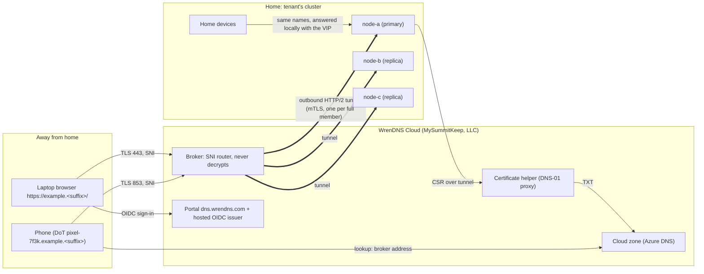

# WrenDNS Cloud (M36) — design

Status: design only (T36.1, fork #41, with #40 and #28). ADR-1047 to ADR-1052, all Proposed. M32's research and tasks are merged into M36. No code is written by T36.1. "WrenDNS Cloud" is a working name.

WrenDNS Cloud is a hosted service run by MySummitKeep, LLC. It lets a household or small business reach its own WrenDNS nodes from anywhere, gives each tenant a public name and a roaming resolver, and makes one device setting work at home and away. The node stays the product: every answer, every policy decision, every secret and the authoritative audit trail stay on the tenant's own hardware.

## Goals and non-goals

### Goals

1. **Configure once, works anywhere.** A device is set up once with one name. At home that name reaches the local node directly. Away it reaches the same node through the cloud. The UI bookmark, the DoH URL and Android's Private DNS hostname are the same in both places.
2. **The remote UI.** A tenant signs in once and opens any of their nodes' own UI from anywhere, with no port forwarding, no inbound firewall rule and no VPN.
3. **RBAC with create, update and remove per object kind,** enforced by the node on every request, with every change audited on the node under the hosted user's identity.
4. **A roaming resolver per tenant.** DoH and DoT at the tenant's name, with the tenant's own policy, device identity and privacy level, closed to everyone who does not hold a device key.
5. **Location-scoped names, managed names, dynamic DNS and DNS-provider integrations** (#40), split between the open-source node and the paid service.
6. **The cloud is never trusted with more than the signed-in user's role** (#41). A full compromise of the cloud must not give an attacker admin on any node, the node's secrets or the stored query log.
7. **Cheap to run at launch.** Tens of dollars a month for the first tenants, and a cost per tenant that stays well under the price of the cheapest paid tier at 10,000 tenants.

### Non-goals

- **DNS never depends on the cloud** (AGENTS rule 5, CLU-004). Nothing on the answer path reads cloud state. A device at home never touches the cloud.
- **The cloud is not a cluster member,** not even an ephemeral one (ADR-1048). A cluster member can vouch for any user's role on a forwarded write (ADR-054), so a cloud member could forge admin writes for every tenant.
- **No second UI.** The cloud does not re-implement the node's pages. It has a small portal for tenant-level objects and links out to each node's own UI (the "UI for every feature" rule and spec/13's "no separate business logic").
- **No support access by default.** MySummitKeep staff cannot sign in to a tenant's node. A node admin can grant time-boxed access, audited on the node (phase 3).
- **No UDP 53 in the cloud.** The roaming resolver speaks only DoH and DoT (and DoQ later), so it cannot be used for reflection.
- **No LDAP** (owner priority). **No WireGuard overlay in the product** (ADR-1047). Bring-your-own Tailscale or Cloudflare Tunnel stays documented as the free self-hosted alternative.
- **Not a public authoritative DNS service** for tenant domains. That is M34 (#30). The cloud serves only its own zone.

## User stories

1. **The owner's configure-once story.** The owner runs a three-node Raspberry Pi cluster at home behind the VIP `dns.home.example.net`. They link the cluster to WrenDNS Cloud once and pick the vanity slug `example`. On their phone they set Android Private DNS to `pixel-7f3k.example.<suffix>` (the device's DoT name) and bookmark `https://example.<suffix>/`. At home, the phone's lookups of those names are answered by the cluster with the VIP, so DNS and the UI go straight to the Pis. On mobile data, public DNS answers the broker's address, and the broker passes the same TLS connection through the tunnel to the same cluster. The phone gets the same policy, the same group and the same entry in the query log in both places. They never touch the setting again.
2. **Keep my own name.** The owner prefers `dns.home.example.net`. They add it as a custom name in the portal, publish a CNAME from `dns.home.example.net` to `example.<suffix>` at their DNS host (or let WrenDNS do it through the Azure DNS integration, #40), and prove ownership with a TXT record. The broker then routes that SNI too, with the node's existing Let's Encrypt wildcard (phase 2).
3. **Fix a block from a café.** A parent at a café sees that a homework site is blocked on the child's tablet. They open the bookmark, sign in with the hosted account (single sign-on), and add an allow rule from the device's panel. The rule is written on the primary, audited as `oidc:https://id.<portal>/` with the real client address and the relay's correlation ID.
4. **A family member who can only pause.** The owner invites a partner as a tenant member. On the node, the owner maps that hosted user to a custom role that may update schedules and pause filtering, but not create or remove lists, records or clients.
5. **A small office with two sites.** An office links two clusters (Office and Warehouse) to one tenant. Each device is named `<device>.<location>.<domain>`. Staff laptops use the tenant's DoH URL; at either site they reach the local cluster, and away they reach the cluster the device belongs to.
6. **Dynamic DNS (premium).** A tenant wants `vpn.home.example.<suffix>` to follow the home WAN address for a WireGuard endpoint. The node reports its WAN address over the tunnel and the cloud updates the record.
7. **An agent from anywhere.** The owner's agent manages the cluster through `/mcp` over the relay, with a node-issued agent token, its scopes and the kill switch, after an admin has turned remote MCP on (off by default).
8. **Unlink.** The owner clicks Disconnect on the node. The tunnel closes, the cloud key is deleted, and the portal shows the cluster as unlinked. DNS at home does not notice.

## Architecture

The cloud has four parts. None of them sees a node's plaintext traffic, holds a node's secret, or can command a node.

- **The portal** (`dns.wrendns.com`): tenants, members, slugs, enrolled clusters and nodes (online state, role, version and last heartbeat from tunnel metadata), enrolment codes, device keys (names and IDs only), custom names, billing and the abuse contact. It is also the **hosted OIDC issuer**. It never renders node data.
- **The broker** (`tunnel.<suffix>` for nodes, `*.<suffix>` for browsers and devices): terminates each node's outbound tunnel, and routes each public TCP connection by its TLS SNI into the right tunnel without decrypting it.
- **The certificate helper:** completes ACME DNS-01 challenges in the cloud's own zone for CSRs that nodes send over the tunnel, limited to that tenant's names.
- **The cloud zone** (Azure DNS): public records for `<slug>.<suffix>` and its children, pointing at the broker; `_acme-challenge` TXT records; dynamic DNS records (premium).

**Trust boundaries.** The browser and device TLS sessions end on the node, so the broker sees encrypted bytes, the SNI, timing and volume. The tunnel's own TLS ends at the broker; inside it, each stream is the raw bytes of one public connection, preceded by a PROXY v2 header the broker writes (ADR-039's rules). The portal holds identities and tenant objects. The node holds everything else.

**Why not proxy HTTP.** A cloud that terminates TLS and proxies HTTP sees session cookies, CSRF tokens, query-log pages and every secret typed into a form, and could replay sessions. The UI also assumes it owns its host: base path `/` (`ui/vite.config.ts`), absolute `/api/v1` calls (`ui/src/lib/api.ts`), a CSP with `connect-src 'self'` and `frame-ancestors 'none'` (`crates/wrendns-api/src/ui.rs`), per-node sessions and a per-node `public_url` (ADR-045). With SNI passthrough nothing in the UI or in sign-in changes. A path-prefix proxy (`dns.wrendns.com/t/<slug>/`) would break the UI, and an iframe portal is blocked by the CSP.

## Node enrolment and the outbound tunnel

### The tunnel (ADR-1047)

- **Transport:** HTTP/2 over TLS to `tunnel.<suffix>:443`. TCP 443 outbound passes nearly everywhere, and `h2`, `hyper` and `rustls` are already linked, so the tunnel adds no runtime crate (AGENTS rule 8, the 25 MiB gate of ADR-916). QUIC (`quinn` is linked for DoQ and DoH3) is added later as the preferred transport with HTTP/2 as the fallback, the way Cloudflare Tunnel does, because UDP is often blocked.
- **Who dials:** every full member of a linked cluster opens one tunnel. Resolver pods and witnesses never do (they hold no secrets and serve no UI, ADR-1027 and the ADR-054 amendment).
- **Framing:** each public connection the broker accepts becomes one HTTP/2 stream. The stream starts with a PROXY v2 header carrying the caller's address and port and the SNI, then carries raw bytes in both directions. Control messages (hello, heartbeat, certificate requests, dynamic DNS updates) use the 4-byte length-prefixed prost frames of the cluster channel (ADR-044) on a control stream.
- **Heartbeats:** every 20 s, below the 4-minute idle timeout of Azure's and most middleboxes' defaults. Each carries `{node_id, cluster_id, role, epoch, ready, version, maintenance}`.
- **Reconnect:** full-jitter backoff from 1 s to a 5-minute cap, longer than ADR-044's 30 s, so a broker restart does not cause a thundering herd.
- **Caps on the node:** 32 concurrent streams, HTTP/2 windows of 64 to 256 KiB per stream, a 1 MiB frame limit as in ADR-044. Targets: at most 2 MiB more RSS idle and 8 MiB with every stream open, measured against the 32 and 128 MiB gates (ADR-1031).
- **Isolation from DNS:** the tunnel runs as its own task, with bounded queues and no lock shared with the pipeline (spec/02 §3 and §8). Its CPU use during a UI burst must not show in DNS p99 (bench-smoke covers it; Pi 4 lacks the ARMv8 crypto extensions, so ChaCha20-Poly1305 is preferred there and both suites are benchmarked).
- **"The tunnel is a socket, not an API."** Down the tunnel the cloud may only open a relayed byte stream into the node's own TLS listeners, return certificate chains the node asked for, and acknowledge updates. Up the tunnel the node sends health and its own requests. There is no RPC through which the cloud can change a node's configuration.

### How the node treats a relayed stream

- The node trusts the PROXY v2 header **only** on an authenticated tunnel stream, never on a LAN socket.
- A relayed stream is always remote: never loopback, never inside `allowed_admin_networks`, never break-glass (ADR-944), whatever its socket address.
- Lockout, rate limits, the audit log and `allowed_networks` see the real caller's address, so one person's failed sign-ins do not lock out everyone behind the broker.
- The audit entry records the relay's correlation ID, so the cloud's log and the node's log can be joined without either holding the other's data.
- **Refused over the relay unless the node opts in:** local password sign-in, HTTP Basic, the setup token, secret writes (`PUT`/`DELETE /api/v1/secrets`), guarded settings, backups, user and token management, and the `[cloud]` settings themselves. Over the relay, sign-in is OIDC through the hosted issuer (below). Each opt-in is a guarded, admin-only setting.

### Enrolment (ADR-1048)

1. An admin on the primary opens **Settings → WrenDNS Cloud** and clicks **Link this cluster**, or runs `wrendns cloud link`.
2. The node calls the portal (outbound) and gets a short user code such as `WREN-7K3Q` and the URL `dns.wrendns.com/link` (RFC 8628 device authorization grant). The code lives 10 minutes, is single use and is rate limited.
3. A tenant admin signs in to the portal, enters the code, picks the tenant and confirms the slug.
4. The node, polling, receives the tenant binding: the tenant ID, the slug, the hosted issuer's URL and the broker's SPKI pin.
5. For headless and Kubernetes installs, the portal issues an enrolment token (`wren_enrol_...`, single tenant, expiring, only its hash stored) that is set through a secret file, like the existing join token.

**Keys.** Each full member generates its own cloud key (Ed25519) in `<data_dir>/cloud/`, mode 0600, node-local and never replicated, like `node.key` (ADR-903's node-identity row). The cloud CA issues it a client certificate of about 30 days, carrying tenant, cluster and node IDs, renewed over the tunnel at two thirds of its life (as ADR-057 does for the cluster). The primary countersigns each member's first request over the cluster channel, so joining the cluster is enough to bring a member online.

**Why not the cluster certificate.** Reusing the node's cluster certificate with a pinned cluster CA needs no new key, but a cluster CA compromise would also be a cloud compromise, the cloud could not revoke one node without the others, and resolver pods hold cluster certificates too.

**Revocation:** Remove node in the portal closes the tunnel and denies the certificate serial at once. Disconnect on the node deletes the cloud key and tells the cloud. A member removed from the cluster registry (ADR-143) loses its countersignature at the next renewal. Every enrol, renew, revoke and slug change is audited on both sides.

**Mutual authentication.** The node checks the broker's certificate against WebPKI and the SPKI pin from enrolment. The broker checks the node's client certificate.

### Cluster-aware routing

- `<slug>.<suffix>` routes **primary first and sticky**: the connected member claiming primary with the highest epoch (spec/12 §5's fencing rule), else a ready replica in a stable order (lowest node ID). Reads work on any member (ADR-053), and writes on a replica are forwarded (ADR-054); with no primary, writes get the existing 503 and read-only banner. The broker re-routes only when the target disconnects, turns unready, enters maintenance (ADR-118) or a promotion is seen.
- `<node>.<slug>.<suffix>` always reaches that node (node comparison, drills, support).
- Each node's `auth.oidc.public_url` is set at enrolment to its own name. It is node-local already (ADR-045), so each node registers its own redirect URI. When the routed node changes, single sign-on is a silent redirect; password sessions are not used over the relay. Cluster-signed sessions (ADR-045's named follow-up) are a later improvement, not needed for v1.

### The `[cloud]` section

Node-local and admin-only, with a UI panel (Settings → WrenDNS Cloud), a help topic and Playwright tests, per the "UI for every feature" rule. It holds: linked or not, tenant and slug (read-only), remote UI on or off, remote MCP on or off (off by default), the hosted-provider role cap, the opt-ins listed above, the roaming listeners on or off, and the CT watch. MCP gets a read tool `cloud_status`; linking and unlinking are never for agents (they join spec/13 §3.2's list), because linking changes who can reach the node.

## The remote UI

- **The portal** at `dns.wrendns.com` lists the tenant's clusters and nodes and links out to `https://<slug>.<suffix>/` (the cluster, primary first) and `https://<node>.<slug>.<suffix>/` (one node). It shows only what the tunnel metadata tells it: online, role, version, last heartbeat, certificate expiry, and the reason a node is unreachable.
- **The node's own UI** does everything else, unchanged: the same pages, the same streaming Queries, Map and Wall pages, the same CSP and cookies. A node shows a small "Reached through WrenDNS Cloud" note in the header when the request came over the relay, so the user knows which path they are on.
- **Bandwidth:** the UI is about 390 KB gzipped on first load and cached afterwards; dashboards are small JSON; the live tail and the map streams are bounded by their existing page limits. The broker caps each node at a configurable rate (2 to 5 Mbit/s) to protect home uplinks and the broker.
- **Latency:** each UI request adds the cloud-to-home round trip (about 20 to 80 ms in-region). HTTP/2 multiplexing avoids per-request handshakes.
- **A fleet view across clusters** (story 5) is deferred. If it comes, it is an opt-in mode in which the portal reads summaries the nodes push, never node pages.

## Identity, tenancy and RBAC (ADR-1049)

### Tenancy

- A **tenant** is an account: a household or a business. It has **members** (hosted users), one or more **slugs**, linked **clusters**, **device keys**, **custom names** and a billing state.
- Portal roles govern portal objects only: **owner** (billing, delete the tenant, transfer), **admin** (members, slugs, enrolment, device keys, custom names), **member** (sees the tenant's clusters and links). Each portal object kind has create, update and remove permissions held by these roles, and every portal change is in the cloud's append-only tenant log.
- The cloud's checks decide only who may reach which tenant's relay. They are a convenience gate, never the security boundary for node data.

### Sign-in on the node

- The portal is an OIDC issuer. Linking adds it to each node as a node-managed `[[auth.oidc.provider]]` (ADR-968), with PKCE, `aud` and `azp` checks and JWKS rotation already built (ADR-951).
- The hosted token asserts identity only: `sub`, email and the tenant ID. **For this provider the node ignores group claims.** The role comes from a node-local table that maps hosted subjects to node roles, set by a node admin, or approved by one on a user's first sign-in (until then the user gets `viewer`, or nothing if the admin chose so).
- **Role cap:** a node setting `max_role` for the hosted provider, default `operator`. Admin work through the hosted provider needs the cap raised and a **step-up factor the cloud never holds**: TOTP enrolled on the node (built), WebAuthn later.
- A compromised hosted issuer can therefore impersonate an already-mapped user up to `max_role`, but cannot create a mapping, cannot escalate, and cannot do admin or guarded work.
- **Agents** through the relay use node-issued tokens (AGT-004) with their scopes, rate limit and kill switch. The hosted issuer may later act as the OAuth authorization server for MCP (AGT-008), but the node always issues and scopes the token.

### Create, update and remove per object kind

- A **custom role** is a set of `(kind, verb)` permissions: kinds are the node's object kinds (clients, groups, lists, quick rules, records, forwards, upstreams, schedules, CMDB items, locations and the rest of the managed kinds), verbs are `create`, `update`, `remove` and `read`.
- `viewer`, `operator` and `admin` become built-in presets of the same table. Existing roles behave exactly as today.
- The verbs map onto routes in the deny-by-default table agent tokens already use (`required(method, path)` in `crates/wrendns-api/src/auth/agent.rs`). A token's effective permissions stay the intersection of its scopes and its owner's role (ADR-064).
- **Create versus update.** The API's `PUT` is an upsert, so the primary decides which verb applies by checking whether the object exists under the `If-Match` version, inside the same write. A forwarded write carries the user's role name; the primary resolves the role to its permissions (roles replicate like users, ADR-045).
- Guarded routes and the never-for-agents list (spec/13 §3.2) stay admin-only whatever a custom role says.
- Custom roles are useful without the cloud and ship in the AGPL node first (T36.3).

### Audit across both sides

- **The node's hash-chained audit stays authoritative.** Hosted sign-ins are recorded as `oidc:<issuer>/`, with the hosted email, the real client address from the PROXY header, and the relay correlation ID.
- **The cloud keeps its own append-only log** of tenant events: sign-ins, enrolment, slug changes, device-key issue and revoke, custom names, certificate issuance, support grants. It never records node content.

## The roaming resolver (ADR-1050)

### Path: home relay first

In v1 the broker routes DoH (443) and DoT (853) for a tenant's names by SNI into the tunnel, and the **home node answers**. Policy, device identity and the query log are exactly the home ones, and the cloud runs no resolver per tenant.

- Cost: one cloud-to-home round trip per query. DoH and DoT keep their connections open, so this is one round trip per query, not per handshake. Volume per device is small (about 2,000 to 5,000 queries a day at 200 to 300 bytes each way, 1 to 3 MB a day).
- Weakness: roaming DNS stops when the home uplink or the tunnel is down. Devices with a strict Private DNS setting then fail closed until they reach a network that works.
- **Later (a paid tier):** the broker falls back to a **cloud resolver** when a tenant's tunnel is down. It runs the tenant's policy from signed snapshots the primary pushes over the tunnel (spec/02 §5's manifest signature and content-addressed blobs), which the cloud verifies but cannot forge. It is multi-tenant (one process per tenant does not fit at scale under the 32/128 MiB gates of ADR-1031), never a cluster member, shares a cache only for unmodified public answers, keeps per-tenant partitions for any answer policy changed, and never serves a tenant's local records. Its design is its own task (T36.12), and it absorbs M32's stateless cloud profile and Azure templates.

### Device keys and the open-resolver gate

- Every roaming query must carry a known **device key**. A key is at least 128 random bits, encoded as 26 base32 characters so it fits one DNS label.
- **DoH:** `https://<slug>.<suffix>/dns-query/<device-key>`. The key travels inside TLS.
- **DoT (Android Private DNS):** the hostname `<device-id>.<slug>.<suffix>`, covered by the node's `*.<slug>.<suffix>` wildcard. The SNI and the bootstrap lookup are cleartext, so the DoT label is an **identifier, not a secret**: it is random, revocable and rate limited, and the device is still matched by the node's client ID rules (ADR-039, ADR-976).
- The node enforces this with T32.1's known-ID gate (`require_client_id`, now T36.2) on its relayed listeners. Unknown keys are refused (REFUSED with an extended error) without saying whether the key exists, and rate limited per address and per key.
- The broker also refuses connections for slugs that do not exist or tenants that are suspended, before any byte reaches a node.
- Device keys are created on the node (the device's panel: Add a device away from home), so the node's CMDB device identity is the anchor (#41). The node tells the cloud the key's ID and its DoT label, never the DoH key itself; the cloud needs only the labels it routes.

### Client setup per OS

| Platform | Native support | Setup WrenDNS generates | Configure once? |
|---|---|---|---|
| Android 9 and later | Private DNS is DoT only, by hostname | the hostname `<device-id>.<slug>.<suffix>`, shown with a QR code | **Yes.** The hostname is resolved through the current network's DNS: the node at home, public DNS away. Android 11+ upgrades only well-known resolvers to DoH3. |
| iOS and iPadOS 14+, macOS 11+ | DoH and DoT through a DNS Settings profile | a `.mobileconfig` with the DoH `ServerURL` carrying the device key, OnDemand rules, and the declarative `com.apple.configuration.network.dns-settings` for OS 27 | **Yes.** The ServerURL host is resolved through the current network. |
| Windows 11 | DoH, but only for a server **IP address** paired with a template; Windows will not resolve a DoH server from its name | a PowerShell script (`Add-DnsClientDohServerAddress` with the broker's IP and the template, and the adapter's DNS set to it); Group Policy and Intune notes | **Partly.** The IP is the broker's, so at home queries also go through the cloud and back. Two ways round it, to be tested in T36.8: keep the home DHCP DNS at home and rely on DDR (ADR-904) to upgrade it, or accept the hairpin. |
| Windows 10 | No native DoH | a dnscrypt-proxy (ISC) configuration | Yes, through the client. |
| Chrome and Edge on any OS | Secure DNS with a custom template | the DoH URL | Yes. |

**The "Add a device away from home" page** on the node creates the key, shows the per-OS setup, a QR code and a single-use setup link that expires, and works through the API and MCP (plan-only for agents, AGT-007). This is M32's T32.6, now T36.8. Client apps of our own (M32's T32.7) are an owner decision; the recommendation is to document permissive third-party clients first.

## Configure-once names and certificates (ADR-1050, ADR-1051)

### Names

- **The portal is `dns.wrendns.com`** (the owner's name for the public website). **Tenant names live under a dedicated suffix**, working name `<suffix>`, on a separate registrable domain listed in the private section of the Public Suffix List. Each `<slug>.<suffix>` is then its own registrable domain:
  - browsers treat each tenant as its own site, so one tenant's cookies can never reach another tenant or `wrendns.com`;
  - Let's Encrypt's limit of 50 new certificates per registered domain per 7 days applies per tenant, not to the whole service;
  - Safe Browsing reputation of one tenant does not touch the brand domain.
  Nabu Casa (`ui.nabu.casa`), DuckDNS, ngrok and trycloudflare all do this. A PSL entry is slow to add and hard to remove, the domain must have at least two years left on its registration, and the PSL asks submitters to disclose any third-party limits the request works around: the request must lead with cookie isolation. So the domain is the first decision.
- **The names a tenant gets:**
  - `<slug>.<suffix>`: the cluster (UI, API, MCP, DoH);
  - `<node>.<slug>.<suffix>`: one node;
  - `<device-id>.<slug>.<suffix>`: a device's DoT name;
  - `<location>.<slug>.<suffix>` and `*.<location>.<slug>.<suffix>`: location-scoped names (below).
- **Split horizon, created automatically.** Linking creates node-managed local records (ADR-968) that answer those names at home with the cluster's VIP or the node's own LAN address (the owner's words: "the local DNS record to be created that would resolve to the local node"). The cloud zone answers them publicly with the broker's address. A node keeps answering its local copies when the cloud is down.
- **Slug rules:** lowercase `a-z`, `0-9` and hyphen, 6 to 32 characters, no `xn--`; a reserved list (wrendns, admin, www, api, mail, tunnel, brands, the most visited sites) and a confusable check. **Opaque by default** (a random slug), vanity opt-in, because the slug is public in CT logs. **Never recycled**: a released slug is quarantined for good, so old devices' DNS can never go to a new owner (and their device keys would be refused anyway).
- **Custom names** (story 2, phase 2): a tenant CNAMEs its own name to `<slug>.<suffix>` and proves ownership with a TXT record; the broker routes that SNI too, and the node presents its own certificate for it.

### Certificates (ADR-1051)

- Each node needs a certificate for `<slug>.<suffix>` and `*.<slug>.<suffix>` (one wildcard level covers node names and DoT device names). Location names add `*.<location>.<slug>.<suffix>`.
- **The node makes its own key and CSR** (with `rcgen`, already linked). The CSR goes over the tunnel to the certificate helper, which checks that every name belongs to that tenant, completes the DNS-01 challenge in the cloud zone and returns the chain. The private key never leaves the node, no DNS credential sits on customer hardware (#40), and the node needs no ACME client.
- **Each node of a cluster gets its own certificate** for the same names. Let's Encrypt's limit of 5 certificates per exact set of names per 7 days covers a three-node cluster, and renewals through ARI are exempt from the limits.
- **Lifetimes are shrinking.** Let's Encrypt's opt-in `tlsserver` profile issues 45-day certificates from 2026-05-13; the default becomes 64 days on 2027-02-10 and 45 days on 2028-02-16, with a 7-hour authorization reuse period. Renewal is timed by ARI, not a fixed 60 days. DNS-PERSIST-01, when Let's Encrypt offers it, would let the cloud publish one standing record per tenant instead of a TXT write per renewal; track it.
- **CAA** on the suffix: RFC 8657 `accounturi` for the service's ACME accounts and `validationmethods=dns-01`, so no other account and no HTTP-01 hijack can issue.
- **CT watch.** The operator controls the zone and the helper, so a compromised cloud could mint a certificate for a tenant name and run a man-in-the-middle on the relay. Each node watches CT logs for certificates covering its names whose key is not its own and raises a health alert and an event marker. That makes a cloud MITM detectable, not silent. The design says so plainly in the docs, as Nabu Casa does.
- Existing hot reload of certificate files applies; the node writes the new chain atomically next to its key.

## Location-scoped names, dynamic DNS and DNS-provider integrations (#40)

### Locations (AGPL node)

- A **location** (Home, Work, Site1) is a first-class object: a label, the networks or VLANs that belong to it (CMDB network CIs and router reads), the nodes that serve it, and an optional parent domain.
- Device names become `<device>.<location>.<domain>`. A device's location follows its network; a device that moves keeps one CMDB identity and its name follows it. Each location answers its own names and may see the others' (a shared or private setting, split horizon by location).
- With the cloud, `<domain>` can be `<slug>.<suffix>` (managed names). Without it, the tenant's own domain.
- UI: a Locations page; the map, the inventory and the CMDB group by location; a help topic; Playwright.
- Locations do not change how a query is answered beyond the records they create; they are names, not policy.

### DNS-provider integrations (AGPL node)

- A `[[dns_provider]]` table, with a UI under Settings → DNS providers, through which a node writes records at the operator's own DNS host: Azure DNS, Cloudflare, Route 53, GoDaddy and others. The provider list is a plug-in table.
- Uses: ACME DNS-01 for the node's own certificates (M32's T32.5 for self-hosters, replacing the owner's hand-run lego), dynamic DNS for the tenant's own domain, and optionally publishing chosen local names publicly.
- Each credential is a stored secret (ADR-903, ADR-917), scoped as narrowly as the provider allows: Azure RBAC on one record set (the owner's service principal limited to `_acme-challenge.home` is the model), a Cloudflare token for one zone, a Route 53 policy on one record name. When a provider cannot scope a token, the docs recommend a CNAME delegation of `_acme-challenge` to a narrowly scoped zone.
- Provider notes to verify in T36.10: GoDaddy restricted its DNS API in 2024 to large accounts and has since loosened the rule (sources disagree on today's terms); Network Solutions has no documented public DNS API that this research found, so it is supported through CNAME delegation only.
- Every write is audited. Provider writes are never for agents (they join spec/13 §3.2's list), because a provider credential can change public DNS.
- An on-node ACME client needs a crate (for example `instant-acme`, permissive) after `cargo-deny` and with its image delta reported. The hosted path needs none.

### Managed names and dynamic DNS (paid)

- **Managed names:** `<device>.<location>.<slug>.<suffix>`, served at home by the node and publicly (when the tenant chooses) by the cloud zone, with certificates through the helper. No public DNS zone or credential on the tenant's side.
- **Dynamic DNS:** a public A/AAAA record such as `vpn.<location>.<slug>.<suffix>` that follows a location's WAN address. The node learns its WAN address from the tunnel's source address as the broker sees it (no third-party "what is my IP" call), and asks the cloud over the tunnel to update; the cloud rate limits updates (one a minute, TTL 60 s) and refuses addresses in private or reserved ranges.
- For a tenant's own domain, dynamic DNS goes through the DNS-provider integration instead, with no cloud involved (free, AGPL).

## The threat model

Assets: node secrets and stored query logs; home policy; sign-in sessions; device keys; tenant identities and billing data; the brand domain's reputation.

| Component | Threat | Mitigation |
|---|---|---|
| Portal and issuer | Account takeover of a tenant admin | WebAuthn or TOTP required for portal owners and admins; the node maps subjects to roles itself, caps them at `max_role`, and asks for its own step-up factor for admin work |
| Portal | Forged enrolment or slug transfer | Enrolment needs a code shown on the node; a slug change must be confirmed on the node |
| Portal | Disclosure of the tenant list, emails, billing | Minimal data, encrypted at rest; Stripe holds card data |
| Tunnel | A stolen cloud key lets an attacker pose as the node and receive relayed streams | The streams are TLS to the node's own certificate, so an attacker without the node's TLS key gets ciphertext only; cloud certificates are short-lived and revocable from both sides |
| Tunnel | The cloud commands the node | No command channel exists; the cloud can open byte streams and return certificates the node asked for |
| Broker | Cross-tenant routing | Routing by SNI only, to the tunnel whose client certificate holds that slug; never by a header |
| Broker | Reconnect storms, floods | Full-jitter backoff, per-tenant caps on streams, bandwidth and connections; Azure's always-on infrastructure DDoS protection |
| Certificate helper | Issuing for another tenant's names | The helper checks every CSR name against the tenant; CAA `accounturi`; every issuance logged; CT watch on the node |
| Certificate helper | Operator MITM (a cert minted by the cloud) | Detected by the node's CT watch and documented honestly; custom names with the tenant's own certificate avoid it entirely |
| Roaming resolver | Open-resolver abuse | No UDP 53; DoH and DoT only; a known device key on every query; refused without saying whether a key exists; per-key and per-tenant rate limits |
| Roaming resolver | A guessed or leaked device key | 128 random bits, revocable from the device's panel; DoT labels treated as identifiers |
| Roaming resolver (cloud fallback, later) | Forged policy; cache snooping across tenants | Signed snapshots the cloud cannot forge; per-tenant partitions for policy-changed answers |
| Names | Slug squatting, impersonation, phishing pages under the suffix | Reserved and confusable lists; verified or paid tenants only for public routing; abuse contact; Safe Browsing monitoring; kill-switch revocation; the PSL keeps abuse off `wrendns.com` |
| Names | A dangling slug after deletion | Never recycled |
| Node | The internet-facing sign-in page | Only OIDC through the hosted issuer over the relay; passwords, Basic, setup token and break-glass refused there; lockout per real client address |

**Blast radius of a full cloud compromise.** An attacker can deny service, see metadata, serve wrong roaming answers from a cloud fallback resolver until devices return home, impersonate already-mapped hosted users up to `max_role` without the step-up factor, and mint certificates for tenant names to run a man-in-the-middle that the CT watch reports. They cannot read node secrets or stored query logs, change home policy beyond a mapped user's permissions, do admin or guarded work, forge cluster writes, or reach a node that has unlinked. With an HTTP proxy design, or with the cloud as a cluster member, the same attacker would be admin on every node: that is why neither is chosen.

**Still open:** an issuer compromise still allows operator-level writes unless the node also asks for step-up at operator level (an owner decision on the default); users may read "the cloud can't see my data" too broadly, so the docs say that roaming queries pass through MySummitKeep's broker in memory, encrypted, and that a cloud fallback resolver would see them in clear.

## Privacy and data residency

- **Roles.** For relayed UI traffic and roaming queries, the tenant is the controller of their household's or business's data and MySummitKeep, LLC is a processor. That needs terms of service with a data processing agreement (GDPR Art. 28), a subprocessor list (Microsoft Azure, Stripe, the email provider), and breach notification.
- **No query log at rest in the cloud.** In home-relay mode the cloud never sees a query in clear. A later cloud fallback resolver streams its query events home over the tunnel (the `ship` telemetry mode, CLU-007) through a small bounded memory buffer that is dropped if the node stays offline, after applying the tenant's privacy level (ADR-102). The cloud keeps counters per tenant and device key only.
- **What the cloud stores:** tenant and member identities (email, OIDC subject), slugs, cluster and node IDs, device key IDs and DoT labels (never DoH keys), custom names, certificate issuance records, tunnel metadata, billing state through Stripe, and its own tenant event log. Retention: the event log 1 year, tunnel metadata 30 days, deleted tenants purged within 30 days except what tax law requires.
- **Residency at launch:** one US region, disclosed in the terms and the privacy policy. EU tenants mean a transfer to the US under Standard Contractual Clauses. The EU-US Data Privacy Framework survived the General Court in Latombe (3 September 2025) but the appeal (C-703/25 P) is pending, so SCCs are the steadier basis. An EU region with tenant pinning comes when demand justifies it.
- **CCPA:** MySummitKeep is likely under the thresholds at launch; the privacy policy already grants state-law rights to every US user. Revisit at tens of thousands of tenants.
- **Children.** A family's devices produce children's queries. `docs/legal/privacy.md` §2.4 says the site is not for minors, but the hosted service processes minors' data on a parent's behalf. Counsel looks at COPPA and GDPR Art. 8; the design keeps no profiles and no query log at rest.
- **Policy edits before launch:** `docs/legal/privacy.md` §3 says none of the software's data is sent to MySummitKeep LLC. That stays true for the self-hosted node and becomes false for a linked one, so a hosted-service section is added (what is collected, residency, retention, the processor role) and the terms gain the DPA (T36.13).
- **CT logs** show the slug (and location labels, if used), never device or node names, because certificates are wildcards.

## Failure modes (DNS never depends on the cloud)

| What fails | DNS at home | Local UI and cluster | Remote UI and MCP | Roaming DNS | Certificates | Shown as |
|---|---|---|---|---|---|---|
| Broker or whole cloud down | unaffected | unaffected | unavailable | unavailable in home-relay mode; served by the cloud fallback resolver where a tenant has one | renewal paused; at 45 to 64 days a renewal at two thirds of life leaves about 15 to 20 days; a warning at 14 days left | `cloud_unreachable` (degraded, never severe, after 60 s), an event marker |
| Home uplink down | unaffected | unaffected | unavailable | unavailable (fallback resolver where present) | renewal paused | the portal shows the cluster offline |
| Primary down, replicas up | unaffected | as today (read-only banner) | routed to a ready replica; writes get 503 | answered by the replica | each node renews its own | as today |
| Tunnel flaps | unaffected | unaffected | reconnect with backoff | reconnect | unaffected | `wrendns_cloud_tunnel_up`, `_reconnects_total`, `_streams` |
| Certificate expired | unaffected on plain DNS; the local DoT/DoH names fail TLS | the UI on its other names works | browsers warn | devices fail TLS (strict mode fails closed) | escape hatch: a DNS-provider integration on the tenant's own domain | severe health on certificate expiry, as today |
| Portal down, broker up | unaffected | unaffected | existing sessions work; new hosted sign-ins fail | unaffected | unaffected | portal status page |
| Slug suspended (billing or abuse) | unaffected | unaffected | refused at the broker | refused at the broker | not renewed | portal and node health note |

Local names keep resolving at home in every case, because the node holds its own copies of the split-horizon records. Nothing on the DNS path waits on the tunnel, the issuer or the helper.

## The platform and the cost model

### Platform at launch

- **Portal and issuer:** Azure Container Apps, Consumption plan, HTTP ingress with a managed certificate. It can scale to zero between sign-ins.
- **Broker:** two small Azure VMs (one active, one warm standby) with static public IPs, because SNI passthrough and DoT on 853 need raw TCP ingress. Container Apps' HTTP ingress terminates TLS, and its TCP ingress needs a VNet environment and cannot expose 80 or 443. Long-lived tunnels mean the broker cannot scale to zero. Nodes find the active broker through the `tunnel.` name (DNS failover, TTL 60 s) and reconnect to whichever answers.
- **Database:** Azure Database for PostgreSQL Flexible Server, Burstable B1ms, for tenants, members, slugs and the event log.
- **Zone:** Azure DNS for `<suffix>`.
- **Later:** more broker VMs behind a tenant-to-broker routing table, or AKS; QUIC ingress; an EU region.

### Prices (Azure retail prices API, East US, pay as you go, checked 2026-11-19)

| Item | Price |
|---|---|
| VM B2pts v2 (Arm, 2 vCPU, 1 GiB), Linux | $0.0084 an hour, about $6.13 a month |
| VM B2als v2 (2 vCPU, 4 GiB), Linux | $0.0376 an hour, about $27.45 a month |
| Standard static public IPv4 | $0.005 an hour, about $3.65 a month |
| PostgreSQL Flexible B1ms | $0.017 an hour, about $12.41 a month, plus storage |
| Azure DNS public zone | $0.50 a month for each of the first 25 zones, $0.10 after |
| Azure DNS queries | $0.40 a million for the first billion, $0.20 after |
| Data out to the internet | first 100 GB a month free, then $0.087 a GB (Microsoft network routing), falling with volume |
| Container Apps Consumption | $0.40 a million requests and per-second vCPU and memory, above a monthly free grant |
| Let's Encrypt | free |

### Assumptions per tenant

Two to three nodes, five roaming devices at about 2 MB a day each, relayed in and out (the broker's egress counts both the leg to the device and the leg down the tunnel), plus about 50 MB a month of remote UI: about 0.65 GB of egress a tenant a month. Tunnel memory on the broker about 64 KiB per idle tunnel and 1 MiB per busy one. Public lookups of tenant names: a few thousand a month per tenant.

| | Launch (≤ 100 tenants) | 1,000 tenants | 10,000 tenants |
|---|---|---|---|
| Broker VMs | 2 × B2pts v2: $12 | 2 × B2als v2: $55 | 6 × B2als v2 (3 active, 3 standby) or AKS: $165 |
| Public IPs | 2: $7 | 2: $7 | 6: $22 |
| Egress | under 100 GB: $0 | about 650 GB: about $48 | about 6.5 TB: about $520 |
| Portal (Container Apps) | within the free grant: $0 | about $10 | about $40 |
| Database | B1ms: $16 | B1ms: $16 | General Purpose 2 vCore: about $130 |
| Azure DNS zone and queries | about $1 | about $2 | about $10 |
| Monitoring, backups, email | about $5 | about $25 | about $100 |
| **Total a month** | **about $41** | **about $163** | **about $990** |
| **Per tenant a month** | — | **about $0.16** | **about $0.10** |

Stripe's fees (2.9% plus $0.30 per US card charge) are the largest variable cost at a low price point, which favours yearly billing for the cheapest tier. A cloud fallback resolver (T36.12) adds compute that this table does not include; it is priced as its own tier once its design measures it. Prices change; the T36.9 task rechecks them in the calculator before launch.

## Commercial tiers and open core (ADR-1052)

### The boundary

- **The node stays fully AGPL** (ADR-1033) and fully usable without the cloud. Everything that runs on customer hardware is in the open repository: the tunnel client, enrolment, the hosted-provider role mapping, `max_role` and step-up, the relayed-stream restrictions, the CT watch, custom roles, locations, DNS-provider integrations, on-node ACME, device keys and onboarding. The enforcement that protects tenants is therefore auditable even though the service is closed.
- **The broker, portal, issuer, certificate helper and the cloud fallback resolver's multi-tenant shell** are separate programs that speak a documented protocol (`spec/14`, written in T36.4), in a separate repository, under a proprietary licence or FSL. They contain no AGPL code from outside the CLA and no AGPL third-party crates. MySummitKeep, LLC holds the copyright and contributions come in under the CLA (ADR-1033), so it can also run modified WrenDNS code in the cloud resolver; publishing that resolver's source is good practice and costs nothing.
- **Self-hosters** may run their own reverse access with Tailscale or Cloudflare Tunnel (documented). Whether they may run their own broker is an owner decision; the recommendation is to publish the protocol but not the broker at launch.
- Counsel confirms before the first sale (ADR-1033 item 6).

### Tiers (proposal; prices are the owner's)

| Tier | What | Price idea |
|---|---|---|
| **Self-hosted** | Everything on the node, AGPL, free; DNS-provider integrations, locations, on-node ACME, dynamic DNS on your own domain | free |
| **Cloud** | Remote UI, single sign-on, one slug, configure-once names and certificates, roaming DoH and DoT through the home relay, up to 3 nodes and 10 roaming devices, 3 members | about $3 a month or $30 a year |
| **Cloud Plus** | Everything in Cloud, plus dynamic DNS, managed location names, custom names, the cloud fallback resolver, 10 nodes, 50 devices, 10 members, a longer cloud event log | about $8 a month |
| **Business** | Several clusters per tenant, SSO from the business's own IdP federated through the issuer, an EU region, priority support, a DPA signed by both parties | quoted |

There is no free cloud tier for the roaming resolver: every query needs a device key, and a paid account makes abuse expensive. A 30-day trial needs a card or a verified email and phone.

## Phased delivery

**Phase 0 — the node, without the cloud (AGPL, useful on its own).** T36.2 (the known-ID gate on public listeners), T36.3 (custom roles with create, update and remove per kind), T36.10 (locations and DNS-provider integrations with on-node ACME). These help self-hosters now and are prerequisites for the cloud.

**Phase 1 — the MVP: the owner's configure-once story, for the owner's tenant only.** T36.4 (tunnel client and protocol), T36.5 (enrolment and keys), T36.6 (hosted sign-in on the node), T36.7 (names, local records and certificates through the helper, CT watch), T36.8 (roaming DoH and DoT through the home relay, device keys and onboarding), T36.9 (the broker, portal, issuer and helper in their own repository, one region, one broker plus a warm standby). Exit: story 1 works on the owner's three Pis and phone, and every failure mode in the table is shown by a test with a fake broker or a drill.

**Phase 2 — a private beta.** Custom names (story 2), invitations and member roles in the portal, slug rules and abuse handling, the PSL entry, the privacy policy, terms and DPA (T36.13), billing through Stripe, and cost and latency measured with real tenants.

**Phase 3 — paid tiers.** Dynamic DNS and managed location names (T36.11), the cloud fallback resolver (T36.12), QUIC transport, support grants, more broker capacity, and an EU region on demand.

## Open questions for the owner

Asked together at the start of M36, with "accept all recommendations". Ordered by how much they block.

1. **The domain for tenant names.** A dedicated domain on the PSL (recommended; `dns.wrendns.com` stays the portal), or `<slug>.dns.wrendns.com` with `dns.wrendns.com` itself on the PSL (as `ui.nabu.casa` is), or plain subdomains of `wrendns.com` without a PSL entry (capped at about 50 certificates a week for the whole service).
2. **How the hosted site shows a node's UI.** SNI passthrough to the node's own UI with a thin portal (recommended), a cloud HTTP proxy, or a separate hosted app.
3. **Where roles for hosted sign-ins come from, and the cap.** A node-local subject-to-role table, `max_role` operator, node-local TOTP for admin (recommended); or group claims from the issuer.
4. **The roaming path in v1.** Home relay (recommended), a cloud resolver, or both.
5. **Where the broker runs.** VMs for the broker and Container Apps for the portal (recommended), Container Apps on a VNet, or AKS.
6. **The open-core boundary and licence of the service.** Node pieces AGPL, the service proprietary or FSL in a separate repository (recommended); or everything AGPL.
7. **Tiers and prices.** The three tiers above, no free cloud tier for roaming, a card-backed trial (recommended); or a free cloud tier with limits.
8. **Data residency and the query log.** US only, SCCs, no query log at rest in the cloud (recommended); or US and EU at launch; or cloud retention by privacy level.
9. **Slug rules.** Opaque by default, vanity opt-in, never recycled (recommended); or vanity required.
10. **Remote MCP and the relayed-stream restrictions.** Remote MCP off by default with an admin opt-in, and passwords, Basic, setup token and secret writes refused over the relay (recommended); or the same rules as the LAN.

## Sources

- Issues: [#41](https://github.com/nbacheller/wrendns/issues/41), [#40](https://github.com/nbacheller/wrendns/issues/40), [#28](https://github.com/nbacheller/wrendns/issues/28).
- Repository: spec/02 §3, §5, §8; spec/12 §5; spec/13 §3.2; ADR-039, ADR-044, ADR-045, ADR-053, ADR-054, ADR-057, ADR-064, ADR-102, ADR-118, ADR-903, ADR-904, ADR-917, ADR-944, ADR-951, ADR-968, ADR-976, ADR-1026, ADR-1027, ADR-1031, ADR-1033; `crates/wrendns-api/src/ui.rs`, `crates/wrendns-api/src/auth/agent.rs`, `crates/wrendns/src/forward.rs`, `ui/vite.config.ts`, `ui/src/lib/api.ts`, `docs/running.md` (users and sign-in), `docs/legal/privacy.md`, `brand/README.md`.
- Comparable services: [Nabu Casa remote UI](https://nabucasa.com/config/remote) and [SniTun](https://github.com/NabuCasa/snitun/); [Cloudflare Tunnel](https://developers.cloudflare.com/cloudflare-one/networks/connectors/cloudflare-tunnel/) and [its QUIC transport](https://blog.cloudflare.com/getting-cloudflare-tunnels-to-connect-to-the-cloudflare-network-with-quic/); [Tailscale DERP](https://tailscale.com/kb/1232/derp-servers) and [Funnel](https://tailscale.com/blog/introducing-tailscale-funnel/).
- Let's Encrypt: [rate limits](https://letsencrypt.org/docs/rate-limits/), [certificate lifetimes](https://letsencrypt.org/docs/cert-lifetimes/), [from 90 to 45 days](https://letsencrypt.org/2025/12/02/from-90-to-45.html).
- Public Suffix List: [the list](https://publicsuffix.org/list/public_suffix_list.dat), [submission guidelines](https://github.com/publicsuffix/list/wiki/Guidelines).
- Azure: [retail prices API](https://prices.azure.com/api/retail/prices) (queried 2026-11-19 for the prices above), [Container Apps ingress](https://learn.microsoft.com/azure/container-apps/ingress-overview), [premium ingress](https://learn.microsoft.com/azure/container-apps/premium-ingress), [DNS pricing](https://azure.microsoft.com/pricing/details/dns/).
- Clients: [Windows DoH client and `Add-DnsClientDohServerAddress`](https://learn.microsoft.com/en-us/powershell/module/dnsclient/add-dnsclientdohserveraddress), [Windows DoH support](https://learn.microsoft.com/windows-server/networking/dns/doh-client-support), [Android DoH3 for well-known resolvers](https://security.googleblog.com/2022/07/), [Android 9 Private DNS](https://www.internetsociety.org/blog/2018/08/dns-privacy-in-new-android-9/).
- DNS providers: [GoDaddy API access](https://www.godaddy.com/en/help/how-do-i-access-domain-related-apis-42424), [the 2024 restriction](https://domainnamewire.com/2024/06/03/developers-frustrated-by-recent-godaddy-api-restrictions/).
